# Serp4J – Verbindliche Gesamtarchitektur

> **Status:** Zur Abnahme durch Angelo · **Stand:** 2026-10-31 · **Phase:** Architektur (keine produktive Implementierung)
> **Grundlage:** WP1 [Domain-Modell](wp1-domain-model.md) · WP2 [Architektur & Ports](wp2-architecture-ports.md) ·
> WP3 [Browser](wp3-browser.md) · WP4 [Build & Distribution](wp4-build-distribution.md) · WP5 [Migration](wp5-migration.md)
> **Entscheidungen im Detail:** [ADRs](adr/README.md) · **Umsetzung:** [Implementierungsplan](implementation-plan.md)

Dieses Dokument ersetzt die fünf Arbeitspaket-Berichte als **verbindliche** Quelle. Wo ein WP-Bericht hiervon
abweicht, gilt dieses Dokument. Die WP-Berichte bleiben als Begründung und Detailreferenz (Feldzuordnungen,
Recherche, Bestandsaufnahme) gültig.

Alle Java-Signaturen sind **Dokumentation** (Java 8), kein Code zum Übernehmen ohne Freigabe.

---

## 0. Kurzfassung

Serp4J ist eine eigenständige Java-Bibliothek, die Suchergebnisse beschafft und in **einem** Datenmodell liefert.
AskAI ist ein Konsument unter mehreren und keine Abhängigkeit.

1. **Core ohne Abhängigkeiten.** `serp4j-core` enthält nur das Domain-Modell und die Ports, die Adapter
   implementieren. Es ist Java 8 und hat keine Drittabhängigkeit, auch kein JSON und kein HTTP.
2. **Optionalität entsteht nur über Modulgrenzen.** Wer keinen Browser braucht, zieht keinen. Es gibt keine
   Maven-`optional`-Abhängigkeiten und keine Gradle Feature Variants.
3. **Drei Datenbereiche:** `SearchResponse = SearchData (Pflicht) + SearchMetadata (optional) + SearchAnalysis (optional)`.
   Alles, was ein Provider liefert (auch Knowledge Graph und KI-Antworten), ist Data oder Metadata. Analysis
   entsteht nur außerhalb der Provider.
4. **Offene Wertetypen statt Enums** für Provider, Suchmaschine, Vertical, Ergebnistyp und Feature-Typ.
5. **Composite ist kein Provider**, sondern Application-Logik (`SearchOrchestrator` in `serp4j-orchestration`).
6. **Dialogsuche über einen eigenen, optionalen Port** (`ConversationalSearchProvider` → `SearchSession`).
   Normale Provider sehen davon nichts.
7. **Der Browser ist Infrastruktur.** `serp4j-browser-api` ist ein eigenes, abhängigkeitsfreies Modul (nicht im
   Core). Google-Adapter hängen nur davon ab, nie von Playwright.
8. **Playwright-Adapter in Java 8**, der JS-Treiber wird als eigenes Laufzeitmodul gewählt (Node für Java 8,
   `playwright4j` für Java 21).
9. **Konfiguration und Secrets bleiben beim Host.** Serp4J definiert nur `CredentialProvider` und `HttpTransport`
   als Ports.
10. **Migration ohne Funktionsverlust:** erst Charakterisierungstests in AskAI, dann Portierung, dann
    Paritätstest, dann Umschalten über eine einzige Bridge-Klasse in AskAI.

---

## 1. Modulstruktur

```
serp4j/                                       (Root, nicht publiziert)
├── build-logic/                              Convention-Plugins (Included Build, nicht publiziert)
├── gradle/libs.versions.toml                 Version Catalog
├── serp4j-bom                                BOM (java-platform)
│
├── serp4j-core                               Domain-Modell + Such-Ports                Java 8 · 0 Deps
├── serp4j-orchestration                      Use Cases, Registry, Orchestrator, Merger  Java 8 · core
├── serp4j-json                               JSON-Format des Domain-Modells             Java 8 · core, gson
│
├── serp4j-http-api                           HTTP-Transport-Port + Auth-Strategien      Java 8 · 0 Deps
├── serp4j-http-ahc                           Adapter async-http-client 2.x              Java 8
├── serp4j-http-jdk          (später)         Adapter HttpURLConnection, ohne Deps       Java 8
│
├── serp4j-provider-brave                     Cloud-Adapter Brave Search API             Java 8
├── serp4j-provider-brightdata                Cloud-Adapter Bright Data SERP API         Java 8
├── serp4j-provider-dataforseo                Cloud-Adapter DataForSEO SERP API          Java 8
│
├── serp4j-browser-api                        Browser-Port (BrowserRuntime/-Session)    Java 8 · 0 Deps
├── serp4j-browser-playwright                 Adapter Playwright-Java-API (ohne Treiber) Java 8
├── serp4j-browser-playwright-driver-node     nur Runtime-Deps: Node-Treiber            Java 8
├── serp4j-browser-playwright-driver-graal    nur Runtime-Deps: playwright4j (GraalJS)  Java 21
├── serp4j-browser-camoufox  (später, E-11)   Camoufox-Backend                          offen (Empf. Java 8)
│
├── serp4j-engine-google                      Google Search + Google AI Mode             Java 8 · core, browser-api
│
├── serp4j-testkit                            Mock-Provider, FakeHttpTransport, Contracts, Fixtures   Java 8
├── serp4j-browser-testkit                    FakeBrowserRuntime, Browser-TCK            Java 8
└── serp4j-examples                           Beispiele, Live-Smoke (nicht publiziert)
```

Abweichungen von den WP-Vorschlägen und ihre Gründe:

| Thema | Entscheidung | Abweichung von |
|---|---|---|
| Browser-Port | eigenes Modul `serp4j-browser-api` | Angelos Skizze (Port unter `serp4j-core`), siehe [ADR-010](adr/ADR-010-browser-api-eigenes-modul.md) |
| Application-Schicht | eigenes Modul `serp4j-orchestration` | WP2 F1 (alles in `serp4j-core`). Grund: Die Regel „Adapter sehen keine Use Cases" wird vom Build erzwungen statt nur per Konvention. |
| Registry-Interface | in `serp4j-orchestration`, nicht im Core | WP4 Frage 3. Grund: Kein Adapter braucht die Registry; der Core enthält nur, was Adapter implementieren oder benutzen. |
| Testkit | zwei Module (`serp4j-testkit`, `serp4j-browser-testkit`) | WP4 (ein Testkit mit `browser-api`). Grund: Cloud-only-Konsumenten sollen auch im Test keine Browser-Typen erhalten. |
| Treibermodule | Namen `-driver-node` / `-driver-graal` (WP4) | WP3 Q2 (`runtime-node`/`runtime-graal`) |
| HTTP-Port | eigenes Modul `serp4j-http-api` (WP4) | WP5 (Port im Core). Grund: Browser-Provider und Testkonsumenten brauchen keinen HTTP-Port. |
| JSON-Modul | `serp4j-json` mit Gson (WP1, WP4) | – |
| Kein `serp4j-all` | nur BOM | – |
| Camoufox | eigenes Modul, aber **nicht** im ersten Implementierungsumfang | WP3/WP4 (Teil von F). Grund: Chromium reicht für die ersten Google-Adapter; Camoufox hängt an offenen Entscheidungen (siehe §13). |

---

## 2. Package-Struktur

Jedes Modul hat eine eigene Paketwurzel, Split Packages sind verboten (Voraussetzung für spätere JPMS-Module).
Jedes JAR trägt `Automatic-Module-Name` = Paketwurzel.

```
com.aresstack.serp4j.core.model                SearchRequest, SearchResponse, SearchLocale, Paging, …
com.aresstack.serp4j.core.model.id             ProviderId, SearchEngineId, SearchVertical, SearchTarget, ElementId, SearchSessionId
com.aresstack.serp4j.core.model.data           SearchData, SearchElement, SearchResultItem, ResultType, SerpPosition, PublishedDate, ResultProvenance, …
com.aresstack.serp4j.core.model.feature        SerpFeature, SerpFeatureType, SerpFeatureVisitor, *Feature, SourceReference
com.aresstack.serp4j.core.model.metadata       SearchMetadata, QueryInfo, PageInfo, ExecutionInfo, ProviderUsage, SearchWarning, ConversationContext
com.aresstack.serp4j.core.model.analysis       SearchAnalysis, AnalysisProvenance, SearchIntent, EntityMention, Topic, SearchMetrics
com.aresstack.serp4j.core.model.ext            Extensions, ExtensionKey, StructuredValue, RawPayload, RawPayloadPolicy
com.aresstack.serp4j.core.port                 ProviderPort, SearchProvider, ProviderDescriptor, SearchContext, CancellationSignal, SearchBudget, ProviderRequestOptions
com.aresstack.serp4j.core.port.capability      SearchCapabilities, SearchFeature, ResponseFeature, ConversationalCapabilities, CapabilityCheck
com.aresstack.serp4j.core.port.conversation    ConversationalSearchProvider, SearchSession, SearchSessionOptions, SearchConversationRequest, ConversationTurn, SearchConversation, SessionState, SessionHandle
com.aresstack.serp4j.core.port.analysis        SearchAnalyzer
com.aresstack.serp4j.core.port.credential      CredentialProvider, SecretValue, CredentialKey
com.aresstack.serp4j.core.port.factory         SearchProviderFactory (ServiceLoader-SPI), ProviderConfiguration, ProviderEnvironment
com.aresstack.serp4j.core.error                SearchProviderException, SearchSessionException, SearchErrorCategory
com.aresstack.serp4j.core.annotation           @Experimental

com.aresstack.serp4j.orchestration             Serp4j (Fassade), SearchUseCase, ConversationalSearchUseCase, SearchOrchestrator, SearchOutcome, ProviderAttempt
com.aresstack.serp4j.orchestration.plan        SearchPlan, SessionPlan, SelectionMode, FailurePolicy, ProviderSelector
com.aresstack.serp4j.orchestration.merge       ResultMerger, UrlDeduplicatingMerger, UrlCanonicalizer
com.aresstack.serp4j.orchestration.registry    SearchProviderRegistry, SearchProviderRegistries, SwappableSearchProviderRegistry

com.aresstack.serp4j.json                      Serp4jJson (Lesen/Schreiben, formatVersion)
com.aresstack.serp4j.http                      HttpTransport, HttpRequest, HttpResponse, RequestAuthentication, HttpTransportException
com.aresstack.serp4j.http.ahc                  AhcHttpTransport, AhcHttpTransportOptions
com.aresstack.serp4j.provider.brave            BraveSearchProvider, BraveSearchOptions, BraveRequestOptions, BraveExtensions, internal.*
com.aresstack.serp4j.provider.brightdata       …
com.aresstack.serp4j.provider.dataforseo       …
com.aresstack.serp4j.browser                   BrowserRuntime, BrowserSession, NetworkObserver, …
com.aresstack.serp4j.browser.playwright        PlaywrightBrowserRuntime, …
com.aresstack.serp4j.engine.google             GoogleSearchProvider, GoogleAiModeProvider, internal.*
com.aresstack.serp4j.testkit                   MockSearchProvider, ScriptedConversationalProvider, FakeHttpTransport, *ContractTest
com.aresstack.serp4j.browser.testkit           FakeBrowserRuntime, BrowserRuntimeContractTest
```

Konventionen (gelten in allen Modulen, [ADR-004](adr/ADR-004-offene-wertetypen.md)):

- Öffentliche Wertklassen sind `public final`, unveränderlich, mit `builder(pflichtfelder…)` und `toBuilder()`.
- Getter im **JavaBean-Stil** (`getQuery()`), weil WP1 und WP2 hier verschieden waren und JavaBean-Getter in Java 8,
  in IDEs und für Werkzeuge der Normalfall sind. (WP2 nutzte `query()`.)
- Optionale Einzelwerte: Feld nullable, Getter liefert `Optional`/`OptionalInt`. Kein `Optional` als Feld oder Parameter.
- Collections nie `null`, immer unveränderlich.
- Kein `java.io.Serializable` auf Domain-Typen ([ADR-013](adr/ADR-013-serialisierung-serp4j-json.md)).
- Pakete `…internal…` sind nicht Teil der öffentlichen API und von der Kompatibilitätsprüfung ausgenommen.

---

## 3. Dependency-Graph

```mermaid
graph TD
    classDef port fill:#e6fffa,stroke:#2c7a7b,color:#1a202c
    classDef j8 fill:#e8f1ff,stroke:#2b6cb0,color:#1a202c
    classDef j21 fill:#fff1e6,stroke:#c05621,color:#1a202c
    classDef later fill:#f7fafc,stroke:#718096,color:#1a202c,stroke-dasharray: 4 3

    core[serp4j-core]:::port
    orch[serp4j-orchestration]:::j8
    json[serp4j-json]:::j8
    httpapi[serp4j-http-api]:::port
    ahc[serp4j-http-ahc]:::j8
    jdk[serp4j-http-jdk]:::later
    brave[serp4j-provider-brave]:::j8
    bright[serp4j-provider-brightdata]:::j8
    d4s[serp4j-provider-dataforseo]:::j8
    bapi[serp4j-browser-api]:::port
    pw[serp4j-browser-playwright]:::j8
    dnode[serp4j-browser-playwright-driver-node]:::j8
    dgraal[serp4j-browser-playwright-driver-graal]:::j21
    camou[serp4j-browser-camoufox]:::later
    google[serp4j-engine-google]:::j8
    tk[serp4j-testkit]:::j8
    btk[serp4j-browser-testkit]:::j8

    orch --> core
    json --> core
    ahc --> httpapi
    jdk --> httpapi
    brave --> core & httpapi
    bright --> core & httpapi
    d4s --> core & httpapi
    pw --> bapi
    camou --> pw
    google --> core & bapi
    tk --> core & httpapi
    btk --> bapi
    dnode -. "Laufzeit, genau einer" .-> pw
    dgraal -. "Laufzeit, genau einer" .-> pw
```



Regeln, die der Build erzwingt (Modulgrenze) oder ein Architekturtest prüft (ArchUnit):

1. Ports (`serp4j-core`, `serp4j-http-api`, `serp4j-browser-api`) haben **keine** ausgehenden Kanten.
2. `serp4j-browser-api` kennt `serp4j-core` **nicht**. Der Browser-Port spricht nur über Browserbegriffe.
3. Kein Adapter hängt an einem anderen Adapter, an `serp4j-orchestration` oder an `serp4j-json`.
4. `serp4j-engine-google` hängt nie an Playwright. Die `BrowserRuntime` wird injiziert.
5. Innerhalb von `serp4j-core`: `core.model..` hängt an nichts außer JDK; `core.port..` und `core.error` nur an `core.model..`.
   Kein Paket des Cores verwendet `java.net`, `java.io.File` oder eigene Threads.
6. Externe Typen (Gson, Netty, Playwright) erscheinen in keiner öffentlichen Signatur, mit Ausnahme von
   Fabrikmethoden eines Adapters, die einen fertigen Fremd-Client annehmen.

### 3.1 Externe Abhängigkeiten

| Modul | `api` | `implementation` | `runtimeOnly` |
|---|---|---|---|
| `serp4j-core`, `serp4j-http-api`, `serp4j-browser-api` | – | – | – |
| `serp4j-orchestration` | core | – | – |
| `serp4j-json` | core | gson | – |
| `serp4j-http-ahc` | http-api | async-http-client 2.x (3.x verlangt Java 11) | – |
| `serp4j-provider-*` | core, http-api | gson | – |
| `serp4j-browser-playwright` | browser-api | playwright (ohne `driver`, `driver-bundle`) | – |
| `…-driver-node` | – | – | playwright `driver`, `driver-bundle` |
| `…-driver-graal` | – | – | `com.aresstack:playwright4j` |
| `serp4j-engine-google` | core, browser-api | – | – |
| `serp4j-testkit` | core, http-api | – (JUnit Jupiter `compileOnly`) | – |
| `serp4j-browser-testkit` | browser-api | – (JUnit Jupiter `compileOnly`) | – |

**Eine** JSON-Bibliothek im Projekt: Gson, nur als `implementation`. Auch das spätere Camoufox-Modul nutzt Gson statt
Jackson.

### 3.2 Typische Konsumenten

```groovy
implementation platform('com.aresstack:serp4j-bom:0.1.0')

// Nur Cloud, ein Provider
implementation 'com.aresstack:serp4j-provider-brave'
implementation 'com.aresstack:serp4j-http-ahc'

// Mehrere Provider mit Fallback/Fan-out
implementation 'com.aresstack:serp4j-orchestration'
implementation 'com.aresstack:serp4j-provider-brave'
implementation 'com.aresstack:serp4j-provider-dataforseo'
implementation 'com.aresstack:serp4j-http-ahc'

// Google (Search + AI Mode) auf Java 8
implementation 'com.aresstack:serp4j-engine-google'
implementation 'com.aresstack:serp4j-browser-playwright'
runtimeOnly    'com.aresstack:serp4j-browser-playwright-driver-node'
```

Kein Setup verlangt Exclusions auf Konsumentenseite.

---

## 4. Domain-Modell

Verbindlich ist das Modell aus [WP1 §3–4](wp1-domain-model.md) mit den folgenden Präzisierungen aus der Integration.
Feldzuordnungen je Provider: WP1 §5 (Mapper-Vorgaben).

```
SearchResponse                                (final, Builder, withAnalysis(), withoutRawPayload())
├── SearchData                       [Pflicht, darf leer sein]
│   ├── List<SearchResultItem> results        (Seitenreihenfolge, ResultType-typisiert)
│   └── List<SerpFeature>      features       (typisiert + GenericSerpFeature)
├── Optional<SearchMetadata>
│   ├── ProviderId, SearchEngineId, SearchVertical      [Pflicht im Provider-Vertrag]
│   ├── QueryInfo                                       [Pflicht im Provider-Vertrag]
│   ├── SearchLocale?, DeviceType?, PageInfo?, ExecutionInfo?, ProviderUsage?
│   ├── ConversationContext?                            (nur Dialogsuche)
│   ├── boolean complete                                (false = Teilergebnis)
│   ├── List<ProviderId> contributingProviders          (nur bei Orchestrierung > 1)
│   ├── List<SearchWarning>
│   ├── Optional<RawPayload>
│   └── Extensions
└── Optional<SearchAnalysis>                            (nur abgeleitet, nie vom Provider)
```

### 4.1 Integrationsentscheidungen zum Modell

| # | Frage (Quelle) | Entscheidung | ADR |
|---|---|---|---|
| M1 | Wo liegt `SearchAnalysis`? (WP1 Q1, Angelo) | **Typen im Core**, Erzeugung nur über den Port `SearchAnalyzer` in eigenen Modulen bzw. beim Konsumenten. Kein Provider befüllt Analysis. | [ADR-003](adr/ADR-003-datenmodell-und-searchanalysis.md) |
| M2 | Enums oder offene Wertetypen? (WP1 D2, WP2 E4) | Offene Wertetypen für `ProviderId`, `SearchEngineId`, `SearchVertical`, `ResultType`, `SerpFeatureType`, `IntentCategory`. Enums nur für geschlossene technische Mengen (`SerpArea`, `DeviceType`, `SafeSearch`, `RawPayloadPolicy`, `SearchErrorCategory`, `SessionState`). WP2 hatte `SearchVertical` als Enum; es wird ein Wertetyp, weil Provider weitere Verticals kennen (z. B. Scholar, Maps). | [ADR-004](adr/ADR-004-offene-wertetypen.md) |
| M3 | Name des Engine-Typs | `SearchEngineId` (WP1). Der Name grenzt klar vom AskAI-Enum `SearchEngine` ab und passt zu `ProviderId`/`ElementId`. | ADR-004 |
| M4 | Google AI Mode: Engine oder Vertical? (WP1 Q3, WP2 F5, WP3) | `SearchEngineId.GOOGLE` + `SearchVertical.AI_MODE`. Ob dialogfähig, sagt der Port, nicht das Vertical. | [ADR-005](adr/ADR-005-ai-mode-als-vertical.md) |
| M5 | Herkunft bei zusammengeführten Ergebnissen (WP1: ein `Optional<ResultProvenance>`, WP2: Liste nötig) | `List<ResultProvenance> getProvenance()` auf jedem `SearchElement`; leer bei Antworten eines einzelnen Providers. Duplikate werden zusammengeführt und behalten alle Herkünfte. | [ADR-008](adr/ADR-008-orchestrator-statt-composite.md) |
| M6 | KI-Antworten (WP1: `GeneratedAnswerFeature` mit `SourceReference`; WP2: Antwort-Feature, Zitate als `SearchResultItem`) | WP1 gilt. Zitate sind `SourceReference`s im Feature und verweisen per `matchingResult` auf ein Item, falls dieselbe URL auch als Treffer vorkommt. Zitate sind keine eigenständigen Treffer. | ADR-003 |
| M7 | Ausführungsprotokoll in `SearchMetadata` oder `SearchOutcome`? (WP2 F4) | `SearchOutcome` (Application). Metadata enthält nur `contributingProviders`, `complete` und Warnungen. | ADR-008 |
| M8 | Unbekannte SERP-Elemente (WP5 `UNKNOWN`, WP1 `GenericSerpFeature`) | `GenericSerpFeature` mit dem **originalen** Typ-Code als `SerpFeatureType` und dem Inhalt als `StructuredValue`. | [ADR-006](adr/ADR-006-erweiterungsmechanismus.md) |
| M9 | Rohantwort: Name, Typ, Default (WP1 `RawPayload` byte[], WP5 `RawResponse` String, Default `ALWAYS`) | `RawPayload` (byte[] + Charset + Content-Type + gefilterte Header). Bibliotheks-Default `RawPayloadPolicy.NONE`; die AskAI-Bridge setzt `ALWAYS` und erhält so das heutige Verhalten. | ADR-006 |
| M10 | Provider-spezifische Request-Optionen (WP1 Extensions vs. WP2 `ProviderRequestOptions`) | Request: typisierte `ProviderRequestOptions` je Provider (`BraveRequestOptions` …), abgelegt in `SearchRequest` je `ProviderId`. Response: `Extensions` mit `ExtensionKey<T>` + `StructuredValue` für Ungemapptes. | ADR-006 |
| M11 | Request-Pflicht vs. Wunsch (WP2 `RequirementLevel`) | Übernommen: `SearchRequest.Builder#require(SearchFeature)`. Default: Query und Target sind REQUIRED, alles andere OPTIONAL. | [ADR-007](adr/ADR-007-provider-port-und-fehlermodell.md) |
| M12 | `Serializable`? (WP1 Q5, WP2 nutzte es) | Nein. Persistenz über `serp4j-json` mit `formatVersion`. | ADR-013 |
| M13 | `RawPayload.body` als byte[] oder Supplier? (WP1 Q6) | `byte[]`, defensiv kopiert; groß nur bei `ALWAYS`. | ADR-006 |
| M14 | Werbung (`PAID`) mappen? (WP1 Q4) | Ja, als `ResultType.PAID`; `getOrganicResults()` enthält sie nie. | – |
| M15 | URL-Kanonisierung (WP1 Q10, WP2 F8) | Nicht im Core. `UrlCanonicalizer` als Strategie in `serp4j-orchestration`. Default: Query bleibt erhalten, nur bekannte Tracking-Parameter (`utm_*`, `gclid`, `fbclid`, `msclkid`) und Fragment werden entfernt. Behebt den AskAI-Fehler, der die ganze Query verwirft. | ADR-008 |

### 4.2 Regel Data ↔ Analysis (verbindlich)

| SearchData / SearchMetadata (vom Provider) | SearchAnalysis (abgeleitet, außerhalb des Providers) |
|---|---|
| Knowledge Panel, AI Overview, AI-Mode-Antwort, Featured Snippet, PAA, Related Searches | Themencluster, Suchintention, Entitäten und ihre Beziehungen |
| Rechtschreibkorrektur des Providers, Brave `is_navigational` (als Extension) | Kennzahlen wie Domain-Diversität, Feature-Abdeckung |
| Ratings, Datum, Domain je Treffer | Bewertungen von Trefferqualität |

Prüffrage bei jedem neuen Feld: *Liefert die Quelle das, oder berechnen wir es?* Geliefert → Data/Metadata.
Berechnet → Analysis mit `AnalysisProvenance`.

---

## 5. Port- und Adapter-Verträge

Verbindlich sind die Verträge aus [WP2 §4–7, §11](wp2-architecture-ports.md) mit den Präzisierungen hier.

### 5.1 Ports im Core (`serp4j-core`)

```java
public interface ProviderPort extends AutoCloseable {
    ProviderDescriptor getDescriptor();   // keine IO
    @Override void close();               // idempotent, beendet laufende Futures definiert
}

public interface SearchProvider extends ProviderPort {
    /** Scheitert nur über das Future, und dann mit genau einer SearchProviderException. Threadsicher. */
    CompletableFuture<SearchResponse> search(SearchRequest request, SearchContext context);
}

public interface ConversationalSearchProvider extends ProviderPort {
    CompletableFuture<SearchSession> openSession(SearchSessionOptions options, SearchContext context);
    CompletableFuture<SearchSession> resumeSession(SessionHandle handle, SearchContext context); // UNSUPPORTED wenn !resumable
}

public interface SearchAnalyzer {
    String getAnalyzerId();
    CompletableFuture<SearchAnalysis> analyze(SearchResponse response, SearchContext context);
}

public interface CredentialProvider {
    /** Liefert das Secret pro Aufruf; der Aufrufer löscht das char[] nach Gebrauch. */
    Optional<SecretValue> resolve(CredentialKey key);
}

public interface SearchProviderFactory {                       // ServiceLoader-SPI
    String getProviderType();                                   // "brave", "brightdata", …
    ProviderPort create(ProviderConfiguration configuration, ProviderEnvironment environment);
}

public interface ProviderEnvironment {
    /** Typisierter Dienstzugriff, ohne dass der Core die Typen kennt (z. B. HttpTransport, BrowserRuntime). */
    <T> Optional<T> getService(Class<T> type);
    CredentialProvider getCredentials();
    Clock getClock();
}
```

`ProviderDescriptor` trägt `id` (eindeutige Instanz, z. B. `brightdata-de`), `providerType` (`brightdata`),
`displayName`, `kind` (`CLOUD_API`, `BROWSER`, `LOCAL`, `MOCK`) und `SearchCapabilities`
(WP2 §6 inkl. `ConversationalCapabilities`; Invariante: `conversational` gesetzt ⇔ Instanz implementiert
`ConversationalSearchProvider`).

`ProviderEnvironment#getService(Class)` löst einen Widerspruch auf: WP2 hatte `httpTransport()` und
`browserRuntime()` als Methoden im Core, was den Core an `http-api` und `browser-api` gebunden hätte.

### 5.2 Fehlermodell ([ADR-007](adr/ADR-007-provider-port-und-fehlermodell.md))

**Eine** Exception `SearchProviderException` mit `SearchErrorCategory`, `isRetryable()`, `getRetryAfter()`,
`getProviderStatusCode()`, `getDetails()` (ohne Secrets, ohne volle Bodies). `SearchSessionException` erweitert sie um
`SearchSessionId`. Kategorien wie WP2 §7.1, ergänzt um `SESSION_LOST` (WP3: Browserabsturz oder geschlossenes Fenster;
nicht wiederherstellbar).

Abgelehnt: die Klassenhierarchie aus der AskAI-Runtime (WP5 F8). Sie wäre bei jeder neuen Fehlerart ein Bruch für
`catch`-Blöcke. Die AskAI-Bridge bildet Kategorien 1:1 auf ihre eigene Hierarchie ab.

WP3-Begriffe auf Kategorien: `ConcurrentTurnException` → `SESSION_BUSY`; `SessionExpired` → `SESSION_EXPIRED`;
`SessionLost` → `SESSION_LOST`; `CapabilityUnavailable` (AI Mode in der Region nicht verfügbar) → `UNSUPPORTED`;
CAPTCHA/`/sorry/` → `BLOCKED`; `BrowserCapacityException` → `RATE_LIMITED`.

### 5.3 Asynchronität und Threads

- Such-Ports sind asynchron (`CompletableFuture`, WP2 F9). Der Browser-Port ist synchron und blockierend mit Timeouts
  (WP3 B-6). Der Google-Adapter führt blockierende Browser-Aufrufe auf eigenem, begrenztem Executor aus und
  liefert Futures. Damit gibt es keinen Konflikt zwischen WP2 und WP3: Die Grenze liegt im Engine-Adapter.
- Abbruch kooperativ über `SearchContext#getCancellation()`, Deadlines über `SearchContext#getDeadline()`.
- Executor-Steuerung nur in der Application-Schicht (`Serp4j.builder().executor(…)`), nicht im Port (WP2 F10).

### 5.4 Adapter-Verträge

Jeder Adapter:

1. setzt in `SearchMetadata` mindestens Provider, Engine, Vertical und `QueryInfo`;
2. bildet alle Transport- und Parsingfehler auf eine Kategorie ab, `HttpTransportException` verlässt den Adapter nie;
3. legt ungemappte Felder als `StructuredValue` in `Extensions` ab (per Option abschaltbar) und verwirft unbekannte
   SERP-Elemente nie;
4. befüllt nie `SearchAnalysis`;
5. besteht den Contract-Test aus dem Testkit.

### 5.5 Provider-spezifische Präzisierungen

| Provider | Festlegung |
|---|---|
| Brave | Engine = `brave`. Offset ist Seitenindex 0–9, `count ≤ 20` → Capabilities `maxResultsPerRequest = 20`, `maxOffset`. Summarizer nicht automatisch (WP1 Q12). |
| Bright Data | Engine pro Request (Google, Bing, DuckDuckGo, Yandex). Sync-Pfad hängt **`brd_json=1`** an, sofern Angelo das bestätigt (offene Entscheidung E-2). Polling über einen geteilten, injizierbaren Scheduler statt eines Threads pro Instanz. `DataFormat.MARKDOWN/SCREENSHOT` nur als RawPayload mit Warnung, nicht als strukturiertes Ergebnis. Async-Modus nur für Engines, die er wirklich kann (Capability). |
| DataForSEO | Engine pro Request statt nur aus Konfiguration. `cost`/`time` → `ProviderUsage`/`ExecutionInfo`. Bedingung für `target_search_mode` wird gegen die API-Doku geprüft und korrigiert. Länder-Lookup für `location_code` optional im Provider-Modul; sonst Provider-Option. |

---

## 6. Provider-Registrierung

- `SearchProviderRegistry` (Interface + Default-Implementierung) liegt in `serp4j-orchestration`
  (WP2 §8, abweichend von WP4 Frage 3, Begründung in §1).
- Unveränderlicher Snapshot. `build()` prüft: eindeutige IDs, Capability-Invarianten. **Mehrere Instanzen eines
  Anbieters** sind erlaubt und erhalten eigene IDs (WP5 F7, WP2 F12).
- Ownership explizit: `register()` (Registry schließt die Instanz) vs. `registerShared()`.
- Hot-Reload durch Austausch des Snapshots. Ein kleiner Helfer `SwappableSearchProviderRegistry` wird angeboten
  (WP2 F7); die Generationen-/Leasing-Logik von AskAI bleibt in AskAI.
- Drei Wege, Provider zu erzeugen:
  1. **Programmatisch** (Normalfall): `BraveSearchProvider.builder().options(…).transport(…).credentials(…).build()`.
  2. **ServiceLoader** über `SearchProviderFactory` mit flacher `ProviderConfiguration`.
  3. **Host-Bootstrap** (z. B. AskAI): eigener Mapper von Host-Konfiguration auf Provider-Options.
- Browser-Voraussetzungen (WP3 Q10): Ein Browser-Provider deklariert seine benötigten `BrowserCapability`s und prüft sie
  beim `build()` gegen `BrowserRuntime#getInfo()` (fail fast). Die Registry kennt den Browser-Port nicht.

---

## 7. Browser-Architektur

Verbindlich ist [WP3](wp3-browser.md) (B-1 bis B-11) mit diesen Festlegungen:

- **Modul:** `serp4j-browser-api`, Java 8, keine Abhängigkeiten, kennt `serp4j-core` nicht ([ADR-010](adr/ADR-010-browser-api-eigenes-modul.md)).
- **Port:** `BrowserRuntime` (langlebig, `getInfo()`, `probe()`, `openSession(options)`) → `BrowserSession`
  (navigate, await, evaluate, click/type/press, snapshot, optional `network()`). Synchron, Owner-Thread je Sitzung
  (Actor-Modell aus AskAI, als Kopie mit neuen Paketen, ohne Abhängigkeit zu AskAI).
- **Isolation:** `IsolationLevel.CONTEXT` (Chromium) bzw. `PROCESS` (Camoufox). Jede Dialogsitzung erhält eine eigene
  ephemere Browsersitzung.
- **Extraktion:** DOM-first über versionierte Skripte als Ressourcen (`google/serp-v1.js`, `google/ai-mode-v1.js`), Mapping in
  Java. Netzwerkbeobachtung ist eine optionale `BrowserCapability`. Degradation wird als `SearchWarning` gemeldet,
  vollständiges Scheitern als Fehler.
- **Playwright-Adapter:** `serp4j-browser-playwright` in Java-8-Bytecode, ohne Treiber. Treiber über
  `-driver-node` (Java 8) **oder** `-driver-graal` (`playwright4j`, Java 21). Der Adapter prüft beim Start, dass genau ein
  Treiber vorhanden ist ([ADR-011](adr/ADR-011-playwright-treibermodule.md)).
- **Betrieb:** In-Process als Standard, optional `RemotePlaywrightRuntime` über `BrowserType.connect(ws)`. Kein
  Sidecar, kein MCP-Server in Serp4J. Serp4J lädt nie implizit Browser herunter.
- **Grenzen:** Keine CAPTCHA-Lösung, keine Umgehung von Schutzmaßnahmen, keine Google-Anmeldung. Hindernisse werden
  typisiert gemeldet; `WAIT_FOR_HUMAN` nur im sichtbaren Modus ([ADR-016](adr/ADR-016-google-browser-adapter-grenzen.md)).
- **Such-Browser ≠ Research-Browser:** AskAIs Research-Browser bleibt in AskAI. Abhängigkeitsrichtung ausschließlich
  AskAI → Serp4J.
- **Camoufox:** eigenes Modul, aber erst nach den offenen Entscheidungen E-5/E-6 (§13). Chromium reicht für den ersten
  Google-Adapter.
- **Vor Paket G** laufen die Spikes S1–S4 aus WP3 §12 (Treibervergleich, Netzwerk unter BiDi, AI-Mode-Ablauf,
  Parallelität).

---

## 8. Session-Management (Dialogsuche)

Verbindlich: [WP2 §11](wp2-architecture-ports.md) + [WP3 §7.3](wp3-browser.md), zusammengeführt in
[ADR-009](adr/ADR-009-conversational-search-port.md).

- `ConversationalSearchProvider` ist ein **eigener** Port neben `SearchProvider`; gemeinsame Basis nur `ProviderPort`.
  Ein Adapter darf beide implementieren. Google AI Mode implementiert nur den dialogorientierten Port.
- `SearchSession`: an genau einen Provider gebunden; höchstens ein laufender Turn (`SESSION_BUSY`); optimistische
  Kontrolle über `expectedTurnIndex`; kein stilles Neuöffnen nach Ablauf.
- **Zustände** (vereinheitlicht aus WP2 und WP3): `OPEN → BUSY → ACTIVE → … → CLOSED`, dazu `EXPIRED`
  (Timeout/Provider) und `FAILED` (Kontext verloren, z. B. Browserabsturz → Fehler `SESSION_LOST`).
- **Jeder Turn liefert eine normale `SearchResponse`**: Antwort als `GeneratedAnswerFeature` (Typ `ai_mode_answer`),
  Zitate als `SourceReference`, Folgevorschläge in `followUpSuggestions`. Dialogbezug steht in
  `SearchMetadata.conversation` (`ConversationContext`: SessionId, Turn-Index, Provider-Konversations-ID, Verweis auf
  das Antwort-Element).
- **Kein eigener Final-Typ:** „Final Response" ist der letzte Turn vor `close()` (`SearchConversation#getLastTurn()`).
  Wann ein Dialog fachlich fertig ist, entscheidet der Aufrufer.
- **Typnamen** (Zusammenführung): `SearchSessionId` (WP1) statt `SessionId` (WP2); `ConversationTurn` und
  `SearchConversation` aus WP2.
- **Browserbindung:** sticky, eine `BrowserSession` je `SearchSession`; nicht persistierbar, bis Spike S3 das Gegenteil
  zeigt (`resumable = false`).
- **Kapazität:** Der Browser blockiert höchstens `acquireTimeout`; der Provider meldet danach `RATE_LIMITED`
  (retryable). So bleiben WP2 (nicht blockierend) und WP3 (begrenztes Warten) vereinbar.
- **Kein Composite für Sessions.** `SessionPlan` erlaubt `single` und `fallback` nur beim Öffnen.
- Der `ConversationalSearchProvider` und alle Sitzungs-Typen sind bis 1.0 `@Experimental`.

---

## 9. Konfigurations- und Secret-Verwaltung

[ADR-012](adr/ADR-012-transport-und-credentials.md)

| Was | Wo | Begründung |
|---|---|---|
| Provider-Options (Brave Freshness, DataForSEO Depth, Bright-Data-Zone …) | Provider-Modul, unveränderliche `…SearchOptions` mit Builder und Validierung in `build()` | Provider-Wissen, kein Dateiformat |
| Per-Request-Optionen | `ProviderRequestOptions` je Provider im `SearchRequest` | typsicher |
| Secrets | Port `CredentialProvider` (Core), liefert `SecretValue` (char[]) pro Aufruf | Serp4J speichert keine Secrets |
| Mitgelieferte Credential-Implementierungen | `StaticCredentialProvider` (Tests), `EnvironmentCredentialProvider` | genügt für Bibliotheksnutzer |
| Datei-Persistenz, AES-GCM, Schlüsseldatei, Settings-Draft, Playground | **bleibt in AskAI** (neues AskAI-Modul `:research-search-config`) | Host-Logik; kein zweiter Konsument bekannt |
| Optionales `serp4j-config-json` | **nicht jetzt** (WP5 F3) | erst wenn ein zweiter Konsument es braucht |
| Auth-Strategien (Header, Bearer, Basic) | `serp4j-http-api`, arbeiten auf neutralem `HttpRequest` und holen das Secret über `CredentialProvider` | entkoppelt von AHC |

Sicherheitsregeln: Secrets nie in `toString()`, Exception-Texten, `details()`, `RawPayload`-Headern, Extensions oder
Logs. Contract-Test prüft das je Provider. Fixtures werden vor dem Einchecken anonymisiert und automatisch auf
Secret-Muster gescannt.

### 9.1 HTTP-Transport

- `HttpTransport`: `CompletableFuture<HttpResponse> execute(HttpRequest)`. Provider bekommen den Transport per
  Konstruktor bzw. Builder. Ein geteilter Transport für alle Provider ist der Normalfall (heute: ein Netty-Eventloop je
  Provider).
- Adapter `serp4j-http-ahc` (Parität mit AskAI) zuerst. `serp4j-http-jdk` (HttpURLConnection, keine Abhängigkeit) folgt
  später und macht „nur Core + Provider + JDK-Transport" möglich (WP5 F4).
- Default-User-Agent `Serp4J/<version>`.
- Retries innerhalb eines Providers (Polling) sind Adapter-Sache, über Provider hinweg Orchestrator-Sache.

---

## 10. Testarchitektur

| Ebene | Ort | Werkzeug | Läuft |
|---|---|---|---|
| Unit | jedes Modul | JUnit Jupiter 5.11.x, AssertJ 3.x | immer, JDK 21 + JDK 8 |
| Architekturregeln | `serp4j-core`, `serp4j-orchestration` | ArchUnit (Java-8-fähige Version) | immer |
| Request-Mapping (golden) | Provider-Module | erwartete URL/Body/Header als Datei | immer |
| Response-Mapping | Provider-Module | echte, anonymisierte Fixtures aus `serp4j-testkit` | immer |
| Provider-Vertrag | Provider-Module | `SearchProviderContractTest` + `FakeHttpTransport` | immer |
| Dialog-Vertrag | `serp4j-engine-google`, Mocks | `ConversationalSearchProviderContractTest` | immer |
| Orchestrierung | `serp4j-orchestration` | `MockSearchProvider`/`ScriptedSearchProvider` mit Fehlerinjektion und Latenz | immer |
| Transport-Adapter | `serp4j-http-*` | lokaler JDK-`HttpServer` | immer |
| Browser-TCK | `serp4j-browser-playwright` | `BrowserRuntimeContractTest` aus `serp4j-browser-testkit` | eigener CI-Job (Linux, Chromium) |
| Google-Extraktion | `serp4j-engine-google` | `FakeBrowserRuntime` + HTML-Fixtures; Mapping in Java getestet | immer |
| Live | Source-Set `liveTest` | echte Keys aus Umgebungsvariablen, `-Pserp4j.live=true`, optional `-Pserp4j.recordFixtures=true` | nur manuell |

Regeln: Kein Test im Default-Build verlässt das Netzwerk. Test-Abhängigkeiten der Java-8-Module müssen auf JDK 8 laufen
(kein Mockito 5, kein WireMock 3; Mockito möglichst vermeiden). Live-Tests werden ohne Voraussetzung lesbar
übersprungen (`Assumptions`), nie still grün.

---

## 11. Migrationsstrategie

Verbindlich: [WP5 §5–6](wp5-migration.md), [ADR-014](adr/ADR-014-migration-charakterisieren-vor-verschieben.md).

1. **Schritt 0 – Charakterisierung in AskAI** (rein additiv, vor Paket A): Fixtures echter Antworten und Fehler,
   Golden-Tests der Request-Mapper. Kein Produktionscode in AskAI wird geändert. *Hängt an Entscheidung E-1.*
2. **Portierung** in den Paketen B–D: Enums, Validatoren, Request-Mapper und Ziel-URL-Logik werden übernommen
   (Paket umbenennt, Gson-Annotationen entfernt); Response-Mapper, Ergebnismodell, Registry, Orchestrierung, Transport
   und Credentials werden neu bzw. refaktoriert.
3. **Paritätstest** in AskAI: gleiche Fixture → altes Modul und Serp4J → gleiche Organic-Treffer (Titel, URL, Snippet,
   Rang). Erlaubte Abweichungen sind nur dokumentierte Fehlerbehebungen.
4. **Umschalten** über `Serp4jSearchProviderBridge` in `:research-agent-runtime`. Die Konfigurationsdateien unter
   `~/agents/research/providers` bleiben formatkompatibel; Secrets müssen nicht neu eingegeben werden.
5. `:web-search-providers` wird gelöscht; die Host-Teile wandern nach `:research-search-config`.

Bekannte Fehler im heutigen Bestand, die die Migration behebt (dokumentierte Paritätsabweichungen):

| Fehler | Quelle | Behebung |
|---|---|---|
| Bright Data und DataForSEO werden in AskAI immer als `GOOGLE` etikettiert; die angeforderte Engine wird ignoriert | WP5 §2.3 | Engine pro Request, Etikett aus `SearchMetadata` |
| Die Rohantwort erreicht AskAI nie, `offset` wird nicht durchgereicht | WP5 §2.3 | Bridge reicht beides durch, `RawPayloadPolicy.ALWAYS` |
| URL-Deduplizierung verwirft die gesamte Query (`?id=1` = `?id=2`) | WP2 F8 | `UrlCanonicalizer` erhält die Query |
| Composite verschluckt Fehler (`exceptionally → null`) und Herkunft | WP2, WP5 | `SearchOutcome` mit Versuchsprotokoll, Herkunftsliste je Element |
| Bright Data sync ohne `brd_json=1` liefert vermutlich 0 Treffer | WP5 | Entscheidung E-2 |
| DataForSEO `target_search_mode` hängt an der falschen Bedingung | WP5 | gegen API-Doku prüfen, Test |

AskAI bindet Serp4J während der Entwicklung per Composite Build (`includeBuild '../Serp4J'`) ein, danach über
Release-Artefakte. Dafür bleibt Serp4J auf Gradle 8.14.x (läuft auf JDK 8, wie AskAIs CI).

---

## 12. Release- und Publishing-Strategie

[ADR-015](adr/ADR-015-release-und-publishing.md), Details in [WP4 §6–9](wp4-build-distribution.md).

| Punkt | Festlegung |
|---|---|
| Build | Gradle 8.14.x Wrapper, Kotlin DSL, `build-logic` mit Convention-Plugins (`serp4j.java-library`, `serp4j.java8`, `serp4j.java21`, `serp4j.published`, `serp4j.provider`), Version Catalog |
| JDK | Toolchain JDK 21; Java-8-Module mit `options.release = 8`; zusätzlicher Testlauf auf JDK 8 in CI |
| Koordinaten | `com.aresstack:serp4j-<modul>`, Paketwurzel `com.aresstack.serp4j.<modul>` |
| Versionierung | SemVer, **Lockstep** für alle Module, BOM `serp4j-bom`; 0.x bis AskAI produktiv auf Serp4J läuft, dann 1.0.0 |
| API-Stabilität | ab 1.0 `japicmp` gegen das letzte Release; `@Experimental` (Dialogsuche, Browser-Module, Google) ist ausgenommen |
| Ziel | Maven Central über das Central Publisher Portal; Signatur über In-Memory-GPG aus GitHub-Secrets |
| Werkzeug | Empfehlung `com.vanniktech.maven.publish`; falls für `playwright4j` bereits ein anderes Verfahren etabliert ist, wird dieses übernommen (E-7) |
| Release | Tag `vX.Y.Z` auf `main` → Workflow: Build, Tests (JDK 21 + 8), Publish, GitHub Release; Snapshots bei Push auf `main` |
| Lizenz | MIT wie AskAI; Lizenz des aus Argos stammenden Camoufox-Codes vor Übernahme prüfen |
| Publiziert | alle Module außer `build-logic`, `serp4j-examples` und vorerst `serp4j-engine-google` (E-4) |

---

## 13. Offene Entscheidungen für Angelo

Diese Fragen kann nur Angelo beantworten. Sie sind **nicht** durch Annahmen ersetzt. Die Empfehlung gilt nur, wenn er
zustimmt. Keine davon blockiert Paket A.

| # | Frage | Optionen | Empfehlung | Blockiert |
|---|---|---|---|---|
| **E-1** | Gibt es echte, gespeicherte Antworten von Brave, Bright Data und DataForSEO (Logs, Playground), die anonymisiert als Fixtures dienen dürfen? | (a) vorhandene Antworten · (b) je Provider ein bezahlter Recording-Aufruf · (c) nur API-Doku | (a), sonst (b). (c) würde Mapper gegen Annahmen bauen. | Schritt 0, Response-Mapper in B–D |
| **E-2** | Liefert Bright Data in AskAI produktiv Treffer? Steht `brd_json=1` in der lokalen `brightdata.json`? | (a) ja, mit `brd_json=1` → Default machen · (b) nein, liefert 0 Treffer → Fehler bestätigt | Prüfen; Serp4J setzt `brd_json=1` im Sync-Pfad als Default, wenn (a) oder (b) | Paket C |
| **E-3** | Google-Nutzungsbedingungen: Soll Serp4J browserbasierte Google-Adapter überhaupt anbieten? | (a) ja, publiziert und `@Experimental` · (b) im Repo, aber nicht publiziert · (c) gar nicht, nur Google über SERP-APIs | (b) für 0.x; Entscheidung über (a) vor 1.0. Bright Data und DataForSEO liefern Google (teils AI Mode) ohne Browser. | Paket G |
| **E-4** | Wird `serp4j-engine-google` als Maven-Artefakt veröffentlicht? | folgt aus E-3 | folgt aus E-3 | Release |
| **E-5** | Soll Camoufox-Provisionierung und -Start eine gemeinsame Bibliothek für Argos, AskAI und Serp4J werden? | (a) gemeinsame Bibliothek (z. B. `camoufox-java`) · (b) dritte Kopie in Serp4J | (a). Bis dahin baut Serp4J kein Camoufox-Modul; Chromium genügt. | Modul `serp4j-browser-camoufox` |
| **E-6** | Java-Baseline des Camoufox-Moduls bzw. der gemeinsamen Bibliothek | (a) Java 8 (Backport: `record`, `HexFormat`, `Files.readString`) · (b) Java 11 · (c) Java 21 | (a). Der Backport ist klein, und Camoufox wird dann auch auf Java-8-Hosts mit Node-Treiber nutzbar. | wie E-5 |
| **E-7** | Mit welchem Werkzeug wurden `playwright4j` und `win-directml-java` nach Maven Central veröffentlicht? | – | Dasselbe Verfahren übernehmen; sonst vanniktech-Plugin | Release-Workflow |
| **E-8** | Sollen DataForSEOs bzw. Bright Datas AI-Mode-Endpunkte als **browserloser** Weg zu Google AI Mode priorisiert werden? (WP1 Q7) | (a) ja, vor dem Browser-Adapter · (b) später | (a), wenn E-3 nicht (a) ist. Rechtlich und betrieblich einfacher. Hinweis: das sind zustandslose Antworten, kein Dialog. | Planung G |

Weitere offene **technische** Fragen sind per Spike zu klären und gehören nicht zu Angelo: AI-Mode-Fortsetzbarkeit
(S3), Netzwerkbeobachtung unter BiDi (S2), Treibergröße und Startzeit (S1), Parallelitäts-Defaults (S4).

---

## 14. Risiken (konsolidiert)

| ID | Risiko | Wirkung | Gegenmaßnahme | Quelle |
|---|---|---|---|---|
| R1 | Google-Nutzungsbedingungen | rechtlich | E-3; keine Umgehungsfunktionen; SERP-APIs bevorzugen | WP3 R1 |
| R2 | Instabiles Google-DOM | Extraktion bricht still | versionierte Skripte, semantische Anker, Degradationswarnung, Fixture-Regression, Live-Smoke | WP3 R2 |
| R3 | CAPTCHA, Rate-Limits | Ausfall | typisiert `BLOCKED`, Backoff, konservative Parallelität | WP3 R3 |
| R4 | Keine echten Fixtures | Mapper gegen Annahmen | E-1 früh klären; Recording im Live-Test | WP1 Q9, WP5 F1 |
| R5 | Versionskopplung Playwright ↔ Treiber ↔ Camoufox | Start schlägt fehl | Kompatibilität im Version Catalog und in der BOM, Probe meldet `INCOMPATIBLE_DRIVER`, CI je Kombination | WP3 R5, WP4 §5 |
| R6 | Playwright Java gibt Java 8 auf | Baseline-Bruch | Browsermodule getrennt anhebbar, ohne den Core zu berühren | WP3 R9 |
| R7 | Modell zu groß für einfache Nutzer | Akzeptanz | Komfortzugriffe (`getOrganicResults()`), Mindestvertrag nur URL + Provider/Engine/Query | WP1 §6 |
| R8 | Provider-JSON ändert sich | stille Verluste | `GenericSerpFeature`, Unmapped-`StructuredValue`, „unbekannter Typ überlebt"-Test | WP1, WP5 |
| R9 | Threading-Fallen Playwright | hängende Sitzungen | Actor-Modell, TCK-Test für Event-Zustellung | WP3 R7 |
| R10 | Hot-Reload in AskAI bricht | Suchen scheitern bei Reload | AskAI-Registry bleibt; Serp4J garantiert idempotentes `close()` und Threadsicherheit (Contract-Test) | WP5 |
| R11 | PF4J-Plugin-Classpath in AskAI | Plugin lädt nicht | `AgentPluginLoadIntegrationTest` als Gate des Umschaltens | WP5 |
| R12 | Speicherlast/Leak durch Rohdaten | Speicher, Secrets | Default `NONE`, Header-Filter, `withoutRawPayload()` | WP1 |

---

## 15. Abnahmekriterien (Abschnitt 10 des Auftrags)

| Kriterium | Erfüllt durch |
|---|---|
| alle fünf Arbeitspakete dokumentiert | `wp1`–`wp5` in diesem Verzeichnis |
| konsistente Gesamtarchitektur | dieses Dokument |
| Modulgrenzen und Abhängigkeiten stehen fest | §1, §3, ADR-001 |
| Suchdatenmodell ausreichend spezifiziert | §4, WP1 §4–5, ADR-003 bis ADR-006 |
| Browser- und Cloud-Provider sauber getrennt | §3, §7, ADR-010, ADR-011 |
| Stateful Search Sessions berücksichtigt | §8, ADR-009 |
| Migration aus AskAI nachvollziehbar geplant | §11, WP5, ADR-014 |
| Java-8-Kompatibilität des Core gewährleistet | §1, §12, ADR-002 |
| wesentliche Entscheidungen begründet und dokumentiert | ADR-001 bis ADR-016 |
| priorisierter, parallelisierbarer Implementierungsplan | [implementation-plan.md](implementation-plan.md) |
