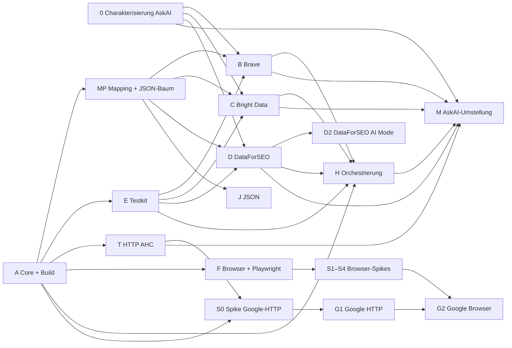

# Serp4J – Priorisierter Implementierungsplan

> **Status:** Nach Angelos Review vom 2026-10-31 angepasst (Review-Punkte A–C, Entscheidungen E-1 bis E-8) · Merge- und Startfreigabe ausstehend
> **Wichtig:** Keines der Pakete wird vor Angelos ausdrücklicher Freigabe begonnen. Paket A kann nach seiner Aussage als erstes freigegeben werden; E-1 und E-2 müssen dafür nicht abgewartet werden.
> Grundlage: [architecture.md](architecture.md), [ADRs](adr/README.md), Paketschnitt A–H aus Angelos Auftrag.

## 1. Überblick

Die Pakete A–H aus Angelos Auftrag bleiben erhalten. Die Integration ergänzt fünf Pakete, die in den WP-Berichten als
notwendig erkannt wurden: **0** (Charakterisierung in AskAI), **S** (Browser-Spikes), **T** (HTTP-Transport-Adapter),
**J** (JSON-Modul) und **M** (Umstellung von AskAI).

| Paket | Inhalt | Module | Hängt ab von | Größe | Priorität |
|---|---|---|---|---|---|
| **0** | Charakterisierung in AskAI: Fixtures, Golden-Tests | (AskAI, nur Tests) | E-1 | S | hoch |
| **A** | Build-Gerüst, Core Domain & Ports, Port-Module | `build-logic`, `serp4j-bom`, `serp4j-core`, `serp4j-http-api` | Freigabe | L | kritisch |
| **MP** | Mapping-Infrastruktur: `serp4j-mapping` und J1 (`JsonTrees` in `serp4j-json`) | `serp4j-mapping`, `serp4j-json` (Teil 1), `serp4j-testkit` (Contract-Test) | A (ADR-019 angenommen) | M | kritisch |
| **B** | Brave-Adapter | `serp4j-provider-brave` | A, MP, (E für Contract-Tests), E-1: echte Fixture vor der Mapping-Definition | M | hoch |
| **C** | Bright-Data-Adapter | `serp4j-provider-brightdata` | A, MP, (E), E-1; `brd_json`-Default erst nach echter Prüfung (E-2) | M | hoch |
| **D** | DataForSEO-Adapter (Web) | `serp4j-provider-dataforseo` | A, MP, (E); Fixtures vorhanden (E-1) | L | hoch |
| **D2** | DataForSEO AI Mode als zustandsloser `SearchProvider` (E-8) | `serp4j-provider-dataforseo` | D; echte AI-Mode-Fixture | S–M | hoch |
| **E** | Testkit & Mock-Provider | `serp4j-testkit` | A | M | kritisch |
| **T** | HTTP-Transport AHC | `serp4j-http-ahc` | A | S | hoch |
| **F** | Browser-Abstraktion & Playwright | `serp4j-browser-api`, `serp4j-browser-testkit`, `serp4j-browser-playwright`, `-driver-node`, `-driver-graal` | A (nur Build-Gerüst) | L | mittel |
| **S** | Spikes S0–S4 (Google-HTTP ohne Browserkontext, Treiber, Netzwerk/BiDi, AI-Mode-Ablauf, Parallelität) | Wegwerf-Prototypen in `serp4j-examples` | S0: A, T · S1–S4: F | M | mittel |
| **G1** | Google HTTP (Quick Web Search, #6) | `serp4j-engine-google-common`, `serp4j-engine-google-http` | A, T, S0 | M | mittel |
| **G2** | Google Browser Search + AI Mode (#7) | `serp4j-engine-google-browser` | A, F, S1–S4, G1 (Parser) | L | mittel |
| **H** | Orchestrierung & Registry | `serp4j-orchestration` | A, E; Abschluss mit B–D | M | hoch |
| **J** | JSON-Format des Modells (J2; J1 gehört zu MP) | `serp4j-json` | A, MP | S | niedrig |
| **M** | AskAI auf Serp4J umstellen | (AskAI) | B, C, D, H, T, 0 | M | hoch, aber zuletzt |
| später | Camoufox-Integration (gemeinsame Bibliothek, Java 8), Bright Data AI Mode (Dataset-Workflow), JDK-Transport, Analyzer, weitere Provider | `serp4j-browser-camoufox`, `serp4j-http-jdk`, `serp4j-analysis-*` | gemeinsame Camoufox-Bibliothek (E-5/E-6) | – | nach 0.1 |

Größen: S ≈ 1–2 Tage, M ≈ 3–5 Tage, L ≈ 1–2 Wochen für einen Agenten (grobe Schätzung ohne Messgrundlage).

## 2. Ablauf und Parallelisierung

| Welle | Parallel | Voraussetzung |
|---|---|---|
| **1** | **A**; parallel dazu **0** (anderes Repo, rein additiv) | Freigabe, für 0 zusätzlich E-1 |
| **2** | **MP** und **E** zuerst (parallel); dann **B, C, D** (Request-Mapper und Provider-Klasse können vor MP beginnen, die Mapping-Definition braucht MP); außerdem **T**, **F**, **J**, Beginn **H** gegen Mocks | A gemergt; für die Definitionen MP gemergt |
| **3a** | **S0** (nach A und T); parallel **D2** (nach D) und **S1–S4** (nach F) | T bzw. F gemergt |
| **3b** | **G1** (nach S0); **G2** (nach S1–S4 und G1); Abschluss **H** mit echten Providern | S0 bzw. S1–S4 abgeschlossen |
| **4** | **M**, Release **0.1.0** | B, C, D, H, T gemergt, Parität grün |

Bis zu sieben Agenten können in Welle 2 gleichzeitig arbeiten, weil jedes Paket ein eigenes Modul besitzt.
Gemeinsame Dateien (`settings.gradle.kts`, `libs.versions.toml`, `serp4j-bom`) werden in A vollständig für **alle**
geplanten Module angelegt, damit spätere Pakete nur ihr eigenes Verzeichnis anfassen.

## 3. Pakete im Detail

### 0 – Charakterisierung in AskAI

- Fixtures: Brave Web; Bright Data Google (sync parsed JSON + async); DataForSEO advanced mit mehreren Item-Typen;
  Fehler 401, 429, 5xx, DataForSEO-Status ≠ 20000, Bright Data „pending". Anonymisiert, Secret-Scan.
- Golden-Tests der Request-Mapper (Konfiguration + Request → URL/Body/Header).
- **Fertig, wenn:** Tests laufen grün in AskAI, kein Produktionscode geändert, Fixtures liegen in einem Format vor, das
  E übernehmen kann.

### A – Core Domain & Ports, Build-Gerüst

1. Gradle-Wrapper 8.14.x, `settings.gradle.kts` mit allen Modulen, `build-logic` mit Convention-Plugins, Version
   Catalog, `serp4j-bom`, CI (JDK 21 Build + JDK-8-Testlauf), ArchUnit-Regeln, `@Experimental`.
2. `serp4j-core`, Paket `core.model.*`: alle Wertobjekte aus architecture.md §4 und WP1 §4 inkl. Builder,
   Validierung, `Extensions`, `StructuredValue`, `RawPayload`, Visitor.
3. `serp4j-core`, Pakete `core.port.*` und `core.error`: Ports und Wertobjekte aus architecture.md §5.
4. `serp4j-http-api`: Transport-Port und Auth-Strategien.
- **Fertig, wenn:** Unit-Tests für Validierung, Unveränderlichkeit, `equals/hashCode`, Builder und
  `toBuilder()`; ArchUnit grün; `--release 8` und JDK-8-Testlauf grün; Javadoc ohne Fehler; keine Drittabhängigkeit.
- Empfehlung: A in zwei PRs teilen (A1 Build + Modell, A2 Ports + http-api), damit E und H früher starten können.

### A – Core-Vertragsfragen aus dem Review (Pflicht vor Freigabe von A)

Angelo macht die Freigabe von A von der Korrektur der beiden Core-Verträge abhängig. Beide sind in
[architecture.md](architecture.md) eingearbeitet und müssen in A umgesetzt werden:
- `SearchMetadata.getProvider()`, `getEngine()`, `getVertical()` als `Optional`; `getContributingProviders()` nie leer
  (Review-Punkt B, ADR-008).
- Ownership-Regel für injizierte Infrastruktur in den Javadocs von `ProviderPort`, `SearchProvider`,
  `ConversationalSearchProvider`, `HttpTransport`, `BrowserRuntime` und als Contract-Test im Testkit
  (Review-Punkt C, ADR-017).

### B, C, D – Cloud-Adapter (je Provider gleiche Reihenfolge)

1. Enums und Validator übernehmen (Paket `com.aresstack.serp4j.provider.<name>`, ohne Gson-Annotationen).
2. Unveränderliche `…SearchOptions` + `…RequestOptions`; Credential über `CredentialProvider`.
3. Request-Mapper übernehmen; Golden-Tests aus 0 grün.
4. Response-Mapper über die Mapping-Infrastruktur (MP, ADR-019): Mapping-Definition als Ressource
   `…/mapping/<name>-<vertical>-v1.json` gegen echte Fixtures, Custom Mapper in Java nur für verschachtelte Features
   und Rangsemantik; Organic mindestens identisch zu heute; `GenericSerpFeature` und `Extensions.unmapped` für alles
   andere; `MappingDefinitionContractTest` grün.
5. Provider-Klasse auf `HttpTransport`; `SearchCapabilities` vollständig deklariert; `SearchProviderFactory`-Eintrag.
6. Contract-Tests aus E.

Zusätzlich:
- **B Brave:** Seitenindex-Semantik als Capability; `mixed` für `SerpPosition.area`/`rankAbsolute`.
- **C Bright Data:** heutiges Verhalten beim `brd_json` unverändert übernehmen, Option setzbar, Default erst nach
  echter Prüfung (E-2); Polling über geteilten, injizierten Scheduler (Ownership nach ADR-017); Async-Pfad mit
  `FakeHttpTransport`-Sequenz getestet; Tests für Bing, DuckDuckGo, Yandex. Response-Mapper erst mit echter Fixture (E-1).
- **D DataForSEO:** Engine pro Request; `cost`/`time`; `target_search_mode`-Bedingung prüfen und testen; alle
  Item-Typen nach WP1 §5.3; vorhandene Playground-Fixtures (E-1) nach `serp4j-testkit` übernehmen.
- **D2 DataForSEO AI Mode (E-8):** Ziel `google/AI_MODE` über den AI-Mode-Live-Endpunkt als zustandslose Suche im
  selben Provider; Endpunktwahl über das Vertical; `GeneratedAnswerFeature` Typ `ai_mode_answer` mit
  `SourceReference`s; Klassifikation nach ausgeführtem Suchmodus, nicht nach JSON-Elementtyp (AI Overview ≠ AI Mode);
  Capabilities enthalten `AI_ANSWER`, `CITED_SOURCES`, aber **kein** `conversational`. Braucht eine echte Fixture.
- **Fertig, wenn:** Contract-Test, Golden-Tests und Fixture-Tests grün; „unbekannter Typ überlebt"; keine Secrets in
  Ausgaben; Live-Test vorhanden (läuft nur manuell).

### MP – Mapping-Infrastruktur (ADR-019)

- `serp4j-mapping` (Java 8, nur `core`): `TreePath` (Namen, Index, `[*]`, zitierte Namen), `MappingDefinitions.from(StructuredValue)`
  mit Validierung, `MappingEngine` (Metadaten, Sektionen `items`/`features`/`elements`, Diskriminator, `fieldsByType`,
  Positionsmodi, Pflichtfelder, Unmapped-Erhalt, Warnungen), `ValueConverters` (Standardkonverter, registrierbar),
  `CustomMapperRegistry` **je Definition**, nie geteilt (`ItemMapper`, `FeatureMapper` je Sektion und Typ, `MetadataMapper`).
- **Verbindlich (Angelo, 2026-10-31):** Regressionstest, in dem zwei Definitionen dieselben Sektions-IDs und
  Feature-Typ-IDs verwenden; die Custom Mapper der einen dürfen die andere nachweislich nicht beeinflussen. Der
  Prototyp teilte zunächst eine `CustomMappers`-Instanz über alle Definitionen; das ist in MP ausgeschlossen.
- J1 in `serp4j-json`: `JsonTrees.read/write` (JSON-Text ↔ `StructuredValue`), einzige Gson-Stelle.
- `serp4j-testkit`: `MappingDefinitionContractTest` (Definition lädt, jeder Pfad trifft in mindestens einer Fixture,
  Golden-Output, „unbekannter Typ überlebt").
- Referenz für die Semantik: `spikes/mapping-prototype` (wird nach MP gelöscht oder als Beispiel nach `serp4j-examples`
  übernommen).
- **Fertig, wenn:** Unit-Tests grün; eine Beispieldefinition im Testkit gegen eine **echte** DataForSEO-Fixture (E-1)
  läuft; ArchUnit: `serp4j-mapping` ohne Gson; Javadoc der öffentlichen API.

### E – Testkit & Mock-Provider

- `FakeHttpTransport` (Fixtures, Aufzeichnung, Status, Verzögerung, Timeout, Sequenzen wie pending → ready).
- `MockSearchProvider`, `ScriptedSearchProvider`, `ScriptedConversationalProvider` (Fehlerinjektion je Kategorie, Latenz).
- `SearchProviderContractTest`, `ConversationalSearchProviderContractTest` (abstrakt, JUnit 5).
- Fixtures aus 0 unter `fixtures/<provider>/`, Secret-Scan-Test.
- Contract-Test „geteilte Infrastruktur überlebt `close()` eines Providers" (ADR-017) und „Einzelantwort setzt Provider"
  (ADR-008).
- **Fertig, wenn:** Mocks bestehen ihre eigenen Contract-Tests; JUnit nur `compileOnly`.

### T – HTTP-Transport AHC

- `AhcHttpTransport` aus `AsyncJsonHttpClient`/`AsyncHttpClientFactory`; geteilter Client; neutraler User-Agent.
- Fehler → `HttpTransportException` ohne Body-Leak. Test gegen lokalen JDK-`HttpServer`.

### F – Browser-Abstraktion & Playwright

1. `serp4j-browser-api` nach WP3 §5 (Java 8, 0 Deps, kennt Core nicht).
2. `serp4j-browser-testkit`: `FakeBrowserRuntime`, `BrowserRuntimeContractTest` (Navigation, Timeouts, Close,
   Isolation, geschlossener Browser, URL-Policy nach Redirect, Event-Zustellung im Leerlauf, keine verwaisten Prozesse).
3. `serp4j-browser-playwright`: Actor-/Owner-Thread-Modell, Probe, Lifecycle, Kapazitätslimit, Chromium,
   `RemotePlaywrightRuntime`; Treiber-Erkennung „genau einer".
4. Treibermodule `-driver-node`, `-driver-graal`.
- **Fertig, wenn:** TCK im eigenen CI-Job (Linux, Chromium) grün mit beiden Treibern; Core-Build bleibt ohne Browser.
- Camoufox ist **nicht** Teil von F (E-5/E-6).

### S – Spikes

S0 (vor G1): `GET /search?q=…` ohne Browserprofil und Cookies: Consent-Redirect, Blockierung, Antwortvarianten,
`/async/folsrch` (#6) · S1 Treibervergleich (Start, Speicher, Größe) · S2 `onResponse`/`body()` Chromium vs. BiDi ·
S3 AI-Mode-Ablauf (initialer Transport HTML vs. dynamisch, `/async/folif` für Folgefragen, Fertig-Erkennung,
Verfügbarkeit DE ohne Login, Fortsetzbarkeit; #7) · S4 Parallelität.
Ergebnis je Spike: kurzer Bericht unter `docs/spikes/` und, bei S0 und S3, ein HTML-/Response-Fixture-Set. Spike-Code
wird nicht publiziert.

### G1 – Google HTTP (Quick Web Search, #6)

- `serp4j-engine-google-common`: `GoogleUrlBuilder`, `GoogleObstacleDetector`, `GoogleSerpHtmlParser` (jsoup) gegen
  HTML-Fixtures aus S0.
- `serp4j-engine-google-http`: `GoogleHttpSearchProvider` über `HttpTransport`; `hl`/`gl`/`start`/`num`; nie `udm=50`;
  Hindernisse → `BLOCKED`/`UNSUPPORTED`; Degradation → Warnung; Capabilities aus S0.
- Grenzen nach ADR-016; Publish-Flag aus (E-3/E-4).
- **Fertig, wenn:** Parser und Provider gegen Fixtures getestet; Contract-Test grün; Live-Smoke manuell; Akzeptanzkriterien
  aus #6, soweit sie Serp4J betreffen.

### G2 – Google Browser Search / AI Mode (#7)

- `GoogleBrowserSearchProvider` (`SearchProvider`) und `GoogleAiModeProvider` (`ConversationalSearchProvider`) in
  `serp4j-engine-google-browser`, Parser aus `-common` wiederverwendet.
- Extraktionsquelle je Fall nach S3: DOM-Skripte `google/serp-v1.js`, `google/ai-mode-v1.js` und/oder beobachtete
  Responses (`/async/folif`); keine undokumentierten RPC-IDs als feste API.
- Consent-Handling nur mit eindeutig ablehnender Option; `BrowserRuntime` wird injiziert und nie vom Provider
  geschlossen (ADR-017).
- **Fertig, wenn:** Extraktion gegen Fixtures getestet; Dialog-Contract-Test grün (Erstfrage + Folgefrage mit
  `FakeBrowserRuntime`); Degradation als Warnung; Live-Smoke manuell.

### H – Orchestrierung & Registry

- `SearchProviderRegistry` + Builder + `SwappableSearchProviderRegistry`.
- `SearchOrchestrator`, `SearchPlan`, `FailurePolicy`, `ProviderSelector`, `SearchOutcome`, `ProviderAttempt`.
- `UrlDeduplicatingMerger` + `UrlCanonicalizer` (Query erhalten, Tracking-Parameter entfernen).
- `ConversationalSearchUseCase`, `SessionPlan`; Fassade `Serp4j`; optionale Analyzer-Kette.
- **Fertig, wenn:** Fan-out, Fallback, Deadline, Abbruch, Budget und Teilfehler gegen Mocks getestet; Abschlusstest mit
  B–D gegen `FakeHttpTransport`.

### J – JSON-Modul

- `Serp4jJson` für `SearchResponse`, `SearchConversation`, `SessionHandle`; `formatVersion`; Round-Trip-Tests;
  unbekannte Felder werden toleriert.

### M – AskAI-Umstellung (eigene Freigabe)

1. `:research-search-config` aus `:web-search-providers` herauslösen (Persistenz, Krypto, Draft, Playground).
2. `AskAiCredentialProvider`, `ProviderOptionsMapper` (Datei-DTO → Serp4J-Options).
3. Paritätstest (Fixtures aus 0) altes Modul vs. Serp4J.
4. `Serp4jSearchProviderBridge` ersetzt `AsyncModuleSearchProvider` (Engine pro Request, Rohantwort, Offset,
   `absoluteRank`, `domain`, `publishedAt`).
5. `AgentPluginLoadIntegrationTest` grün, danach `:web-search-providers` löschen.

## 4. Freigaben und Entscheidungen je Paket

| Paket | Braucht vor Beginn |
|---|---|
| alle | Angelos endgültige Abnahme und ausdrückliche Startfreigabe |
| A – Core und Build | Korrektur der beiden Core-Vertragsfragen (Review-Punkte B und C, oben eingearbeitet); E-1/E-2 **nicht** nötig |
| 0 | vorhandene DataForSEO-Fixtures (E-1); für Brave/Bright Data ein Recording-Lauf mit Angelos Keys |
| MP – Mapping-Infrastruktur | A; ADR-019 angenommen (2026-10-31); Regressionstest „getrennte Registries je Definition" ist Teil der Fertigstellung |
| B – Brave | A, MP, E-1: echte Fixture |
| C – Bright Data | A, MP, E-1 und E-2 (Default erst nach echter Prüfung) |
| D – DataForSEO | A, MP, vorhandene Fixtures (E-1) |
| D2 – DataForSEO AI Mode | D, echte AI-Mode-Fixture (E-8) |
| E – Testkit | A |
| T – HTTP-Transport | A |
| F – Browser | A |
| S – Spikes | S0: A, T · S1–S4: F |
| G1 – Google HTTP | A, T, S0; nicht publiziert (E-3/E-4) |
| G2 – Google Browser | F, S, G1; nicht publiziert (E-3/E-4) |
| H – Orchestrierung | A und E |
| J – JSON (J2) | A, MP |
| Release 0.1.0 | nmcp-Publishing (E-7) |
| Camoufox (später) | gemeinsame Bibliothek (E-5), Java 8 (E-6) |
| M – AskAI-Migration | gesonderte Freigabe |

## 5. Definition of Done (alle Pakete)

- Java-8-Module: `--release 8` und JDK-8-Testlauf grün.
- Keine neue externe Abhängigkeit außerhalb des Version Catalogs; keine Drittanbieter-Typen in öffentlichen Signaturen.
- ArchUnit-Regeln grün; keine Split Packages; `Automatic-Module-Name` gesetzt.
- Kein Test verlässt im Default-Build das Netzwerk.
- Javadoc für öffentliche Typen; `CHANGELOG.md` ergänzt.
- Ein PR je Paket (bei A zwei), Review durch Angelo.
