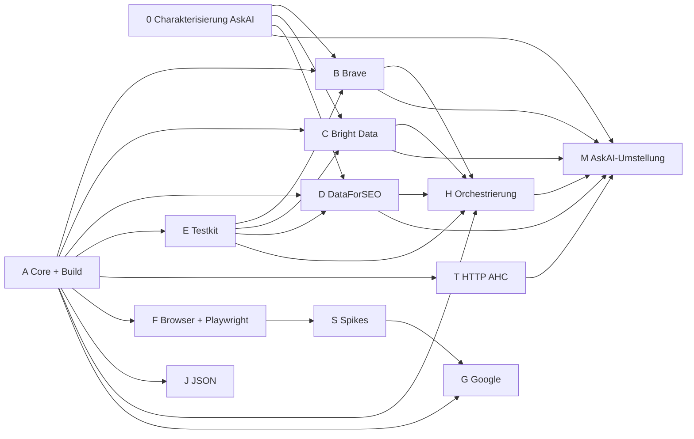

# Serp4J – Priorisierter Implementierungsplan

> **Status:** Zur Abnahme durch Angelo · **Stand:** 2026-10-31
> **Wichtig:** Keines der Pakete wird vor Angelos ausdrücklicher Freigabe begonnen.
> Grundlage: [architecture.md](architecture.md), [ADRs](adr/README.md), Paketschnitt A–H aus Angelos Auftrag.

## 1. Überblick

Die Pakete A–H aus Angelos Auftrag bleiben erhalten. Die Integration ergänzt fünf Pakete, die in den WP-Berichten als
notwendig erkannt wurden: **0** (Charakterisierung in AskAI), **S** (Browser-Spikes), **T** (HTTP-Transport-Adapter),
**J** (JSON-Modul) und **M** (Umstellung von AskAI).

| Paket | Inhalt | Module | Hängt ab von | Größe | Priorität |
|---|---|---|---|---|---|
| **0** | Charakterisierung in AskAI: Fixtures, Golden-Tests | (AskAI, nur Tests) | E-1 | S | hoch |
| **A** | Build-Gerüst, Core Domain & Ports, Port-Module | `build-logic`, `serp4j-bom`, `serp4j-core`, `serp4j-http-api` | Freigabe | L | kritisch |
| **B** | Brave-Adapter | `serp4j-provider-brave` | A, (E für Contract-Tests) | M | hoch |
| **C** | Bright-Data-Adapter | `serp4j-provider-brightdata` | A, (E), E-2 | M | hoch |
| **D** | DataForSEO-Adapter | `serp4j-provider-dataforseo` | A, (E) | L | hoch |
| **E** | Testkit & Mock-Provider | `serp4j-testkit` | A | M | kritisch |
| **T** | HTTP-Transport AHC | `serp4j-http-ahc` | A | S | hoch |
| **F** | Browser-Abstraktion & Playwright | `serp4j-browser-api`, `serp4j-browser-testkit`, `serp4j-browser-playwright`, `-driver-node`, `-driver-graal` | A (nur Build-Gerüst) | L | mittel |
| **S** | Spikes S1–S4 (Treiber, Netzwerk/BiDi, AI-Mode-Ablauf, Parallelität) | Wegwerf-Prototypen in `serp4j-examples` | F (teilweise), E-3 | M | mittel |
| **G** | Google Search / AI Mode | `serp4j-engine-google` | A, F, S, E-3 | L | mittel |
| **H** | Orchestrierung & Registry | `serp4j-orchestration` | A, E; Abschluss mit B–D | M | hoch |
| **J** | JSON-Format des Modells | `serp4j-json` | A | S | niedrig |
| **M** | AskAI auf Serp4J umstellen | (AskAI) | B, C, D, H, T, 0 | M | hoch, aber zuletzt |
| später | Camoufox, JDK-Transport, Analyzer, weitere Provider | `serp4j-browser-camoufox`, `serp4j-http-jdk`, `serp4j-analysis-*` | E-5, E-6 | – | nach 0.1 |

Größen: S ≈ 1–2 Tage, M ≈ 3–5 Tage, L ≈ 1–2 Wochen für einen Agenten (grobe Schätzung ohne Messgrundlage).

## 2. Ablauf und Parallelisierung

| Welle | Parallel | Voraussetzung |
|---|---|---|
| **1** | **A**; parallel dazu **0** (anderes Repo, rein additiv) | Freigabe, für 0 zusätzlich E-1 |
| **2** | **E** zuerst bzw. im Gleichschritt mit **B, C, D**; außerdem **T**, **F**, **J**, Beginn **H** gegen Mocks | A gemergt |
| **3** | **S**, danach **G**; Abschluss **H** mit echten Providern | F gemergt, E-3 entschieden |
| **4** | **M**, Release **0.1.0** | B, C, D, H, T gemergt, Parität grün |

Bis zu sieben Agenten können in Welle 2 gleichzeitig arbeiten, weil jedes Paket ein eigenes Modul besitzt.
Gemeinsame Dateien (`settings.gradle.kts`, `libs.versions.toml`, `serp4j-bom`) werden in A vollständig für **alle**
geplanten Module angelegt, damit spätere Pakete nur ihr eigenes Verzeichnis anfassen.

## 3. Pakete im Detail

### 0 – Charakterisierung in AskAI

- Fixtures: Brave Web; Bright Data Google (sync parsed JSON + async); DataForSEO advanced mit mehreren Item-Typen;
  Fehler 401, 429, 5xx, DataForSEO-Status ≠ 20000, Bright Data „pending". Anonymisiert, Secret-Scan.
- Golden-Tests der Request-Mapper (Konfiguration + Request → URL/Body/Header).
- **Fertig, wenn:** Tests laufen grün in AskAI, kein Produktionscode geändert, Fixtures liegen in einem Format vor, das
  E übernehmen kann.

### A – Core Domain & Ports, Build-Gerüst

1. Gradle-Wrapper 8.14.x, `settings.gradle.kts` mit allen Modulen, `build-logic` mit Convention-Plugins, Version
   Catalog, `serp4j-bom`, CI (JDK 21 Build + JDK-8-Testlauf), ArchUnit-Regeln, `@Experimental`.
2. `serp4j-core`, Paket `core.model.*`: alle Wertobjekte aus architecture.md §4 und WP1 §4 inkl. Builder,
   Validierung, `Extensions`, `StructuredValue`, `RawPayload`, Visitor.
3. `serp4j-core`, Pakete `core.port.*` und `core.error`: Ports und Wertobjekte aus architecture.md §5.
4. `serp4j-http-api`: Transport-Port und Auth-Strategien.
- **Fertig, wenn:** Unit-Tests für Validierung, Unveränderlichkeit, `equals/hashCode`, Builder und
  `toBuilder()`; ArchUnit grün; `--release 8` und JDK-8-Testlauf grün; Javadoc ohne Fehler; keine Drittabhängigkeit.
- Empfehlung: A in zwei PRs teilen (A1 Build + Modell, A2 Ports + http-api), damit E und H früher starten können.

### B, C, D – Cloud-Adapter (je Provider gleiche Reihenfolge)

1. Enums und Validator übernehmen (Paket `com.aresstack.serp4j.provider.<name>`, ohne Gson-Annotationen).
2. Unveränderliche `…SearchOptions` + `…RequestOptions`; Credential über `CredentialProvider`.
3. Request-Mapper übernehmen; Golden-Tests aus 0 grün.
4. Response-Mapper neu auf `SearchData`/`SearchMetadata` nach WP1 §5; Organic mindestens identisch zu heute;
   Extensions und `GenericSerpFeature` für alles andere.
5. Provider-Klasse auf `HttpTransport`; `SearchCapabilities` vollständig deklariert; `SearchProviderFactory`-Eintrag.
6. Contract-Tests aus E.

Zusätzlich:
- **B Brave:** Seitenindex-Semantik als Capability; `mixed` für `SerpPosition.area`/`rankAbsolute`.
- **C Bright Data:** `brd_json=1` nach E-2; Polling über geteilten Scheduler; Async-Pfad mit `FakeHttpTransport`-Sequenz
  getestet; Tests für Bing, DuckDuckGo, Yandex.
- **D DataForSEO:** Engine pro Request; `cost`/`time`; `target_search_mode`-Bedingung prüfen und testen; alle
  Item-Typen nach WP1 §5.3.
- **Fertig, wenn:** Contract-Test, Golden-Tests und Fixture-Tests grün; „unbekannter Typ überlebt"; keine Secrets in
  Ausgaben; Live-Test vorhanden (läuft nur manuell).

### E – Testkit & Mock-Provider

- `FakeHttpTransport` (Fixtures, Aufzeichnung, Status, Verzögerung, Timeout, Sequenzen wie pending → ready).
- `MockSearchProvider`, `ScriptedSearchProvider`, `ScriptedConversationalProvider` (Fehlerinjektion je Kategorie, Latenz).
- `SearchProviderContractTest`, `ConversationalSearchProviderContractTest` (abstrakt, JUnit 5).
- Fixtures aus 0 unter `fixtures/<provider>/`, Secret-Scan-Test.
- **Fertig, wenn:** Mocks bestehen ihre eigenen Contract-Tests; JUnit nur `compileOnly`.

### T – HTTP-Transport AHC

- `AhcHttpTransport` aus `AsyncJsonHttpClient`/`AsyncHttpClientFactory`; geteilter Client; neutraler User-Agent.
- Fehler → `HttpTransportException` ohne Body-Leak. Test gegen lokalen JDK-`HttpServer`.

### F – Browser-Abstraktion & Playwright

1. `serp4j-browser-api` nach WP3 §5 (Java 8, 0 Deps, kennt Core nicht).
2. `serp4j-browser-testkit`: `FakeBrowserRuntime`, `BrowserRuntimeContractTest` (Navigation, Timeouts, Close,
   Isolation, geschlossener Browser, URL-Policy nach Redirect, Event-Zustellung im Leerlauf, keine verwaisten Prozesse).
3. `serp4j-browser-playwright`: Actor-/Owner-Thread-Modell, Probe, Lifecycle, Kapazitätslimit, Chromium,
   `RemotePlaywrightRuntime`; Treiber-Erkennung „genau einer".
4. Treibermodule `-driver-node`, `-driver-graal`.
- **Fertig, wenn:** TCK im eigenen CI-Job (Linux, Chromium) grün mit beiden Treibern; Core-Build bleibt ohne Browser.
- Camoufox ist **nicht** Teil von F (E-5/E-6).

### S – Spikes (vor G)

S1 Treibervergleich (Start, Speicher, Größe) · S2 `onResponse`/`body()` Chromium vs. BiDi · S3 AI-Mode-Ablauf
(Erstfrage, Folgefrage, Fertig-Erkennung, Verfügbarkeit DE ohne Login, Fortsetzbarkeit) · S4 Parallelität.
Ergebnis je Spike: kurzer Bericht unter `docs/spikes/` und, bei S3, ein Fixture-Set. Spike-Code wird nicht publiziert.

### G – Google Search / AI Mode

- `GoogleSearchProvider` (`SearchProvider`) und `GoogleAiModeProvider` (`ConversationalSearchProvider`) in einem Modul.
- Gemeinsam: `GoogleUrlBuilder`, `GoogleObstacleDetector`, Consent-Handling nur mit eindeutig ablehnender Option,
  versionierte Skripte `google/serp-v1.js`, `google/ai-mode-v1.js`, Mapping in Java.
- Grenzen nach ADR-016; Publish-Flag aus (E-3/E-4).
- **Fertig, wenn:** Extraktion gegen HTML-Fixtures getestet; Dialog-Contract-Test grün; Degradation als Warnung;
  Live-Smoke manuell.

### H – Orchestrierung & Registry

- `SearchProviderRegistry` + Builder + `SwappableSearchProviderRegistry`.
- `SearchOrchestrator`, `SearchPlan`, `FailurePolicy`, `ProviderSelector`, `SearchOutcome`, `ProviderAttempt`.
- `UrlDeduplicatingMerger` + `UrlCanonicalizer` (Query erhalten, Tracking-Parameter entfernen).
- `ConversationalSearchUseCase`, `SessionPlan`; Fassade `Serp4j`; optionale Analyzer-Kette.
- **Fertig, wenn:** Fan-out, Fallback, Deadline, Abbruch, Budget und Teilfehler gegen Mocks getestet; Abschlusstest mit
  B–D gegen `FakeHttpTransport`.

### J – JSON-Modul

- `Serp4jJson` für `SearchResponse`, `SearchConversation`, `SessionHandle`; `formatVersion`; Round-Trip-Tests;
  unbekannte Felder werden toleriert.

### M – AskAI-Umstellung (eigene Freigabe)

1. `:research-search-config` aus `:web-search-providers` herauslösen (Persistenz, Krypto, Draft, Playground).
2. `AskAiCredentialProvider`, `ProviderOptionsMapper` (Datei-DTO → Serp4J-Options).
3. Paritätstest (Fixtures aus 0) altes Modul vs. Serp4J.
4. `Serp4jSearchProviderBridge` ersetzt `AsyncModuleSearchProvider` (Engine pro Request, Rohantwort, Offset,
   `absoluteRank`, `domain`, `publishedAt`).
5. `AgentPluginLoadIntegrationTest` grün, danach `:web-search-providers` löschen.

## 4. Freigaben und Entscheidungen je Paket

| Paket | Braucht vor Beginn |
|---|---|
| alle | Angelos Abnahme der Architektur und ausdrückliche Implementierungsfreigabe |
| 0 | E-1 (Fixtures) |
| C | E-2 (`brd_json`) |
| G | E-3 (Google-Adapter ja/nein); E-8 (browserloser AI-Mode-Weg zuerst?) |
| Release 0.1.0 | E-4, E-7 |
| Camoufox (später) | E-5, E-6 |
| M | gesonderte Freigabe für Änderungen im AskAI-Repository |

## 5. Definition of Done (alle Pakete)

- Java-8-Module: `--release 8` und JDK-8-Testlauf grün.
- Keine neue externe Abhängigkeit außerhalb des Version Catalogs; keine Drittanbieter-Typen in öffentlichen Signaturen.
- ArchUnit-Regeln grün; keine Split Packages; `Automatic-Module-Name` gesetzt.
- Kein Test verlässt im Default-Build das Netzwerk.
- Javadoc für öffentliche Typen; `CHANGELOG.md` ergänzt.
- Ein PR je Paket (bei A zwei), Review durch Angelo.
