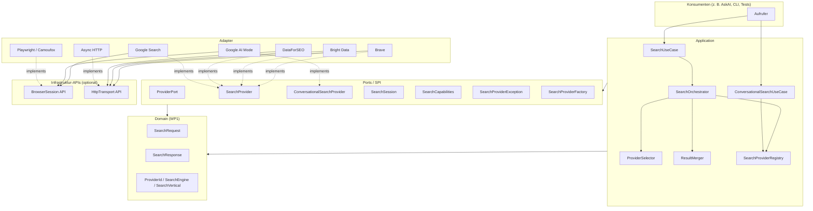
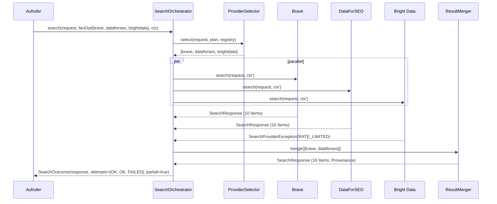
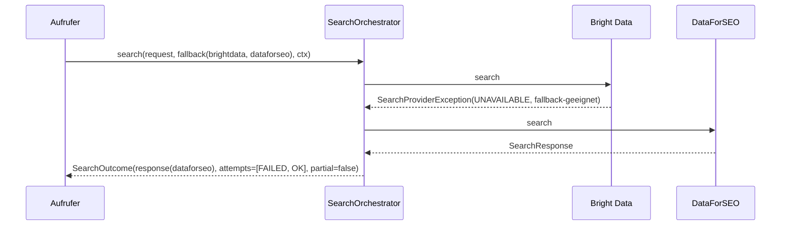
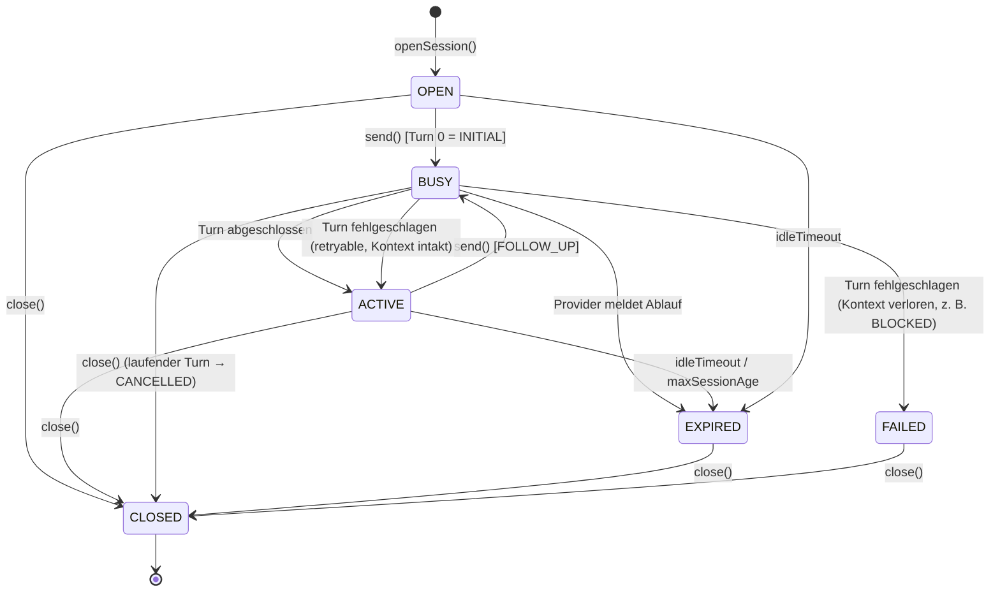
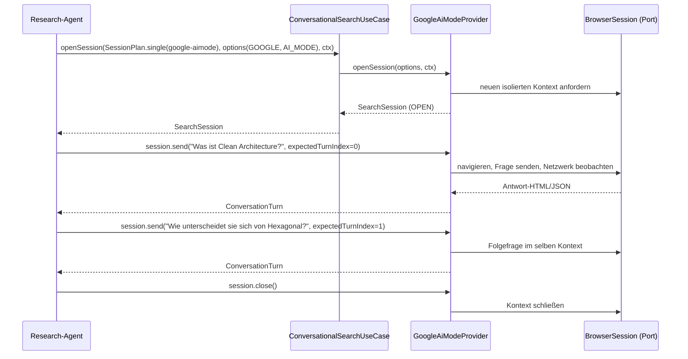
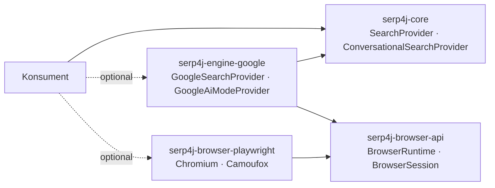

# WP2 – Clean Architecture & Provider Ports

> Status: **Entwurf zur Integration** (Architekturphase, keine produktive Implementierung)
> Arbeitspaket: WP2 – Clean Architecture, Provider Ports, Composite, Stateful Search Sessions
> Stand: 2026-10-31
> Abhängige Arbeitspakete: WP1 (Datenmodell), WP3 (Browser), WP4 (Module), WP5 (Migration)

Alle Java-Signaturen in diesem Dokument sind **Dokumentation**, kein Produktivcode. Sie sind bewusst
Java-8-kompatibel gehalten: keine `record`, kein `var`, keine `sealed`-Typen, keine Default-Methoden
mit Geschäftslogik, `Optional` nur als Rückgabewert, `CompletableFuture` als Async-Primitive.

---

## 0. Zusammenfassung der Kernentscheidungen

| # | Entscheidung | Kurzbegründung |
|---|---|---|
| E1 | Vier Schichten: **Domain → Ports → Application → Adapter**. Abhängigkeiten zeigen nur nach innen. | Clean Architecture; Domain ist provider-frei testbar. |
| E2 | `SearchProvider` ist ein **minimaler** Port: `descriptor()`, `search(request, context)`, `close()`. | Normale Provider bleiben einfach; alles andere ist optional. |
| E3 | **Provider ≠ SearchEngine.** Provider = *wer ausführt* (Brave-API, Bright Data, DataForSEO, Browser-Adapter). SearchEngine = *wessen Index/SERP* (Google, Bing, Brave …). Zusätzlich `SearchVertical` (WEB, NEWS, IMAGES, AI_MODE …). | Bright Data und DataForSEO liefern Google-, Bing-, Yahoo-SERPs; ein Provider-Enum mit `MULTI`/`COMPOSITE` vermischt beides heute. |
| E4 | `ProviderId` und `SearchEngine` sind **offene Value Objects** (String-basiert mit Konstanten), keine Enums. | Eine Bibliothek muss Fremd-Provider und neue Engines zulassen, ohne den Core zu ändern. |
| E5 | **Composite ist kein Provider**, sondern Application-Logik (`SearchOrchestrator`). Es gibt keine Pseudo-IDs `COMPOSITE`/`MULTI`. | Ergebnisse mehrerer Provider haben mehrere Herkünfte; ein Fake-Provider verschleiert das. |
| E6 | Provider liefern `SearchResponse` oder scheitern mit **genau einem typisierten Fehler** (`SearchProviderException` + `SearchErrorCategory`). Die Orchestrierung liefert `SearchOutcome` (= Antwort + Protokoll aller Versuche + Teilerfolgs-Flag). | Teilergebnisse werden sichtbar statt verschluckt (heute: `exceptionally(→ null)`). |
| E7 | **Kein stilles Fallback.** Ein anderer Provider wird nur verwendet, wenn der Aufrufer das per `SelectionMode.FALLBACK` oder `FAN_OUT` ausdrücklich verlangt. | Übernommen aus der AskAI-Research-Runtime; Reproduzierbarkeit und Kostenkontrolle. |
| E8 | `SearchCapabilities` ist ein **unveränderliches Value Object**, das statisch beschreibt, was ein Provider kann; Auswahl und Validierung arbeiten darauf. | Provider-Auswahl ohne Probe-Requests; UI kann Fähigkeiten anzeigen. |
| E9 | `SearchRequest` (*was*) und `SearchContext` (*wie*: Deadline, Abbruch, Korrelation, Budget) sind getrennt. | Domain-Request bleibt rein; Ausführungsdetails gehören nicht ins Datenmodell. |
| E10 | Dialogsuche über **eigenen, optionalen Port** `ConversationalSearchProvider` → `SearchSession` → `send(SearchConversationRequest)`. Gemeinsame Basis mit `SearchProvider` ist nur `ProviderPort` (Descriptor + Lifecycle). | KI-Dialoge werden nicht in `SearchRequest → SearchResponse` gepresst, normale Provider sehen davon nichts. |
| E11 | Eine `SearchSession` ist **an genau einen Provider gebunden**, hat einen expliziten Zustandsautomaten und erlaubt **höchstens einen laufenden Turn**. Keine transparente Neuerstellung bei Ablauf. | Konversationskontext ist nicht übertragbar; stilles Neuöffnen würde falsche Antworten erzeugen. |
| E12 | `BrowserSession` ist ein **Infrastruktur-Port in einer eigenen Browser-API**, nicht Teil des Search-Cores (Vorschlag, siehe offene Frage F2). | Nutzer ohne Browser sollen den Port nicht einmal sehen müssen; Google-Adapter hängt nur an der Browser-API. |
| E13 | Die `SearchProviderRegistry` ist ein **unveränderlicher Snapshot**. Hot-Reload erfolgt durch Austausch des Snapshots, nicht durch Mutation. | Thread-sicher ohne Locks; entspricht AskAIs „Generation“-Konzept. |

---

## 1. Bestandsaufnahme (lesend)

### 1.1 Serp4J-Repository

Das Repository `aresstack/Serp4J` ist zum Zeitpunkt dieses Berichts **leer** (kein Commit, kein Branch).
Es gibt also keinen bestehenden Code, auf den WP2 Rücksicht nehmen muss. Dieses Dokument ist die erste
Datei unter `docs/architecture/`.

### 1.2 AskAI `web-search-providers` (Paket `com.aresstack.askai.research.search`)

| Element | Ist-Zustand | Bewertung für Serp4J |
|---|---|---|
| `WebSearchProvider` | `getProviderId()`, `supports(SearchEngine)`, `CompletableFuture<WebSearchResult> search(WebSearchRequest)`, `close()` | Gute, kleine Basis. Async über `CompletableFuture` ist Java-8-tauglich und wird übernommen. `supports(engine)` ist zu schmal → wird zu `SearchCapabilities`. |
| `SearchProviderId` | Enum `BRAVE, BRIGHT_DATA, DATA_FOR_SEO, COMPOSITE` | Geschlossen; `COMPOSITE` ist kein echter Provider → offenes Value Object, `COMPOSITE` entfällt. |
| `SearchEngine` | Enum `MULTI, BRAVE, GOOGLE, BING, …` mit `apiValue` | `MULTI` vermischt Engine und Aggregation. `apiValue` ist Provider-Wissen (gehört in den Adapter-Mapper). |
| `WebSearchRequest` | Query, Country, Language, maxResults (1–200), offset | Kein Vertical, keine Provider-Optionen, keine Deadline. |
| `WebSearchResult` / `WebSearchHit` | Hits + `rawResponse` | Ersetzt durch WP1-Modell (`SearchResponse`). |
| `WebSearchException` | Ein untypisierter `RuntimeException` | Zu grob; `HttpResponseException(statusCode)` leckt Transportdetails nach oben. |
| `WebSearchProviderRegistry` | `EnumMap`, `require(id)`, `getAll()`, schließt alle Provider | Konzept übernehmen, aber offen (ID-basiert) und mit Capability-Suche. |
| `CompositeWebSearchProvider` | Parallel-Fan-out, URL-Kanonisierung, Dedupe, `toleratePartialFailure` → Fehler werden zu `null`, Ergebnis-ID `COMPOSITE`/`MULTI` | Fan-out und Kanonisierung übernehmen; Fehler müssen protokolliert werden; Herkunft je Treffer muss erhalten bleiben. |
| `WebSearchProvidersModule` | Lädt Konfiguration + Secrets (AES-GCM) aus Dateien, baut Registry, strikter/resilienter Modus, `reloadProviders()` | Gehört **nicht** in den Core. Dateikonfiguration und Secret-Speicher sind Konsumenten-Sache (AskAI) bzw. ein optionales Modul (WP4/WP5). |

### 1.3 AskAI `research-agent-runtime` (zweite, parallele Provider-Hierarchie)

AskAI enthält eine zweite Abstraktion (`com.aresstack.askai.research.runtime.search.provider`), die
mehrere gute Ideen enthält, die WP2 übernimmt:

- **Typisierte Fehler** mit `retryable`-Flag (`SearchProviderRateLimitException`,
  `…AuthenticationException`, `…TemporaryException`, `…UnsupportedEngineException`, …).
- **„Ein ausgewählter Provider wird nie still ersetzt“** – Fallback nur über eine explizite Strategie.
- **Descriptor/Katalog** getrennt von Instanzen (`SearchProviderDescriptor`, Implementierungsstatus).
- **Unveränderliche Generationen** (`AsyncSearchGeneration`) für Hot-Reload.
- Klare Abgrenzung: Provider kennt Auth, Endpunkte, Paginierung; *Strategie* entscheidet über Fallback/Merge.

Dass AskAI heute **zwei** Provider-Abstraktionen hat, ist ein Argument dafür, dass Serp4J eine
einzige, offene und vollständige Port-Definition bereitstellt, auf die beide Pfade migriert werden (WP5).

---

## 2. Schichtenmodell und Abhängigkeitsrichtung

### 2.1 Schichten

| Schicht | Inhalt | Darf abhängen von |
|---|---|---|
| **Domain** | Datenmodell (WP1): `SearchRequest`, `SearchResponse`, `SearchData`, `SearchMetadata`, `SearchAnalysis`, `SearchResultItem`, `SerpFeature`; Value Objects `ProviderId`, `SearchEngine`, `SearchVertical`, `SearchLocale` | nur JDK |
| **Ports** (Outbound/SPI) | `ProviderPort`, `SearchProvider`, `ConversationalSearchProvider`, `SearchSession`, `SearchCapabilities`, `ProviderDescriptor`, `SearchContext`, Fehler-Typen, `SearchProviderFactory` (SPI) | Domain |
| **Application** (Inbound Ports + Use Cases) | `SearchUseCase`, `ConversationalSearchUseCase`, `SearchOrchestrator`, `ProviderSelector`, `ResultMerger`, `SearchProviderRegistry` (Implementierung), `SearchOutcome` | Domain, Ports |
| **Adapter** | Cloud-Adapter (Brave, Bright Data, DataForSEO), Engine-Adapter (Google Search, Google AI Mode), Browser-Adapter (Playwright, Camoufox), Transport-Adapter (HTTP) | Ports (+ eigene Infrastruktur-APIs), **nie** Application-Interna anderer Adapter |

Regeln:

1. Die Domain kennt **keine** Provider, keine Engines-spezifischen API-Werte, kein HTTP, kein JSON.
2. Use Cases kennen nur Ports, **nie** konkrete Adapter-Klassen.
3. Adapter implementieren Ports; sie kennen sich gegenseitig nicht. Ausnahme: ein Engine-Adapter
   (Google AI Mode) hängt an einer **Infrastruktur-API** (`BrowserSession`), nicht an einer Implementierung (Playwright).
4. Keine Abhängigkeit auf AskAI, in keiner Schicht.
5. Provider-spezifische Konfiguration (API-Keys, Endpunkte, Zonen) lebt im jeweiligen Adapter-Modul.

### 2.2 Abhängigkeitsdiagramm (logisch)



Wichtig: Keine Kante zeigt von `Domain`/`Ports` nach außen. `Playwright` ist nur über
`BrowserSession API` erreichbar; wer keinen Browser nutzt, hat weder `BS` noch `PW` im Classpath.

### 2.3 Abbildung auf Module (Vorschlag, verbindlich entscheidet WP4/Integration)

| Logische Schicht | Vorgeschlagenes Modul |
|---|---|
| Domain + Ports | `serp4j-core` (ggf. aufgeteilt in `serp4j-api` + `serp4j-spi`, siehe F1) |
| Application | `serp4j-core` (Paket `…application`) oder `serp4j-engine`/`serp4j-orchestration` |
| HTTP-Transport-Port | `serp4j-transport-api` (oder in `serp4j-core`, falls schlank) |
| HTTP-Transport-Adapter | `serp4j-transport-asynchttp` |
| Browser-Port | `serp4j-browser-api` |
| Browser-Adapter | `serp4j-browser-playwright` |
| Cloud-Adapter | `serp4j-provider-brave`, `serp4j-provider-brightdata`, `serp4j-provider-dataforseo` |
| Engine-Adapter | `serp4j-engine-google` (Search + AI Mode) |
| Testkit | `serp4j-testkit` (Mock-Provider, Contract-Tests für Ports) |

Paketwurzel-Vorschlag: `com.aresstack.serp4j` mit `…domain`, `…spi` (Ports), `…application`, `…provider.<name>`.

---

## 3. Provider vs. SearchEngine vs. Vertical

### 3.1 Begriffe

- **Provider** (`ProviderId`): die technische Quelle, die eine Suche *ausführt* und dafür Auth, Endpunkte,
  Kosten und Limits hat. Beispiele: `brave`, `brightdata`, `dataforseo`, `google-browser`.
- **SearchEngine** (`SearchEngine`): die Suchmaschine, deren Index bzw. SERP geliefert wird.
  Beispiele: `google`, `bing`, `brave`, `yahoo`, `yandex`, `baidu`, `duckduckgo`, `naver`, `seznam`.
- **SearchVertical** (`SearchVertical`): die Ergebnisart/Oberfläche innerhalb der Engine:
  `WEB`, `NEWS`, `IMAGES`, `VIDEOS`, `SHOPPING`, `AI_MODE` (dialogorientiert).
- **SearchTarget** = `SearchEngine` + `SearchVertical`: das, was ein Aufrufer *haben will*.

| Provider | Engines | Verticals (Beispiele) |
|---|---|---|
| Brave API | `brave` | WEB, NEWS, IMAGES, VIDEOS |
| Bright Data SERP API | `google`, `bing`, `yandex`, `duckduckgo`, … | WEB, (NEWS, IMAGES je nach Konfiguration) |
| DataForSEO SERP API | `google`, `bing`, `yahoo`, `baidu`, `naver`, `seznam` | WEB, NEWS, … |
| Google (Browser) | `google` | WEB |
| Google AI Mode (Browser) | `google` | AI_MODE (conversational) |

Konsequenz: Ein und dieselbe Engine (`google`) kann von **mehreren** Providern bedient werden. Die
Auswahl erfolgt deshalb über das Paar *(Provider, Target)*, nicht über die Engine allein.

### 3.2 Value Objects (offen statt Enum)

```java
/** Offener Identifikator eines Providers. Gleichheit über den normalisierten Wert. */
public final class ProviderId implements Serializable {
    public static ProviderId of(String value);   // lower-case, [a-z0-9-]+
    public String value();
    // equals/hashCode/toString über value
}

/** Offener Identifikator einer Suchmaschine; bekannte Werte als Konstanten. */
public final class SearchEngine implements Serializable {
    public static final SearchEngine GOOGLE = of("google");
    public static final SearchEngine BING = of("bing");
    public static final SearchEngine BRAVE = of("brave");
    public static final SearchEngine YAHOO = of("yahoo");
    public static final SearchEngine YANDEX = of("yandex");
    public static final SearchEngine BAIDU = of("baidu");
    public static final SearchEngine DUCKDUCKGO = of("duckduckgo");
    public static final SearchEngine NAVER = of("naver");
    public static final SearchEngine SEZNAM = of("seznam");
    public static SearchEngine of(String value);
    public String value();
}

/** Ergebnisart. Hier genügt ein Enum plus Escape-Hatch über SearchEngine-spezifische Optionen. */
public enum SearchVertical { WEB, NEWS, IMAGES, VIDEOS, SHOPPING, AI_MODE }

public final class SearchTarget {
    public static SearchTarget of(SearchEngine engine, SearchVertical vertical);
    public static SearchTarget web(SearchEngine engine);
    public SearchEngine engine();
    public SearchVertical vertical();
}
```

`apiValue` (z. B. DataForSEO-Pfadsegmente) ist **Adapter-Wissen** und wird im jeweiligen Mapper gehalten.

---

## 4. Basis-Port und Descriptor

```java
/**
 * Gemeinsame Basis aller Provider-Ports. Enthält bewusst nur Identität, Fähigkeiten und Lifecycle,
 * damit SearchProvider und ConversationalSearchProvider unabhängig bleiben.
 */
public interface ProviderPort extends AutoCloseable {

    /** Unveränderliche Selbstbeschreibung; darf keine Netzwerkaufrufe auslösen. */
    ProviderDescriptor descriptor();

    /** Gibt alle Ressourcen frei (HTTP-Clients, Browser-Kontexte, offene Sessions). Idempotent. */
    @Override
    void close();
}

public final class ProviderDescriptor {
    public ProviderId id();
    public String displayName();
    public SearchCapabilities capabilities();
    public ProviderKind kind();          // CLOUD_API, BROWSER, LOCAL, MOCK
    public Map<String, String> attributes(); // frei, z. B. "vendorUrl", "pricingModel"; unveränderlich
    public static Builder builder(ProviderId id);
}

public enum ProviderKind { CLOUD_API, BROWSER, LOCAL, MOCK }
```

---

## 5. `SearchProvider` (zustandslose Suche)

```java
/**
 * Ein einzelner Such-Adapter. Er besitzt Authentifizierung, Endpunkte, Provider-Parameter,
 * Serialisierung, Fehler-Mapping, Rate-Limits und Paginierung.
 *
 * Er entscheidet NICHT, ob andere Provider aufgerufen werden, ob ein Fallback läuft oder wie
 * Ergebnisse mehrerer Provider zusammengeführt werden – das ist Aufgabe der Application-Schicht.
 *
 * Thread-Sicherheit: Implementierungen MÜSSEN parallele search()-Aufrufe erlauben.
 */
public interface SearchProvider extends ProviderPort {

    /**
     * Führt genau eine Suche aus.
     *
     * Vertrag:
     *  - Liefert ein Future, das entweder mit einer SearchResponse (ggf. mit leerer SearchData)
     *    abschließt oder mit genau einer SearchProviderException scheitert.
     *  - Wirft synchron nur IllegalArgumentException/NullPointerException für Programmierfehler
     *    (null-Argumente). Alle fachlichen/technischen Fehler laufen über das Future.
     *  - Prüft die Anfrage gegen descriptor().capabilities(); nicht unterstützte PFLICHT-Aspekte
     *    führen zu SearchErrorCategory.UNSUPPORTED, nicht unterstützte OPTIONALE Aspekte werden
     *    ignoriert und als Warning in SearchMetadata vermerkt (siehe 6.3).
     *  - Beachtet context.deadline() und context.cancellation().
     *  - Ändert keinen globalen Zustand; zwei gleiche Requests sind unabhängig.
     */
    CompletableFuture<SearchResponse> search(SearchRequest request, SearchContext context);
}
```

Warum `CompletableFuture` statt synchron? Alle drei bestehenden Cloud-Adapter sind bereits
asynchron (AsyncHttpClient), Fan-out über mehrere Provider braucht Nebenläufigkeit, und Java 8 bietet
`CompletableFuture` ohne Zusatzabhängigkeit. Synchrone Bequemlichkeit bietet die Application-Schicht
(`SearchUseCase.searchBlocking`, siehe 9).

Warum kein `supports(SearchRequest)` im Port? Weil es aus `SearchCapabilities` ableitbar ist und
die Application-Schicht damit *vor* dem Aufruf entscheiden kann. Ein Provider braucht keine zweite
Wahrheit neben seinen Capabilities.

### 5.1 `SearchContext` (Ausführung, nicht Domain)

```java
public final class SearchContext {
    public static SearchContext defaults();
    public static Builder builder();

    /** Absoluter Zeitpunkt, nach dem das Ergebnis wertlos ist. Leer = Provider-Default. */
    public Optional<Instant> deadline();          // java.time ist Java 8
    public CancellationSignal cancellation();     // nie null, ggf. CancellationSignal.NONE
    public String correlationId();                // für Logs/Tracing, generiert wenn leer
    public Optional<SearchBudget> budget();       // optional: max. kostenpflichtige Requests
    public Map<String, String> attributes();      // frei, unveränderlich
}

/** Kooperativer Abbruch; CompletableFuture.cancel() bricht in Java 8 keine laufende IO ab. */
public interface CancellationSignal {
    CancellationSignal NONE = CancellationSignals.none(); // nie abgebrochen
    boolean isCancelled();
    /** Registriert einen Callback, der beim Abbruch einmalig aufgerufen wird. */
    void onCancel(Runnable callback);
}

/** Kosten-/Mengengrenze, die der Orchestrator vor jedem externen Aufruf prüft. */
public interface SearchBudget {
    boolean tryAcquire(ProviderId provider, int units);
}
```

### 5.2 Provider-spezifische Optionen (Erweiterungsmechanismus)

Die Domain kennt keine Provider – trotzdem müssen Aufrufer z. B. Brave-`freshness` oder
DataForSEO-`device` setzen können. Vorschlag (Abstimmung mit WP1):

```java
/** Marker für provider-spezifische Request-Optionen. Implementierungen leben im Adapter-Modul. */
public interface ProviderRequestOptions {
    ProviderId providerId();
}

// In SearchRequest (WP1):
//   public <T extends ProviderRequestOptions> Optional<T> providerOptions(ProviderId id, Class<T> type);
//   Builder#providerOptions(ProviderRequestOptions options)
```

Regel: Ein Provider ignoriert Optionen anderer Provider stillschweigend; eigene Optionen falschen
Typs führen zu `INVALID_REQUEST`.

---

## 6. `SearchCapabilities`

### 6.1 Struktur

```java
public final class SearchCapabilities {

    public static Builder builder();

    /** Welche Engine/Vertical-Kombinationen der Provider bedienen kann. Nie leer. */
    public Set<SearchTarget> targets();

    /** Unterstützte Request-Merkmale. */
    public Set<SearchFeature> features();

    /** Welche Datenbereiche die Antwort typischerweise enthält (für Auswahl/Erwartung). */
    public Set<ResponseFeature> responseFeatures();

    /** Grenzen. Leer = keine bekannte Grenze. */
    public Optional<Integer> maxResultsPerRequest();
    public Optional<Integer> maxOffset();

    /** Nur gesetzt, wenn der Provider ConversationalSearchProvider implementiert. */
    public Optional<ConversationalCapabilities> conversational();

    public boolean supports(SearchTarget target);
    public boolean supports(SearchFeature feature);

    /** Prüft einen Request und liefert alle nicht unterstützten Aspekte (leere Liste = passt). */
    public CapabilityCheck check(SearchRequest request);
}

public enum SearchFeature {
    QUERY_TEXT,             // immer
    PAGINATION_OFFSET,
    PAGINATION_PAGE,
    MAX_RESULTS,
    COUNTRY,
    LANGUAGE,
    GEO_LOCATION,           // Koordinaten/Ort
    FRESHNESS,
    SAFE_SEARCH,
    DEVICE,                 // desktop/mobile
    ASYNC_TASK,             // Provider arbeitet intern mit Task/Polling (DataForSEO standard)
    RAW_RESPONSE            // Rohdaten verfügbar
}

public enum ResponseFeature {
    ORGANIC_RESULTS,
    SERP_FEATURES,          // allgemeine SERP-Elemente
    KNOWLEDGE_GRAPH,
    AI_OVERVIEW,
    AI_ANSWER,              // Antworttext einer KI-Suche
    CITED_SOURCES,
    RELATED_QUERIES,
    TOTAL_RESULT_COUNT,
    PROVIDER_USAGE          // Kosten/Quota in SearchMetadata
}

public final class ConversationalCapabilities {
    public Optional<Integer> maxTurns();           // inkl. Initial-Turn
    public Optional<Duration> idleTimeout();       // Session verfällt nach Inaktivität
    public Optional<Duration> maxSessionAge();
    public int maxConcurrentSessions();            // pro Provider-Instanz; 1 = seriell
    public boolean resumable();                    // Session per Handle wieder aufnehmbar (6.4/11.6)
}

public final class CapabilityCheck {
    public boolean isSupported();                  // keine REQUIRED-Verletzung
    public List<CapabilityViolation> violations(); // inkl. OPTIONAL-Verletzungen
}

public final class CapabilityViolation {
    public SearchFeature feature();                // oder Target-Verletzung
    public RequirementLevel level();               // REQUIRED / OPTIONAL
    public String message();
}
```

### 6.2 Invarianten

- `conversational().isPresent()` ⇔ Instanz implementiert `ConversationalSearchProvider`.
  Wird beim Aufbau der Registry geprüft (Fail-fast).
- Ein Provider, der **nur** dialogorientiert ist (Google AI Mode), implementiert **nicht** `SearchProvider`.
- Capabilities sind **statisch pro Instanz** (aus Konfiguration abgeleitet, z. B. Bright-Data-Zone mit
  bestimmten Engines). Sie ändern sich nicht zur Laufzeit; Konfigurationswechsel = neue Instanz.

### 6.3 Pflicht- vs. optionale Request-Merkmale

Ein Request soll zwischen „muss“ und „wäre schön“ unterscheiden können, damit z. B. `freshness`
bei einem Provider ohne Freshness nicht automatisch zum Fehler führt:

```java
public enum RequirementLevel { REQUIRED, OPTIONAL }
// In SearchRequest (WP1): requirementLevel(SearchFeature) mit Default
//   QUERY_TEXT, target           -> REQUIRED
//   alle übrigen                 -> OPTIONAL
// Builder#require(SearchFeature) hebt einzelne Merkmale auf REQUIRED.
```

Verhalten:

| Fall | Provider-Verhalten | Orchestrator-Verhalten |
|---|---|---|
| REQUIRED nicht unterstützt | Future scheitert mit `UNSUPPORTED` | Provider wird bei Auswahl gar nicht erst gewählt |
| OPTIONAL nicht unterstützt | ignorieren, `SearchMetadata.warnings` += Hinweis | Provider bleibt wählbar, niedrigere Priorität beim Scoring |

---

## 7. Fehlerbehandlung

### 7.1 Ein Fehlertyp, klassifiziert

Statt vieler Unterklassen (AskAI-Runtime) **eine** Exception mit Kategorie – leichter zu mappen,
`switch`-bar in Java 8, und neue Kategorien brechen keine `catch`-Blöcke:

```java
public class SearchProviderException extends RuntimeException {

    public SearchProviderException(ProviderId provider, SearchErrorCategory category, String message);
    public SearchProviderException(ProviderId provider, SearchErrorCategory category, String message,
                                   Throwable cause);

    public ProviderId providerId();
    public SearchErrorCategory category();
    public boolean isRetryable();               // Default aus category, überschreibbar per Builder
    public Optional<Duration> retryAfter();     // z. B. aus HTTP Retry-After
    public Optional<Integer> providerStatusCode(); // z. B. HTTP-Status oder DataForSEO status_code
    public Map<String, String> details();       // ohne Secrets, ohne volle Response-Bodies

    /** Entpackt CompletionException/ExecutionException aus Futures. */
    public static Optional<SearchProviderException> unwrap(Throwable failure);
}

/** Sessionspezifische Fehler: gleiche Basis, zusätzlich SessionId. */
public final class SearchSessionException extends SearchProviderException {
    public SessionId sessionId();
}

public enum SearchErrorCategory {
    //                       retryable  fallback-geeignet
    AUTHENTICATION,       // false      true   (anderer Provider kann funktionieren)
    CONFIGURATION,        // false      true
    INVALID_REQUEST,      // false      false  (würde überall scheitern)
    UNSUPPORTED,          // false      true
    RATE_LIMITED,         // true       true
    QUOTA_EXHAUSTED,      // false      true
    TIMEOUT,              // true       true
    UNAVAILABLE,          // true       true   (5xx, Netzwerk)
    BLOCKED,              // false      true   (CAPTCHA/Anti-Bot, v. a. Browser)
    RESPONSE_INVALID,     // false      true   (Parsing/Schema)
    CANCELLED,            // false      false
    SESSION_EXPIRED,      // false      false  (nur Sessions)
    SESSION_BUSY,         // true       false
    SESSION_CLOSED,       // false      false
    TURN_LIMIT_REACHED,   // false      false
    INTERNAL              // false      false
}
```

Regeln:

1. Adapter mappen **alle** Transportfehler (HTTP-Status, IO, Parsing) auf eine Kategorie.
   `HttpResponseException` o. Ä. verlässt nie den Adapter (höchstens als `cause`).
2. Fehlertexte und `details()` enthalten **niemals** Secrets oder komplette Response-Bodies.
3. „retryable“ = derselbe Provider kann es später erneut versuchen.
   „fallback-geeignet“ = ein *anderer* Provider kann sinnvoll einspringen (Methode
   `SearchErrorCategory#isFallbackEligible()`).
4. Retries **innerhalb** eines Providers (z. B. Polling bei DataForSEO-Tasks) sind Adapter-Sache;
   Retries/Fallback **über** Provider hinweg sind Orchestrator-Sache.

### 7.2 Teilergebnisse

Zwei Ebenen von „teilweise“:

- **Innerhalb eines Providers** (z. B. Seite 2 der Paginierung scheitert, DataForSEO liefert Task mit
  Teil-Items): Der Provider liefert eine `SearchResponse` und vermerkt die Unvollständigkeit in
  `SearchMetadata` (`complete = false`, `warnings`). Kein Exception-Pfad.
- **Über Provider hinweg** (Fan-out): Der Orchestrator liefert ein `SearchOutcome`.

```java
public final class SearchOutcome {

    /** Zusammengeführte Antwort. Leer nur, wenn kein Versuch erfolgreich war UND die FailurePolicy das erlaubt. */
    public Optional<SearchResponse> response();

    /** Alle Versuche in Ausführungsreihenfolge – auch übersprungene und abgebrochene. */
    public List<ProviderAttempt> attempts();

    /** true, wenn mindestens ein gewählter Provider nicht erfolgreich war, aber ein Ergebnis vorliegt. */
    public boolean isPartial();

    /** Einzelantworten je Provider (unverändert, vor dem Merge) – für Analyse/Debugging. */
    public List<SearchResponse> providerResponses();
}

public final class ProviderAttempt {
    public ProviderId providerId();
    public SearchTarget target();
    public AttemptStatus status();      // SUCCEEDED, FAILED, SKIPPED, TIMED_OUT, CANCELLED
    public Optional<SearchErrorCategory> errorCategory();
    public Optional<String> errorMessage();
    public Duration duration();
    public int resultCount();
    public Optional<String> skipReason(); // z. B. "capability: FRESHNESS required", "budget exhausted"
}
```

Abgrenzung zu WP1: `ProviderAttempt` ist **Ausführungsprotokoll**, nicht Suchdaten. Ob es in
`SearchMetadata` (z. B. als `ProviderUsage`-Liste) gespiegelt wird, entscheidet die Integration (F4).
WP2-Empfehlung: `SearchOutcome` bleibt ein Application-Typ; die gemergte `SearchResponse` trägt in
`SearchMetadata` nur die Liste der *beteiligten* Provider.

---

## 8. Registry und Provider-Erzeugung

### 8.1 `SearchProviderRegistry`

```java
/** Unveränderlicher Snapshot aller verfügbaren Provider-Instanzen. Thread-sicher. */
public interface SearchProviderRegistry extends AutoCloseable {

    Optional<ProviderPort> find(ProviderId id);

    /** Typisierter Zugriff; leer, wenn die ID fehlt oder den Port nicht implementiert. */
    <T extends ProviderPort> Optional<T> find(ProviderId id, Class<T> portType);

    /** @throws ProviderNotAvailableException mit klarer Meldung (nicht konfiguriert / falscher Port) */
    <T extends ProviderPort> T require(ProviderId id, Class<T> portType);

    List<ProviderDescriptor> descriptors();

    /** Alle SearchProvider, die das Target bedienen, in Registrierungsreihenfolge. */
    List<SearchProvider> searchProvidersFor(SearchTarget target);

    /** Alle ConversationalSearchProvider, die das Target bedienen. */
    List<ConversationalSearchProvider> conversationalProvidersFor(SearchTarget target);

    /** Schließt alle Provider, die die Registry besitzt (siehe Ownership). Idempotent. */
    @Override
    void close();
}

// Erzeugung
SearchProviderRegistry registry = SearchProviderRegistries.builder()
        .register(braveProvider)                 // Registry besitzt die Instanz (Default)
        .registerShared(sharedProvider)          // Registry schließt diese Instanz NICHT
        .build();                                // prüft: eindeutige IDs, Capability-Invarianten
```

Entscheidungen:

- **Ownership explizit** (`register` vs. `registerShared`), statt eines globalen `owning`-Flags wie im
  heutigen Composite.
- **Doppelte IDs** → Fehler beim `build()`. Mehrere Instanzen desselben Anbieters (z. B. zwei
  Bright-Data-Zonen) erhalten unterschiedliche IDs (`brightdata-serp-de`, `brightdata-serp-us`).
- **Hot-Reload** ist kein Registry-Feature. Konsumenten bauen eine neue Registry und tauschen die
  Referenz atomar (z. B. `AtomicReference<SearchProviderRegistry>`); die alte wird nach Abschluss
  laufender Requests geschlossen. Ein kleiner Helfer `SwappableSearchProviderRegistry` kann im
  Application-Modul angeboten werden (F7).

### 8.2 SPI für Provider-Fabriken (optional)

Damit Konsumenten Provider aus Konfiguration erzeugen können, ohne Adapter-Klassen zu kennen:

```java
/** Per java.util.ServiceLoader auffindbar (META-INF/services). Java-8-kompatibel. */
public interface SearchProviderFactory {
    String providerType();                                  // z. B. "brave"
    ProviderPort create(ProviderConfiguration configuration, ProviderEnvironment environment);
}

/** Generische, flache Konfiguration (Schlüssel/Wert + Secrets). Typisierung erfolgt im Adapter. */
public interface ProviderConfiguration {
    ProviderId id();
    String providerType();
    Optional<String> get(String key);
    Optional<SecretValue> secret(String key);   // char[]-basiert, kein String-Leak
}

/** Gemeinsame Infrastruktur, die die Fabrik nutzen darf. */
public interface ProviderEnvironment {
    Optional<HttpTransport> httpTransport();
    Optional<BrowserRuntime> browserRuntime();  // nur, wenn das Browser-Modul vorhanden ist (F2)
    Clock clock();
}
```

Dateiformate, Verschlüsselung (AES-GCM) und Speicherorte bleiben **außerhalb** des Cores (WP5).
Der Core definiert nur `SecretValue` als Träger.

---

## 9. Application Layer: Use Cases, Auswahl, Composite

### 9.1 Inbound Ports

```java
/** Haupteinstieg für zustandslose Suchen. */
public interface SearchUseCase {
    CompletableFuture<SearchOutcome> search(SearchRequest request, SearchPlan plan, SearchContext context);

    /** Bequemlichkeit: blockiert bis zur Deadline; wirft SearchProviderException bzw. SearchExecutionException. */
    SearchOutcome searchBlocking(SearchRequest request, SearchPlan plan, SearchContext context);
}

/** Haupteinstieg für dialogorientierte Suchen (siehe 11). */
public interface ConversationalSearchUseCase {
    CompletableFuture<SearchSession> openSession(SessionPlan plan, SearchSessionOptions options,
                                                 SearchContext context);
}
```

Für einfache Nutzung eine Fassade, die beides bündelt:

```java
Serp4j serp4j = Serp4j.builder()
        .registry(registry)
        .defaultPlan(SearchPlan.single(ProviderId.of("brave")))
        .executor(executor)            // optional, sonst Provider-eigene Threads
        .build();

SearchOutcome outcome = serp4j.searchBlocking(SearchRequest.builder("clean architecture").build());
```

### 9.2 `SearchPlan` – Provider-Auswahl

```java
public final class SearchPlan {

    public static SearchPlan single(ProviderId provider);
    public static SearchPlan fallback(ProviderId... providersInOrder);
    public static SearchPlan fanOut(ProviderId... providers);
    public static SearchPlan byCapability(SearchTarget target, SelectionMode mode); // Registry wählt
    public static Builder builder();

    public SelectionMode mode();                 // SINGLE, FALLBACK, FAN_OUT
    public ProviderSelection selection();        // explizite IDs oder Capability-basierte Auswahl
    public FailurePolicy failurePolicy();        // für FAN_OUT
    public Optional<Duration> perProviderTimeout();
    public int maxParallelism();                 // FAN_OUT; Default = Anzahl Provider
    public ResultMerger merger();                // FAN_OUT; Default = UrlDeduplicatingMerger
}

public enum SelectionMode {
    /** Genau ein Provider. Fehler wird durchgereicht. Kein Fallback. */
    SINGLE,
    /** Sequenziell in Reihenfolge; nächster nur bei fallback-geeignetem Fehler (7.1). Erstes Ergebnis gewinnt. */
    FALLBACK,
    /** Parallel; Ergebnisse werden zusammengeführt. */
    FAN_OUT
}

public enum FailurePolicy {
    /** Erster Fehler lässt das Gesamtergebnis scheitern, laufende Versuche werden abgebrochen. */
    FAIL_FAST,
    /** Mindestens ein Erfolg genügt; Fehler werden in attempts() protokolliert, isPartial() = true. */
    TOLERATE_PARTIAL,
    /** Alle müssen erfolgreich sein. */
    REQUIRE_ALL
}

/** Strategie zur Auswahl/Reihung, wenn byCapability verwendet wird. */
public interface ProviderSelector {
    List<SearchProvider> select(SearchRequest request, SearchPlan plan, SearchProviderRegistry registry);
}
```

Standard-`ProviderSelector`: filtert über `capabilities().check(request).isSupported()`, sortiert
nach Anzahl OPTIONAL-Verletzungen, dann nach Registrierungsreihenfolge. Kosten-/Prioritäts-basierte
Selektoren können ergänzt werden, ohne den Port zu ändern.

### 9.3 `SearchOrchestrator` (der „Composite“)

```java
/** Default-Implementierung von SearchUseCase. Kein SearchProvider! */
public final class SearchOrchestrator implements SearchUseCase { ... }

/** Zusammenführung mehrerer Provider-Antworten zu einer SearchResponse. */
public interface ResultMerger {
    SearchResponse merge(SearchRequest request, List<SearchResponse> responses);
}
```

Default-Merger `UrlDeduplicatingMerger` (übernimmt die bestehende AskAI-Kanonisierung: Schema/Host
lower-case, Default-Port entfernen, Trailing Slash entfernen, Query erhalten – offene Frage F8 zu
Tracking-Parametern) mit folgenden Regeln:

1. Reihenfolge: Round-Robin über Provider nach Original-Rang (fairer als „erster Provider gewinnt alles“).
2. Duplikate werden **zusammengeführt, nicht verworfen**: Das Ergebnis-Item behält die Liste aller
   Herkünfte (Provider, Engine, Original-Rang). → **Anforderung an WP1**: `SearchResultItem` braucht
   eine Provenance-Liste.
3. `SerpFeature`s werden nicht dedupliziert, sondern mit Herkunft übernommen.
4. `SearchAnalysis` wird **nicht** gemergt (ist nicht Aufgabe des Providers; siehe 12).

### 9.4 Ablauf Fan-out mit Teilfehler



`ctx'` ist ein abgeleiteter Kontext: Deadline = min(globale Deadline, perProviderTimeout), gemeinsames
Cancellation-Signal (bei `FAIL_FAST` wird es nach dem ersten Fehler ausgelöst).

### 9.5 Ablauf Fallback



Bei `INVALID_REQUEST` oder `CANCELLED` wird **kein** weiterer Provider versucht.

---

## 10. Klassendiagramm der Ports

```mermaid
classDiagram
    direction LR
    class ProviderPort {
        <<interface>>
        +descriptor() ProviderDescriptor
        +close()
    }
    class SearchProvider {
        <<interface>>
        +search(SearchRequest, SearchContext) CompletableFuture~SearchResponse~
    }
    class ConversationalSearchProvider {
        <<interface>>
        +openSession(SearchSessionOptions, SearchContext) CompletableFuture~SearchSession~
        +resumeSession(SessionHandle, SearchContext) CompletableFuture~SearchSession~
    }
    class SearchSession {
        <<interface>>
        +id() SessionId
        +state() SessionState
        +send(SearchConversationRequest, SearchContext) CompletableFuture~ConversationTurn~
        +snapshot() SearchConversation
        +handle() Optional~SessionHandle~
        +close()
    }
    class ProviderDescriptor {
        +id() ProviderId
        +capabilities() SearchCapabilities
        +kind() ProviderKind
    }
    class SearchCapabilities {
        +targets() Set~SearchTarget~
        +features() Set~SearchFeature~
        +conversational() Optional~ConversationalCapabilities~
        +check(SearchRequest) CapabilityCheck
    }
    class SearchProviderRegistry {
        <<interface>>
        +find(ProviderId, Class) Optional
        +searchProvidersFor(SearchTarget) List
        +conversationalProvidersFor(SearchTarget) List
    }
    class SearchUseCase {
        <<interface>>
        +search(SearchRequest, SearchPlan, SearchContext) CompletableFuture~SearchOutcome~
    }
    class ConversationalSearchUseCase {
        <<interface>>
        +openSession(SessionPlan, SearchSessionOptions, SearchContext) CompletableFuture~SearchSession~
    }
    ProviderPort <|-- SearchProvider
    ProviderPort <|-- ConversationalSearchProvider
    ProviderPort --> ProviderDescriptor
    ProviderDescriptor --> SearchCapabilities
    ConversationalSearchProvider --> SearchSession : creates
    SearchProviderRegistry o-- ProviderPort
    SearchUseCase ..> SearchProviderRegistry
    ConversationalSearchUseCase ..> SearchProviderRegistry
```



---

## 11. Stateful Search Sessions

### 11.1 Ziel und Abgrenzung

Eine normale Suche ist zustandslos: `SearchRequest → SearchResponse`. Eine KI-Suche (Google AI Mode)
führt einen **Dialog**: Initialfrage, Folgefragen, jeweils mit Antworttext und zitierten Quellen, wobei
jede Antwort vom bisherigen Verlauf abhängt.

Leitlinien:

- **Normale Provider bleiben unberührt.** `SearchProvider` hat keine Session-Methoden, kein
  Session-Argument, keine Default-Methoden dafür.
- **Ein Adapter darf beide Ports implementieren**, wenn die Quelle beides kann (z. B. ein
  zukünftiger KI-Such-API-Anbieter mit Einzel- *und* Dialogsuche). Google AI Mode implementiert nur
  `ConversationalSearchProvider`.
- **Jeder Turn liefert eine normale `SearchResponse`** (WP1-Modell): Antworttext als `SerpFeature`
  vom Typ `AI_ANSWER`, zitierte Quellen als `SearchResultItem`s. So bleiben Merger, Konsumenten
  und Serialisierung wiederverwendbar, ohne dass der Dialog in den zustandslosen Port gepresst wird.

### 11.2 Port-Definitionen

```java
public interface ConversationalSearchProvider extends ProviderPort {

    /**
     * Öffnet eine neue, leere Session. Darf Ressourcen reservieren (z. B. Browser-Kontext),
     * sendet aber noch KEINE Frage. Scheitert mit RATE_LIMITED, UNAVAILABLE oder BLOCKED, wenn
     * maxConcurrentSessions erreicht ist oder die Ressource nicht bereitsteht.
     */
    CompletableFuture<SearchSession> openSession(SearchSessionOptions options, SearchContext context);

    /**
     * Nimmt eine früher geöffnete Session wieder auf (nur wenn capabilities().conversational()
     * .resumable()). Sonst scheitert das Future mit UNSUPPORTED.
     */
    CompletableFuture<SearchSession> resumeSession(SessionHandle handle, SearchContext context);
}

public interface SearchSession extends AutoCloseable {

    SessionId id();
    ProviderId providerId();
    SearchTarget target();
    SessionState state();

    /**
     * Sendet den nächsten Turn. Der erste Turn ist die Initialsuche, alle weiteren sind Folgefragen.
     *
     * Vertrag:
     *  - Höchstens ein laufender Turn pro Session. Ein zweiter gleichzeitiger send() scheitert mit
     *    SESSION_BUSY (kein implizites Queueing, damit die Reihenfolge eindeutig bleibt).
     *  - Ist request.expectedTurnIndex() gesetzt und passt nicht zum aktuellen Stand, scheitert
     *    der Aufruf mit INVALID_REQUEST (optimistische Konkurrenzkontrolle).
     *  - Bei Ablauf beim Provider: SESSION_EXPIRED; die Session wechselt nach EXPIRED.
     *    Es wird NICHT still eine neue Session geöffnet.
     *  - Bei maxTurns erreicht: TURN_LIMIT_REACHED, Session bleibt ACTIVE (lesbar), aber ohne send.
     */
    CompletableFuture<ConversationTurn> send(SearchConversationRequest request, SearchContext context);

    /** Unveränderliche Momentaufnahme aller abgeschlossenen Turns; billig, ohne IO. */
    SearchConversation snapshot();

    /** Serialisierbarer Handle zur Wiederaufnahme, falls resumable. */
    Optional<SessionHandle> handle();

    /** Gibt Ressourcen frei; idempotent; bricht einen laufenden Turn ab (CANCELLED). */
    @Override
    void close();
}
```

### 11.3 Request- und Ergebnis-Typen

```java
public final class SearchSessionOptions {
    public static Builder builder(SearchTarget target);    // z. B. SearchTarget.of(GOOGLE, AI_MODE)
    public SearchTarget target();
    public Optional<SearchLocale> locale();                // WP1: Land/Sprache
    public Optional<Duration> idleTimeout();               // ≤ Capability, sonst Capability-Wert
    public Optional<Integer> maxTurns();                   // ≤ Capability
    public List<ProviderRequestOptions> providerOptions(); // z. B. Browser-Profil, Proxy-Region
}

public final class SearchConversationRequest {
    public static Builder builder(String message);
    public String message();                               // Frage bzw. Folgefrage
    public Optional<Integer> expectedTurnIndex();          // 0 = Initial, 1 = erste Folgefrage, …
    public Set<ResponseFeature> requestedFeatures();       // z. B. CITED_SOURCES
    public List<ProviderRequestOptions> providerOptions();
}

public final class ConversationTurn {
    public int index();                                    // 0-basiert
    public TurnKind kind();                                // INITIAL, FOLLOW_UP
    public SearchConversationRequest request();
    public SearchResponse response();                      // WP1-Modell
    public Instant startedAt();
    public Instant completedAt();
}

public final class SearchConversation {                     // für Persistenz in Konsumenten
    public SessionId sessionId();
    public ProviderId providerId();
    public SearchTarget target();
    public SessionState state();
    public List<ConversationTurn> turns();                 // unveränderlich
    public Optional<ConversationTurn> lastTurn();          // „Final Response“ = letzter Turn
}

public enum TurnKind { INITIAL, FOLLOW_UP }

public final class SessionId { public static SessionId random(); public String value(); }

/** Opaker, serialisierbarer Wiederaufnahme-Token. Inhalt ist Adapter-Sache (z. B. URL + Cookie-Ref). */
public final class SessionHandle implements Serializable {
    public ProviderId providerId();
    public SessionId sessionId();
    public String opaqueToken();                            // darf keine Klartext-Secrets enthalten
}
```

Zur „Final Response“ aus Angelos Skizze: WP2 modelliert **keinen** eigenen Final-Typ. Der Provider
weiß nicht, wann der Dialog fachlich fertig ist – das entscheidet der Aufrufer (Research-Agent).
„Final“ ist daher der letzte Turn vor `close()`; `SearchConversation.lastTurn()` liefert ihn.

### 11.4 Session-Lifecycle



| Zustand | `send()` erlaubt | `snapshot()` | Ressourcen gehalten |
|---|---|---|---|
| OPEN | ja (Initial) | leer | ja |
| BUSY | nein → `SESSION_BUSY` | ja (ohne laufenden Turn) | ja |
| ACTIVE | ja (Folgefrage) | ja | ja |
| EXPIRED | nein → `SESSION_EXPIRED` | ja | nein (bereits freigegeben) |
| FAILED | nein → `SESSION_CLOSED` | ja | nein |
| CLOSED | nein → `SESSION_CLOSED` | ja | nein |

Verantwortung:

- **Adapter** (z. B. Google AI Mode) setzt `idleTimeout`/`maxSessionAge` durch, weil nur er die
  Ressource (Browser-Kontext) kennt. `ConversationalSearchProvider.close()` schließt alle offenen Sessions.
- **Application** (`ConversationalSearchUseCase`) wählt nur den Provider beim Öffnen und kann Sessions
  optional tracken (z. B. für Metriken), führt aber keinen eigenen Session-Zustand.
- **Konsument** persistiert bei Bedarf `SearchConversation` (z. B. AskAI-Recherche-Verlauf).

### 11.5 Ablauf Google AI Mode mit Folgefrage



### 11.6 Isolation, Parallelität, Wiederaufnahme

- **Isolation:** Jede Session besitzt einen eigenen Kontext beim Provider (bei Browser-Adaptern:
  eigener BrowserContext mit eigenen Cookies/Storage; Details WP3). Zwei Sessions teilen nie Verlauf.
- **Parallelität:** `maxConcurrentSessions` begrenzt pro Provider-Instanz. Überschreitung →
  `openSession` scheitert mit `RATE_LIMITED` (retryable) statt zu blockieren.
- **Wiederaufnahme** ist **optional** (`resumable`). Für Google AI Mode ist offen, ob ein Dialog nach
  Prozessende wieder aufgenommen werden kann (F6). Ohne Wiederaufnahme ist eine Session an die
  Lebenszeit der Provider-Instanz gebunden.
- **Kein Composite für Sessions:** Ein Dialog ist an genau einen Provider gebunden. `SessionPlan`
  unterstützt `single(id)` und `fallback(ids…)` **nur für das Öffnen** – nach dem ersten Turn gibt es
  keinen Providerwechsel.

---

## 12. Einordnung von `SearchAnalysis`

Aus Port-Sicht gilt Angelos Regel strikt:

- **Provider befüllen nur `SearchData` und `SearchMetadata`.** Ein Knowledge Graph, eine AI Overview
  oder eine AI-Mode-Antwort sind *Suchdaten* (`SerpFeature`).
- **`SearchAnalysis` wird nie von einem `SearchProvider` erzeugt**, sondern von einem separaten,
  optionalen Port:

```java
/** Optionaler Port: leitet Analysen aus einer SearchResponse ab (z. B. Intent, Entities, Topics). */
public interface SearchAnalyzer {
    String analyzerId();
    CompletableFuture<SearchAnalysis> analyze(SearchResponse response, SearchContext context);
}
```

Der Orchestrator kann Analyzer optional nach dem Merge anwenden (`SearchPlan#analyzers`), das
Ergebnis wird über `SearchResponse#withAnalysis(...)` (WP1: unveränderliche Kopie) angehängt.
AskAI kann eigene Analyzer implementieren, ohne dass Serp4J von AskAI abhängt.

---

## 13. Browser-Port: Abgrenzung aus WP2-Sicht

Die Detailarchitektur gehört zu WP3. Aus Sicht der Ports gilt:

1. Playwright ist **kein** Provider; es implementiert einen Infrastruktur-Port (`BrowserSession`/
   `BrowserRuntime`).
2. Engine-Adapter (Google Search, Google AI Mode) sind **Provider**, die diesen Infrastruktur-Port
   **konsumieren**. Sie hängen nie an Playwright-Klassen.
3. WP2 empfiehlt, den Browser-Port **nicht** in `serp4j-core` zu legen, sondern in `serp4j-browser-api`:
   - Der Search-Core bleibt für reine Cloud-Nutzer schlank und vollständig browserfrei.
   - Der Browser-Port ist kein Such-Port; er hat einen eigenen Lebenszyklus (Runtime, Kontexte, Seiten).
   - `ProviderEnvironment#browserRuntime()` bleibt im Core nur als `Optional` eines opaken Typs –
     alternativ bekommt der Google-Adapter die Runtime direkt über seine Fabrik injiziert (F2).
4. Der Name `BrowserSession` kollidiert semantisch mit AskAIs gleichnamigem, viel breiterem Port
   (MCP-`web_*`-Tools inkl. HUD, Consent, CAPTCHA). Serp4J sollte seinen Port schmal halten
   (Kontext öffnen, navigieren, Netzwerk beobachten, DOM/Response lesen, schließen).



---

## 14. Migrationsabbildung AskAI → Serp4J (Port-Ebene)

| AskAI heute | Serp4J (WP2) | Hinweis |
|---|---|---|
| `WebSearchProvider` | `SearchProvider` | + `SearchContext`, Descriptor statt `getProviderId()/supports()` |
| `WebSearchProvider#supports(SearchEngine)` | `SearchCapabilities#supports(SearchTarget)` | |
| `SearchProviderId` (Enum) | `ProviderId` (Value Object) | `COMPOSITE` entfällt |
| `SearchEngine` (Enum inkl. `MULTI`) | `SearchEngine` (Value Object) + `SearchVertical` | `MULTI` entfällt, `apiValue` → Adapter |
| `WebSearchRequest` | `SearchRequest` (WP1) | + Target, Provider-Optionen, RequirementLevel |
| `WebSearchResult`/`WebSearchHit` | `SearchResponse`/`SearchResultItem` (WP1) | |
| `WebSearchException`, `HttpResponseException` | `SearchProviderException` + `SearchErrorCategory` | |
| `WebSearchProviderRegistry` | `SearchProviderRegistry` | offen, Ownership explizit, Port-typisiert |
| `CompositeWebSearchProvider` | `SearchOrchestrator` + `SearchPlan.fanOut` + `ResultMerger` | Fehler werden protokolliert, Provenance bleibt |
| `toleratePartialFailure` | `FailurePolicy.TOLERATE_PARTIAL` | |
| `SearchProviderFactory` (konkrete `createBrave()` …) | `SearchProviderFactory` SPI je Adapter | |
| `WebSearchProvidersModule` (Dateien, AES-GCM, Reload) | **nicht im Core**; AskAI-seitig oder optionales Konfig-Modul | WP5 |
| Runtime-`SearchProvider` (sync) + typisierte Exceptions | `SearchProvider` + `SearchUseCase.searchBlocking` + Kategorien | eine Hierarchie statt zwei |
| `AsyncSearchGeneration` | unveränderliche `SearchProviderRegistry` + Austausch | |
| Runtime-`SearchStrategy`/`StrategySelection` | bleibt in AskAI (Recherchelogik), nutzt `SearchUseCase` | Serp4J beschafft nur Suchergebnisse |

---

## 15. Teststrategie für die Ports (Hinweis an WP5/Testkit)

- **Contract-Tests** im `serp4j-testkit`: abstrakte JUnit-Basisklassen `SearchProviderContractTest`
  und `ConversationalSearchProviderContractTest`, die jeder Adapter erbt (z. B.: Future scheitert nur
  mit `SearchProviderException`; `close()` idempotent; `SESSION_BUSY` bei parallelem `send`;
  `snapshot()` unveränderlich; Capabilities-Invarianten).
- **Mock-Provider** (`MockSearchProvider`, `ScriptedConversationalProvider`) mit deterministischen
  Antworten, Fehlerinjektion je Kategorie und künstlicher Latenz – damit Orchestrator-Logik
  (Fallback, Fan-out, FailurePolicy, Deadline) ohne Netzwerk testbar ist.
- **Architekturtests** (z. B. ArchUnit, Java-8-kompatible Version) erzwingen die Abhängigkeitsregeln
  aus 2.1: `..domain..` hängt an nichts außer JDK; `..spi..` nur an `..domain..`; Adapter nicht
  untereinander.

---

## 16. Offene Fragen für die Integration

| # | Frage | WP2-Empfehlung | Betrifft |
|---|---|---|---|
| F1 | Ein Modul `serp4j-core` (Domain + Ports + Application) oder Trennung `serp4j-api` (Domain+Ports) / `serp4j-core` (Application)? | Start mit **einem** `serp4j-core`, Pakete strikt getrennt und per Architekturtest geprüft; Aufteilung nur, wenn Fremd-Provider ohne Application-Code gebaut werden sollen. | WP4 |
| F2 | Gehört der `BrowserSession`-Port in den Core oder in `serp4j-browser-api`? | Eigene `serp4j-browser-api` (Kap. 13). Angelos Skizze verortet ihn unter `serp4j-core` – hier muss die Integration bewusst entscheiden. | WP3, WP4 |
| F3 | `ProviderRequestOptions` (typisierte Marker) vs. generische `Map<String,Object>` im Request? | Typisierte Marker (Kap. 5.2): Compile-Zeit-Sicherheit, keine Stringly-API. | WP1 |
| F4 | Liegt das Ausführungsprotokoll (`ProviderAttempt`) in `SearchMetadata` oder nur im Application-Typ `SearchOutcome`? | Nur in `SearchOutcome`; `SearchMetadata` listet beteiligte Provider + Usage. | WP1 |
| F5 | Ist `SearchVertical.AI_MODE` ein Vertical oder eine eigene Engine/Produktfläche? | Vertical der Engine `google`; Konversationsfähigkeit kommt aus dem Port, nicht aus dem Vertical. | WP1, WP3 |
| F6 | Sind Google-AI-Mode-Sessions über Prozessgrenzen wiederaufnehmbar (`resumable`)? | Port vorsehen, für Google zunächst `false`, bis WP3 es technisch belegt. | WP3 |
| F7 | Bietet Serp4J einen Hot-Reload-Helfer (`SwappableSearchProviderRegistry`) an oder bleibt das Konsumentensache? | Kleiner Helfer im Application-Paket, weil AskAI ihn sicher braucht; kein Dateiformat im Core. | WP5 |
| F8 | Sollen Tracking-Parameter (`utm_*`, `gclid` …) bei der URL-Kanonisierung entfernt werden? Die heutige AskAI-Kanonisierung **verwirft die komplette Query** – das führt zu falschen Duplikaten (z. B. `?id=1` vs. `?id=2`). | Query erhalten, nur bekannte Tracking-Parameter entfernen; Kanonisierer als austauschbare Strategie. | WP1, WP5 |
| F9 | `CompletableFuture` oder `CompletionStage` als Rückgabetyp der Ports? | `CompletableFuture` (Java-8-pragmatisch, konsistent mit Bestand); Doku verbietet Aufrufern `complete()` auf fremden Futures. | alle |
| F10 | Wo laufen Callbacks? Eigene Executor-Steuerung im Port (`SearchContext#executor`) oder nur in der Application-Schicht? | Nur Application (`Serp4j.builder().executor(...)`); Adapter nutzen ihre eigene IO-Infrastruktur. | WP4 |
| F11 | Braucht der Core ein Budget/Kosten-Modell (`SearchBudget`), oder ist das AskAI-Logik? | Minimaler Port im `SearchContext` (optional), weil Kosten pro Provider-Aufruf entstehen und nur der Orchestrator alle Aufrufe sieht. | WP5 |
| F12 | Mehrere Instanzen eines Anbieters (z. B. zwei Bright-Data-Zonen) – reicht eine eigene `ProviderId` je Instanz, oder braucht es `providerType` + `instanceId`? | `ProviderDescriptor` trägt `providerType` (für Fabrik/UI) und `id` (eindeutige Instanz). | WP1, WP5 |

---

## 17. Nicht-Ziele von WP2

- Kein Produktivcode, keine Gradle-Dateien, keine Klassen im Repository.
- Keine Festlegung der konkreten Feldliste von `SearchResultItem`/`SerpFeature` (WP1).
- Keine technische Lösung für Browser-Automatisierung, Camoufox, Netzwerkbeobachtung (WP3).
- Keine Festlegung von Modulnamen/Publishing (WP4) – Kap. 2.3 ist nur ein Vorschlag.
- Keine Migration von Konfigurationsdateien und Secret-Speicher (WP5).
