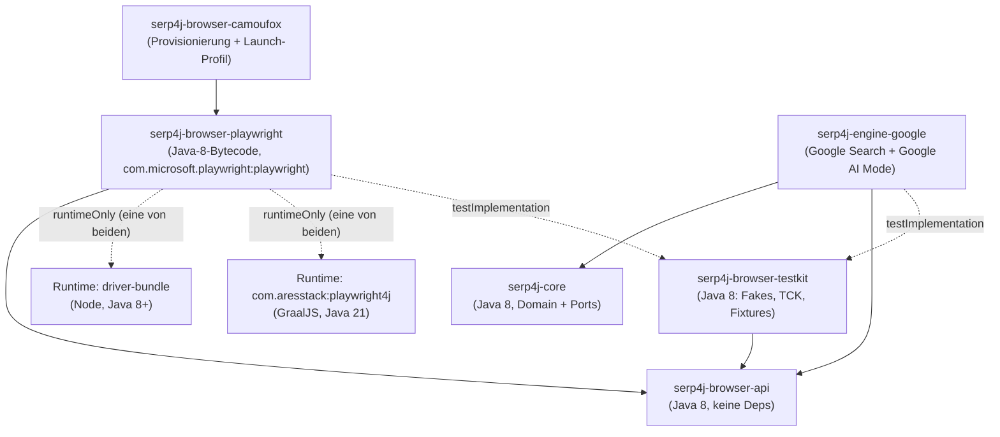
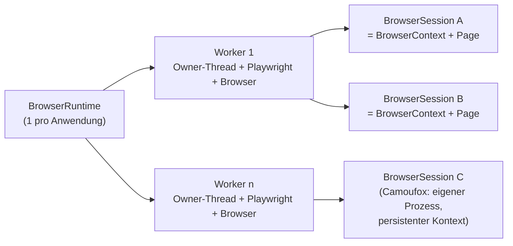
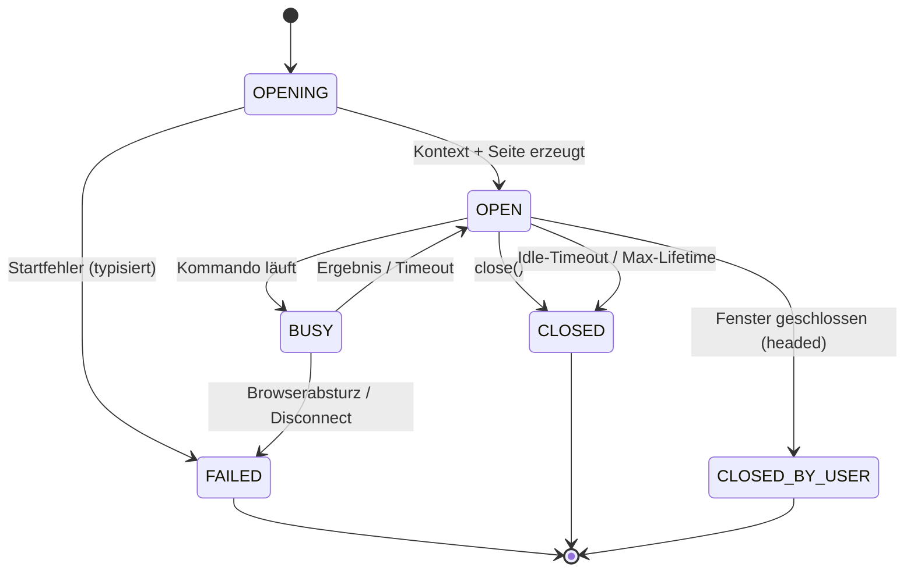
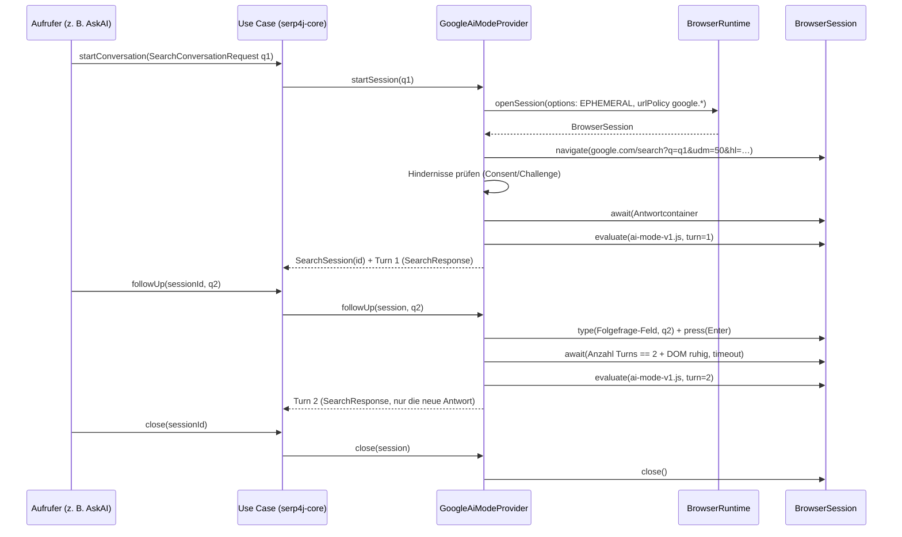

# WP3 – Browser-Architektur (optionales Browsermodul)

> **Status:** Architekturvorschlag (Entwurf für die Integrationsphase), **keine Implementierung**.
> **Arbeitspaket:** WP3 – Browser & Playwright
> **Stand:** 2026-10-31
> **Abhängigkeiten zu anderen WPs:** WP1 (Datenmodell: `SerpFeature`, Zitate/Quellen), WP2 (Ports:
> `SearchProvider`, `ConversationalSearchProvider`, `SearchSession`, `SearchCapabilities`), WP4 (Modulbaum,
> Java-Baseline je Modul, optionale Dependencies), WP5 (Migration aus AskAI).

---

## 0. Zusammenfassung

1. **Der Browser ist Infrastruktur, kein Suchprovider.** Serp4J bekommt einen eigenen, abhängigkeitsfreien
   Java-8-Port `serp4j-browser-api` (`BrowserRuntime` → `BrowserSession`). Engine-Adapter wie Google Search und
   Google AI Mode hängen **nur** von diesem Port und von `serp4j-core` ab, nie von Playwright.
2. **Empfehlung zur offenen Frage „BrowserSession im Core oder eigene API?“:** eigene API (`serp4j-browser-api`),
   nicht im Core. Der Browser ist ein *getriebener Port der Engine-Adapter*, nicht der Use Cases. Wer nur
   Cloud-Provider nutzt, sieht die Browser-Typen gar nicht.
3. **Playwright Java ist offiziell Java-8-fähig**, braucht aber einen JS-Treiber. Es gibt zwei Treiber-Varianten:
   den offiziellen Node-Treiber (`driver-bundle`, Java 8+) und `com.aresstack:playwright4j` (GraalJS, ohne Node,
   **Java 21**). Der Adapter-Code ist für beide identisch; die Variante wird als Runtime-Abhängigkeit gewählt.
4. **Camoufox ist ein optionales Browser-Backend**, kein Pflichtbestandteil. Es ist ein Firefox-Fork und läuft
   über Playwrights `firefox()`-Pfad. Es gibt zwei Protokollwege (Juggler bzw. WebDriver BiDi), beide mit
   echter Versionskopplung. AskAI nutzt bereits den BiDi-Weg mit einer gepatchten Argos-Distribution.
5. **Netzwerkbeobachtung ist eine optionale Fähigkeit des Ports**, keine Grundannahme. Die primäre
   Extraktionsquelle für Google ist das gerenderte DOM; Netzwerkantworten sind eine zweite Quelle, wo sie
   zuverlässig verfügbar sind (unter BiDi/Firefox ist das noch nicht gesichert, siehe Risiko R6).
6. **Google AI Mode** wird als `ConversationalSearchProvider` modelliert. Eine `SearchSession` ist fest
   („sticky“) an genau eine `BrowserSession` gebunden; der Zustand lebt in der Seite und ist **nicht**
   prozessübergreifend fortsetzbar.
7. **Such-Browser (Serp4J) und Research-Browser (AskAI) bleiben getrennt.** AskAI hat bereits einen
   ausgereiften Research-Browser (`browser-api`, Java-21-Sidecar, Camoufox). Serp4J übernimmt davon nur
   generische Laufzeit-Bausteine (Threading-Modell, Probe, Profil-Leasing, Camoufox-Provisionierung) und
   bleibt dabei unabhängig von AskAI. Die Abhängigkeitsrichtung ist ausschließlich AskAI → Serp4J.

---

## 1. Bestandsaufnahme

### 1.1 Serp4J-Repository

Das Repository `aresstack/Serp4J` ist zum Zeitpunkt dieses Berichts leer (keine Commits). Es gibt keinen
vorhandenen Browser-Code, an den anzuknüpfen wäre.

### 1.2 Vorhandener Browser-Code in AskAI

AskAI enthält bereits einen vollständigen, produktiv getesteten Browser-Stack für den **Research-Agenten**:

| Modul | Java | Inhalt | Relevanz für Serp4J |
|---|---|---|---|
| `browser-api` | 8 | Port `BrowserSession` (`search/open/currentPage/links/follow/back/probe/dismissConsent/renderHud/challengeStatus/close`), `BrowserPageSnapshot`, `BrowserLink`, `UrlSafetyPolicy`, `BrowserLimits`, `BrowserBackendKind`, Domain-Familien (Public Suffix), Search-Settings, Layout-Repair-Typen, `RenderedPageDocument` | Vorbild für Neutralität des Ports, aber **fachlich ein Research-Port** (Seiten besuchen, Links folgen, HUD). Nicht 1:1 übernehmen. |
| `browser-search-analysis` | 8 | Mechanische SERP-Analyse über das neutrale `RenderedPageDocument` (Regionen, Container-Scoring, Ergebnisblöcke, KI-gestützte Layout-Reparatur) | Interessant als generische, engine-unabhängige SERP-Extraktion. Gehört eher zu einem späteren Modul „generische SERP-Extraktion“ als zum Google-Adapter. |
| `browser-static-http` | 8 | jsoup-Backend ohne JavaScript, ausdrücklich **kein** stiller Fallback | Bestätigt das Prinzip „Backend explizit wählen“. |
| `browser-mcp-server-java21` | 21 | Sidecar-Prozess: Playwright Java 1.62 + `playwright4j` 0.3.0 (GraalJS statt Node), Camoufox-Provisionierung (aus Argos übernommen), `BrowserSessionActor` (Owner-Thread + Event-Pump), `ThreadOwnershipGuard`, `PlaywrightCapabilityProbe`, Request-Interception gegen private Ziele, Consent/CAPTCHA-Guards, MCP-Server | **Wichtigste Wissensquelle.** Enthält alle harten Laufzeit-Erkenntnisse (siehe 1.3). |

Bemerkenswert:

- Der Browser-Katalog in AskAI kennt **kein Google** (`BrowserSearchEngineCatalog`: DuckDuckGo, Bing, Custom).
  Google Search und Google AI Mode sind also für Serp4J neu.
- Es gibt **keine Netzwerkbeobachtung** (kein `onResponse`/`waitForResponse`). AskAI extrahiert ausschließlich
  aus dem gerenderten DOM (`RenderedPageDocumentCapture`). Request-Routing wird nur als SSRF-Schutz verwendet.
- Es gibt kein Konzept für dialogorientierte Suche.

### 1.3 Übertragbare Erkenntnisse aus AskAI (belegt im Code bzw. in `problems.md` MCP-P005)

1. **Playwright Java ist nicht threadsicher, und Events werden nur dispatcht, während der Owner-Thread in
   einem Playwright-Aufruf steckt.** AskAI löst das mit einem Actor: ein dedizierter Owner-Thread erzeugt
   `Playwright → Browser → Context → Page`, alle anderen Threads reichen Kommandos über eine Queue ein, und im
   Leerlauf pumpt der Owner-Thread die Event-Schleife. Das deckt sich mit der offiziellen Doku
   ([Playwright Java Multithreading](https://playwright.dev/java/docs/multithreading): „not thread safe“,
   Events nur während der Message-Loop, `waitForTimeout` statt `Thread.sleep`).
   → Für Netzwerkbeobachtung in Serp4J **zwingend**, sonst kommen `onResponse`-Events nie an.
2. **Fat-Jar mit GraalJS/Truffle funktioniert nicht** (`Multi-Release`-Manifest geht verloren, doppelte
   `META-INF/services` kollabieren → „Truffle could not be initialized“). Die `playwright4j`-Variante muss als
   Thin-Jar + `lib/` bzw. über normale Maven-Auflösung ausgeliefert werden.
3. **Ohne JVMCI läuft GraalJS im Interpreter-Modus** (langsamer, Warnung im Log).
4. **Es darf genau eine `com.microsoft.playwright.impl.driver.Driver`-Klasse auf dem Classpath liegen**
   (`playwright4j` ersetzt sie; die upstream-Module `driver`/`driver-bundle` müssen ausgeschlossen werden).
5. **Camoufox startet in AskAI als persistenter Kontext** (`firefox().launchPersistentContext`, Kanal
   `moz-firefox`, also WebDriver BiDi) ohne Playwright-Emulation (Viewport, Farbschema usw.), damit der
   Fingerprint konsistent bleibt. Pro Browserprozess gibt es damit genau **einen** Kontext. Parallele
   Sitzungen erhalten ein temporäres Profil, das beim Schließen gelöscht wird.
6. **Explizite Readiness-Probe statt stiller Fallbacks** (`READY / INCOMPATIBLE_DRIVER /
   DRIVER_BUNDLE_NOT_FOUND / BROWSER_NOT_INSTALLED / BROWSER_START_FAILED`).
7. **Das Schließen des Fensters durch den Nutzer** muss als typisierter Zustand erkannt werden
   (`onDisconnected`/`onClose`), nicht als anonymer „Target closed“.
8. **BiDi-Eigenheit:** Back-Forward-Cache muss für Firefox/BiDi abgeschaltet werden
   (`browser.sessionhistory.max_total_viewers=0`), sonst bleibt `page.url()` nach `goBack` veraltet.

---

## 2. Technische Recherche

### 2.1 Playwright Java

- **Java-Baseline:** Die offizielle Doku nennt „Java 8 or higher“
  ([Installation](https://playwright.dev/java/docs/intro)). Ein Community-PR auf Java 11/JPMS
  ([playwright-java#1165](https://github.com/microsoft/playwright-java/pull/1165)) ist nicht gemerged.
  → Ein Playwright-Adapter mit Java-8-Bytecode ist möglich. **Bei jedem Playwright-Upgrade erneut prüfen**
  (Risiko R9).
- **Treiber:** Playwright Java ist ein Client des Playwright-Core-Treibers (JavaScript). Upstream liefert ihn
  mit Node-Binärdateien aller Plattformen im Artefakt `driver-bundle` aus. Alternative: `playwright4j`
  (aresstack, GraalJS im zweiten Java-Prozess, kein Node, aber Java 21).
- **Remote-Betrieb:** Playwright kann sich per `BrowserType.connect(wsEndpoint)` mit einem entfernten
  Playwright-Server verbinden. Das bietet Prozess- oder Container-Isolation ohne eigenes Protokoll. Client- und
  Serverversion müssen zusammenpassen.
- **Netzwerk-API:** `Page.onRequest/onResponse/onRequestFinished`, `Response.body()`, `Page.waitForResponse`,
  `BrowserContext.route`. Antwortkörper stehen erst **nach Abschluss** der Antwort zur Verfügung. Inkrementelles
  Lesen von Streams ist über die öffentliche Java-API nicht möglich (nur Chromium-CDP, browserspezifisch).

### 2.2 Camoufox – tatsächliche technische Voraussetzungen

Ergebnis der Recherche, nicht vorausgesetzt:

| Aspekt | Befund |
|---|---|
| Was ist es? | Ein Firefox-Fork mit Anti-Fingerprinting-Patches. Playwright startet es über `firefox` mit eigenem `executablePath` ([Camoufox-Doku](https://docsearch.algolia.com/mcp/docs/repo/daijro/camoufox)). |
| Protokoll (upstream) | Camoufox bringt **Playwrights Juggler-Patches** mit (`additions/juggler/`, `0-playwright.patch`). Juggler ist an die Playwright-Version gekoppelt, die die Patches liefert. Ein beliebiges Playwright Java mit beliebigem Camoufox ist **nicht** garantiert kompatibel. |
| Protokoll (AskAI/Argos) | AskAI startet Camoufox über den Kanal `moz-firefox` (**WebDriver BiDi**). Dafür sind zwei BiDi-Fixes nötig (daijro/camoufox#952), die in **keinem** offiziellen Camoufox-Release enthalten sind. Argos liefert deshalb eine eigene, per SHA-256 gepinnte Distribution `camoufox-156.0.1-beta.36-argos.2` (Windows x86_64 und Linux x86_64, **kein macOS, kein ARM**). |
| BiDi-Reife in Firefox | Mozillas Meta-Bug „Support WebDriver BiDi in Playwright“ ([Bug 1917540](https://bugzilla.mozilla.org/show_bug.cgi?id=1917540)) ist offen. Mehrere Emulations- und Screencast-Funktionen fehlen noch. |
| Offizielle Sprachen | Python (offizielles Paket) und Node-Beispiele. **Kein offizieller Java-Support.** Der Remote-Server-Modus (`python -m camoufox server`) ist laut Doku „experimental“ und nutzt „undocumented Playwright methods“ ([Remote Server](https://camoufox.com/python/remote-server.md)). Er würde zudem Python als Laufzeitvoraussetzung einführen. |
| Fingerprint-Konfiguration | Über Umgebungsvariablen `CAMOU_CONFIG_1..n`, `CAMOU_PREFS_1..n` und Firefox-Prefs. In AskAI liegt ein eingebautes Profil (`camoufox/default-launch.json`) vor. |
| Java-Code in AskAI | `CamoufoxLaunch` ist ein `record`, nutzt `HexFormat` und `Files.readString` (also Java 17+). Für ein Java-8-Modul wäre ein Backport nötig. |

**Schlussfolgerung:** Camoufox ist in Java nur praktikabel über (a) eine gepinnte, selbst verifizierte
Distribution plus Playwright-`firefox()` mit genau passender Playwright-Version oder (b) einen entfernten
Playwright-Server. Beides ist Betriebsaufwand und gehört deshalb in ein eigenes, optionales Modul.

### 2.3 Google Search und Google AI Mode

- **Google Search** (klassische SERP): `https://www.google.com/search?q=…&hl=…&gl=…`. Das HTML ist stark
  dynamisch und die Klassennamen sind obfuskiert und wechseln häufig. Hinzu kommen Consent-Seiten
  (`consent.google.com`, EU) und Rate-Limit-/CAPTCHA-Seiten (`/sorry/…`).
- **Google AI Mode:** Er wird über `udm=50` auf der normalen Such-URL aktiviert. Die Antwort wird per JavaScript
  generiert, Quellen und Zitate werden eingeblendet, Folgefragen sind im Dialog möglich
  ([Bright Data: Scrape Google AI Mode](https://brightdata.com/blog/ai/scrape-google-ai-mode.md)). Öffentlich
  dokumentierte Selektoren (z. B. `div[data-subtree="aimc"]`) haben keine Stabilitätszusage. Wie Folgefragen
  technisch übertragen werden (Request-Format, Streaming, Session-Token), ist **nicht öffentlich dokumentiert**
  und muss per Spike ermittelt werden.
- **Rechtliches:** Automatisierte Abfragen der Google-Oberfläche verstoßen gegen Googles Nutzungsbedingungen.
  Das ist eine Produkt- und Haftungsentscheidung von Angelo, keine technische (Risiko R1).

---

## 3. Architekturentscheidungen (Vorschläge)

| ID | Entscheidung | Begründung | Alternative |
|---|---|---|---|
| **B-1** | `BrowserSession` und `BrowserRuntime` liegen in einem eigenen Modul `serp4j-browser-api` (Java 8, **keine** Dependencies), **nicht** in `serp4j-core`. | Der Browser ist ein getriebener Port der *Engine-Adapter*, nicht der Use Cases. Der Core bleibt frei von Browserbegriffen, und Cloud-Nutzer sehen sie nicht. Der Port kann sich in eigenem Tempo entwickeln. | Paket `com.aresstack.serp4j.browser` im Core. Das ist einfacher, belastet aber den Core-API-Vertrag mit Browserbegriffen. |
| **B-2** | Engine-Adapter (Google) hängen nur von `serp4j-core` + `serp4j-browser-api` ab. | Das ist Angelos Vorgabe: Google AI nutzt den Port, nicht Playwright. Damit sind die Adapter mit einer Fake-Session offline testbar. | – |
| **B-3** | Ein Playwright-Adapter `serp4j-browser-playwright` (Java-8-Bytecode). Die Treiberwahl erfolgt über eine **Runtime-Abhängigkeit**: `driver-bundle` (Node, Java 8+) **oder** `playwright4j` (Java 21). | Es entsteht kein doppelter Adapter-Code, und Java 8 bleibt möglich. Wer Node vermeiden will, nimmt `playwright4j`. | Zwei getrennte Adapter. Das wäre unnötige Duplizierung. |
| **B-4** | Camoufox lebt in einem eigenen Modul `serp4j-browser-camoufox` (Provisionierung, Verifikation, Launch-Profil) und ist eine **Backend-Option** des Playwright-Adapters. | Es ist das größte Betriebs- und Versionsrisiko und darf niemandem aufgezwungen werden. Chromium/Chrome/Edge funktionieren ohne Camoufox. | Camoufox im Playwright-Modul. Das würde Jackson, Download-Logik und Plattformbeschränkungen in jeden Browsernutzer ziehen. |
| **B-5** | Die primäre Extraktion erfolgt aus dem **DOM** per injiziertem Skript, das strukturierte Werte liefert. **Netzwerkbeobachtung ist sekundär und optional** (Capability). | DOM ist auf allen Backends verfügbar. Netzwerkkörper sind unter BiDi unsicher und bei gestreamten Antworten erst am Ende verfügbar. | Netzwerk-first. Das wäre stabiler gegen CSS-Änderungen, aber backendabhängig. |
| **B-6** | Thread-Modell: **Jede `BrowserSession` gehört genau einem Owner-Thread** (Actor). Der Port ist synchron und blockierend mit Timeouts, und Aufrufe aus beliebigen Threads werden serialisiert. Asynchronität entsteht oberhalb (Application-Layer, `CompletableFuture`). | Das ist bewährt in AskAI und entspricht der Playwright-Doku. Netzwerk-Events brauchen die Event-Pump. | Asynchroner Port. Er würde Playwrights Threading-Einschränkung nur verstecken. |
| **B-7** | Session-Isolation über `IsolationLevel { CONTEXT, PROCESS }` als Runtime-Fähigkeit: Chromium isoliert pro `BrowserContext`, Camoufox (persistenter Kontext) pro Prozess. | Das bildet die tatsächliche Technik ab, statt Gleichheit vorzutäuschen. | – |
| **B-8** | Google AI Mode = `ConversationalSearchProvider`. Eine `SearchSession` ist **sticky** an eine `BrowserSession` gebunden und nicht persistierbar. | Der Dialogzustand lebt in der Seite bzw. bei Google. Er ist nicht serialisierbar, ohne undokumentierte Interna zu nutzen. | Die Konversations-URL wiederverwenden. Das ist unklar und wird per Spike geprüft (Q5). |
| **B-9** | **Keine automatische CAPTCHA-Lösung**, kein Umgehen von Schutzmaßnahmen als Bibliotheksfunktion. Hindernisse werden typisiert gemeldet. Die Policy ist entweder `FAIL_FAST` oder `WAIT_FOR_HUMAN` (nur im sichtbaren Modus). | Das sind rechtliche und ethische Grenzen. Es entspricht auch der bisherigen AskAI-Linie (manuelles Lösen im Browser). | – |
| **B-10** | Such-Browser (Serp4J) und Research-Browser (AskAI) bleiben getrennte Ports. AskAI darf Serp4J-Browsermodule später als Laufzeit nutzen, umgekehrt nie. | Serp4J beschafft Suchergebnisse und besucht keine Fundseiten (Produktabgrenzung). | Ein gemeinsamer Port. Er würde Serp4J zum Research-Werkzeug aufblähen. |
| **B-11** | Standardmäßig In-Process-Betrieb. Optional `RemotePlaywrightRuntime` über `BrowserType.connect(ws)`. Kein eigener Sidecar/MCP-Server in Serp4J. | Eine Bibliothek soll keine Prozesse orchestrieren müssen. Wer Isolation will, nutzt Playwrights eigenen Server bzw. einen Container. AskAIs Sidecar bleibt AskAI-Sache. | Den AskAI-Sidecar übernehmen. Er ist an MCP und Solon gebunden und damit zu AskAI-spezifisch. |

---

## 4. Modulschnitt (Vorschlag an WP4)



Regeln:

- `serp4j-core` kennt **kein** Browsermodul.
- `serp4j-browser-api` kennt **nicht** `serp4j-core`. Der Browser-Port spricht nur über Browserbegriffe (URL,
  Seite, Element, Netzwerk), nie über `SearchResponse`. So bleibt er auch für andere Konsumenten nutzbar
  (z. B. später AskAI).
- `serp4j-engine-google` kennt **kein** Playwright. Die Laufzeit wird vom Anwender injiziert:

  ```java
  BrowserRuntime runtime = PlaywrightBrowserRuntime.builder()
          .backend(BrowserBackend.chromium())          // oder CamoufoxBackend.managed(...)
          .headless(true)
          .maxConcurrentSessions(2)
          .build();
  SearchProvider google = GoogleSearchProvider.builder().browser(runtime).build();
  ConversationalSearchProvider aiMode = GoogleAiModeProvider.builder().browser(runtime).build();
  ```
- Der Anwender bindet in Gradle/Maven **genau eine** Treiber-Runtime ein. Die Exklusionsregel für
  `playwright4j` (upstream `driver`/`driver-bundle` ausschließen) muss WP4 als dokumentiertes Rezept oder als
  BOM bzw. Platform-Constraint lösen (offene Frage Q2).
- Die Java-Baseline je Modul legt WP4 fest. Vorschlag: `browser-api`, `browser-testkit`, `browser-playwright`
  und `engine-google` mit Java 8. `browser-camoufox` mit Java 8 (Backport) **oder** Java 11 (Entscheidung Q3).

Optional später (nicht Teil der ersten Implementierung): `serp4j-serp-extraction` als generische,
engine-unabhängige SERP-Analyse nach dem Vorbild von AskAIs `browser-search-analysis`.

---

## 5. Port-Verträge (Java 8)

Paket: `com.aresstack.serp4j.browser`. Alle Wertobjekte sind unveränderlich, haben Builder und keine
Playwright-Typen. Die folgenden Signaturen sind Vorschläge für die Integrationsphase, kein finaler Code.

### 5.1 Laufzeit und Sitzung

```java
/** Schwergewichtige, langlebige Browser-Infrastruktur (ein Treiber, ggf. mehrere Browserprozesse). */
public interface BrowserRuntime extends AutoCloseable {

    /** Statische Beschreibung: Backend, Engine-Familie, Version, Fähigkeiten. Löst keinen Start aus. */
    BrowserRuntimeInfo info();

    /** Explizite Bereitschaftsprüfung ohne stillen Fallback (vgl. AskAI PlaywrightCapabilityProbe). */
    BrowserReadiness probe();

    /**
     * Öffnet eine isolierte Sitzung. Blockiert höchstens options.acquireTimeout(), wenn das Limit
     * paralleler Sitzungen erreicht ist, und wirft dann BrowserCapacityException.
     */
    BrowserSession openSession(BrowserSessionOptions options) throws BrowserException;

    /** Schließt alle offenen Sitzungen und beendet Browser und Treiber. Idempotent. */
    @Override
    void close();
}

/**
 * Eine isolierte Browsersitzung (Cookies, Storage, History) mit genau einer aktiven Seite.
 * Threadsicher im Sinne von "serialisiert": Aufrufe aus beliebigen Threads werden auf den Owner-Thread
 * der Sitzung geleitet. Alle Methoden blockieren bis zum Ergebnis oder Timeout.
 */
public interface BrowserSession extends AutoCloseable {

    BrowserSessionId id();

    BrowserSessionState state();              // OPEN, BUSY, CLOSED, FAILED, CLOSED_BY_USER

    NavigationResult navigate(NavigationRequest request) throws BrowserException;

    /** Wartet auf eine Bedingung (Selektor sichtbar, DOM ruhig, URL-Muster, Netzwerk ruhig ...). */
    WaitOutcome await(WaitCondition condition, Duration timeout) throws BrowserException;

    /** Führt ein seitenseitiges Skript aus und liefert ein neutrales Wertobjekt (kein JSON-Framework). */
    BrowserValue evaluate(PageScript script) throws BrowserException;

    /** Minimale Interaktion, die Engine-Adapter brauchen (Folgefrage eingeben, Absenden, Consent). */
    void click(ElementSelector selector, InteractionOptions options) throws BrowserException;
    void type(ElementSelector selector, String text, InteractionOptions options) throws BrowserException;
    void press(ElementSelector selector, String key) throws BrowserException;

    /** Gerenderter Zustand (URL, Titel, optional HTML/Text, begrenzt durch SnapshotOptions). */
    PageSnapshot snapshot(SnapshotOptions options) throws BrowserException;

    /**
     * Optionale Fähigkeit: liefert eine Netzwerkbeobachtung, falls
     * info().capabilities() NETWORK_OBSERVATION enthält, sonst UnsupportedBrowserCapabilityException.
     */
    NetworkObserver network() throws BrowserException;

    /** Schließt Seite und Kontext (bzw. bei PROCESS-Isolation den Browserprozess). Idempotent. */
    @Override
    void close();
}
```

### 5.2 Wertobjekte (Auswahl)

```java
public final class BrowserSessionOptions {           // Builder
    Locale locale();                                 // Accept-Language / UI-Sprache, sofern das Backend emuliert
    Optional<String> geoHint();                      // nur Hinweis; viele Backends können es nicht
    ProfileMode profileMode();                       // EPHEMERAL (Default) | PERSISTENT_EXCLUSIVE(profileKey)
    Duration acquireTimeout();
    Duration defaultTimeout();
    UrlPolicy urlPolicy();                           // Allowlist der Engine (z. B. nur google.*-Domains)
    ObstaclePolicy obstaclePolicy();                 // FAIL_FAST | WAIT_FOR_HUMAN(timeout)
    Set<BrowserCapability> requiredCapabilities();   // fail fast, wenn das Backend sie nicht hat
}

public enum BrowserCapability {
    JAVASCRIPT,
    NETWORK_OBSERVATION,          // onResponse + body()
    NETWORK_INTERCEPTION,         // route/abort
    LOCALE_EMULATION,
    HEADED_MODE,                  // sichtbares Fenster, nötig für WAIT_FOR_HUMAN
    PERSISTENT_PROFILE,
    PARALLEL_SESSIONS
}

public enum IsolationLevel { CONTEXT, PROCESS }

public final class BrowserRuntimeInfo {
    String backendId();                 // "playwright-chromium", "playwright-camoufox", "remote-playwright", "fake"
    EngineFamily engineFamily();        // CHROMIUM, FIREFOX, WEBKIT
    String browserVersion();
    IsolationLevel isolationLevel();
    int maxConcurrentSessions();
    Set<BrowserCapability> capabilities();
}

/** Neutraler Werte-Baum für evaluate(): null, Boolean, Number, String, List, Map. Kein Gson/Jackson im Port. */
public final class BrowserValue { /* asString(), asList(), asMap(), path("a", 0, "b") ... */ }

public final class ElementSelector {                // nur CSS oder Text-Locator, keine Playwright-Locator-Syntax
    static ElementSelector css(String css);
    static ElementSelector role(String role, String accessibleName);
}

public final class NavigationResult {
    String requestedUrl(); String finalUrl(); int httpStatus(); Duration elapsed();
    PageObstacle obstacle();            // NONE, CONSENT, CHALLENGE, BLOCKED, UNKNOWN (generisch erkannt)
}
```

Hinweis zu `PageObstacle`: Die Browser-API meldet nur generische Signale (HTTP-Status, Weiterleitung auf eine
fremde Domain). Die **engine-spezifische** Erkennung (z. B. `consent.google.com`, `/sorry/`) liegt im
Engine-Adapter.

### 5.3 Netzwerkbeobachtung

```java
public interface NetworkObserver {

    /** Beginnt die Aufzeichnung passender Antworten. Mehrere Captures pro Sitzung sind erlaubt. */
    NetworkCapture start(NetworkFilter filter);
}

public interface NetworkCapture extends AutoCloseable {

    /** Bisher abgeschlossene Austausche (Snapshot, unveränderlich). */
    List<ObservedExchange> exchanges();

    /** Wartet auf den ersten passenden, vollständig empfangenen Austausch. */
    Optional<ObservedExchange> awaitFirst(NetworkFilter filter, Duration timeout) throws BrowserException;

    /** Wartet, bis für quietPeriod keine passende Anfrage mehr offen ist ("Netzwerk ruhig"). */
    WaitOutcome awaitQuiet(Duration quietPeriod, Duration timeout) throws BrowserException;

    @Override
    void close();
}

public final class NetworkFilter {                   // Builder
    List<String> urlPatterns();                      // Glob/Regex auf die URL
    Set<String> resourceTypes();                     // document, xhr, fetch, ...
    Set<String> contentTypes();                      // application/json, text/html ...
    boolean captureBody();
    int maxBodyBytes();                              // harte Obergrenze, Default z. B. 2 MiB
}

public final class ObservedExchange {
    String method(); String url(); int status();
    Map<String, String> responseHeaders();           // gefiltert, keine Cookies/Set-Cookie
    Optional<byte[]> body();                         // nur wenn captureBody und innerhalb maxBodyBytes
    boolean bodyTruncated();
    Instant finishedAt();
}
```

Vertragliche Regeln:

- Aufgezeichnete Körper bleiben **in der Sitzung** und werden beim Schließen verworfen. Serp4J persistiert
  keine Rohdaten, solange der Aufrufer das nicht ausdrücklich verlangt.
- `Cookie`/`Set-Cookie`/`Authorization` werden nie herausgegeben.
- Gestreamte Antworten erscheinen erst nach Abschluss. Für „Antwort fertig?“ wird deshalb DOM-Stabilität
  genutzt, nicht der Stream (siehe 7.3).

### 5.4 Test-Kit

`serp4j-browser-testkit` enthält:

- `FakeBrowserRuntime`/`FakeBrowserSession`, die aufgezeichnete Seiten (HTML-Fixture + optionale Netzwerk-
  Fixtures) ausliefern und `evaluate()` gegen ein statisches DOM simulieren. Für `evaluate` ist das nur
  eingeschränkt möglich. Engine-Adapter sollten ihre Extraktion deshalb so schneiden, dass das Skript ein
  Rohobjekt liefert und das Mapping in Java getestet wird.
- Ein **TCK** (abstrakte JUnit-Contract-Tests), das jedes Backend erfüllen muss: Navigation, Timeouts,
  idempotentes Close, Isolation zweier Sitzungen, Erkennen eines geschlossenen Browsers, URL-Policy nach
  Redirect und, falls deklariert, Netzwerkbeobachtung.
- Live-Tests sind wie in AskAI per `Assume` an `probe() == READY` gekoppelt. Ohne Browser werden sie lesbar
  übersprungen, nie still grün.

---

## 6. Lifecycle, Threading und parallele Sitzungen

### 6.1 Objektgraph



- **Worker** = ein Owner-Thread mit eigener `Playwright`-Instanz und einem Browserprozess. Das entspricht der
  Doku-Empfehlung „eine Playwright-Instanz pro Thread“.
- **Chromium/Chrome/Edge:** Ein Worker kann mehrere Sitzungen als getrennte `BrowserContext`e halten
  (Isolation `CONTEXT`). Weil alle Sitzungen eines Workers über denselben Owner-Thread laufen, serialisieren
  sie sich. Für echte Parallelität werden mehrere Worker konfiguriert (`workers`, `sessionsPerWorker`).
- **Camoufox:** Ein persistenter Kontext entspricht einem Prozess und damit einer Sitzung (Isolation
  `PROCESS`). Parallele Sitzungen bedeuten parallele Browserprozesse mit eigenem, temporärem Profil, wie in
  AskAI.
- **Remote:** Die Worker verbinden sich per `connect(ws)` statt `launch()`, sonst gilt dasselbe Modell.

### 6.2 Zustände einer Sitzung



### 6.3 Regeln

1. **Lazy Start:** Die Runtime startet Treiber und Browser erst beim ersten `openSession`. `probe()` darf
   einen Probestart ausführen, aber nur auf ausdrücklichen Aufruf.
2. **Einheitliche Abbaureihenfolge:** Page → Context → Browser → Playwright (beendet den Treiberprozess).
   Zusätzlich gibt es einen JVM-Shutdown-Hook als Sicherheitsnetz und ein Close-Timeout. Bleibt der Prozess
   hängen, wird er hart beendet und das protokolliert.
3. **Budgets je Sitzung:** `maxLifetime`, `idleTimeout`, `maxNavigations`. Bei Überschreitung wird die Sitzung
   geschlossen, und der nächste Aufruf meldet `SessionExpired`.
4. **Event-Pump:** Wartet ein Worker im Leerlauf, pumpt er Playwright-Events mit kurzen
   `waitForTimeout`-Scheiben (AskAI: 50 ms). Event-Callbacks dürfen nie selbst ein Kommando einreihen und
   darauf warten (Deadlock).
5. **Kapazität:** `maxConcurrentSessions` ist ein hartes Semaphore-Limit. Bei Überschreitung wartet der
   Aufrufer höchstens `acquireTimeout` und erhält dann `BrowserCapacityException`. Es gibt keine unbegrenzte
   Queue.
6. **Profile:** Default ist `EPHEMERAL`. `PERSISTENT_EXCLUSIVE(profileKey)` wird per Dateisperre geleast
   (AskAI: `ProfileLease`). Ein persistentes Profil darf nie von zwei Sitzungen gleichzeitig benutzt werden.
   Das ist relevant, wenn Consent-Cookies erhalten bleiben sollen.
7. **Ressourcen:** Jede Chromium-Sitzung kostet grob 100–300 MB RAM, ein Camoufox-Prozess deutlich mehr
   (Schätzung, per Spike zu messen). Die Defaults sind deshalb konservativ: 1 Worker, 2 Sitzungen.

---

## 7. Google-Adapter über den Browser-Port

### 7.1 Schnitt

`serp4j-engine-google` enthält zwei Provider mit getrennter Fähigkeit (Bezeichner sind Vorschläge, abhängig
von WP1/WP2):

| Provider | Port (WP2) | Engine | Capabilities (Auszug) |
|---|---|---|---|
| `GoogleBrowserSearchProvider` | `SearchProvider` | `GOOGLE` | `ORGANIC_RESULTS`, `SERP_FEATURES`, `REQUIRES_BROWSER`, `LOCALE` |
| `GoogleAiModeProvider` | `ConversationalSearchProvider` | `GOOGLE_AI_MODE` (bzw. `GOOGLE` + Modus) | `CONVERSATIONAL`, `AI_ANSWER`, `CITATIONS`, `REQUIRES_BROWSER` |

Beide nutzen intern dieselben Bausteine: `GoogleUrlBuilder`, `GoogleObstacleDetector` (Consent, `/sorry/`,
Login), `GoogleConsentHandler` (nur die eindeutig ablehnende Option, wenn per Konfiguration erlaubt) und
versionierte Extraktionsskripte.

### 7.2 Extraktion (beide Provider)

```
Navigation ──► Hinderniserkennung ──► Warten auf Bereitschaft ──► Extraktion ──► Mapping ──► SearchResponse
                     │                                              │
                     └─ CONSENT / CHALLENGE → ObstaclePolicy        ├─ 1. DOM-Skript (primär)
                                                                     ├─ 2. Netzwerk-JSON (optional, wenn Capability + Muster bekannt)
                                                                     └─ 3. Text-Fallback (markiert als degradiert)
```

- **Extraktionsskripte sind Daten, kein Java-Code:** versionierte Ressourcen (`google/serp-v1.js`,
  `google/ai-mode-v1.js`), die einen neutralen Rohbaum liefern. Das Mapping auf `SearchData` (WP1) geschieht in
  Java und ist mit Fixtures testbar. So lässt sich ein Google-Layoutwechsel durch Austausch des Skripts beheben.
- **Ankern an Semantik statt an obfuskierten Klassen:** ARIA-Rollen, `data-*`-Attribute, Linkstruktur
  (`a[href]` mit `h3`) und Überschriften.
- **Degradation wird sichtbar gemacht:** Fehlen erwartete Strukturen, liefert der Adapter ein Ergebnis mit
  `SearchMetadata`-Hinweis „extraction degraded“ (Feld abhängig von WP1) statt still leerer Listen. Wurde gar
  nichts erkannt, gibt es einen typisierten Fehler.
- **KI-Antworten sind Suchdaten, keine Analyse** (Angelos Regel 4): AI Overview bzw. die AI-Mode-Antwort und
  ihre Zitate werden `SerpFeature`s bzw. Quellen innerhalb von `SearchData`. Nichts davon landet in
  `SearchAnalysis`.
- **Rohartefakte** (HTML, Screenshot, Netzwerk-JSON) gibt es nur auf ausdrücklichen Wunsch (Debug-Option) und
  größenbegrenzt. Sie fließen nie automatisch in die Antwort.

### 7.3 Google AI Mode: Dialog und Folgefragen



Regeln:

1. **Sticky Binding:** Der Provider hält eine interne Zuordnung `SearchSessionId → BrowserSession`. Die
   Domain-`SearchSession` (WP2) enthält keinen Browserbezug, nur Id, Turns und Status.
2. **Nur der neue Turn wird extrahiert.** Turns werden über ihre Position im Dialog identifiziert. Frühere Turns
   werden nicht erneut gemappt, können aber zur Konsistenzprüfung gezählt werden.
3. **Fertig-Erkennung:** Antwortcontainer vorhanden, kein Lade- bzw. „Stop“-Indikator mehr und keine
   DOM-Mutation im Antwortcontainer für eine Ruhezeit (z. B. 1,5 s), optional zusätzlich Netzwerk ruhig.
   Beim Timeout wird die Teilantwort mit `complete=false` (Metadaten) geliefert, nicht verworfen.
4. **Folgefragen sind seriell.** Eine zweite Folgefrage, während eine läuft, ergibt einen
   `ConcurrentTurnException`.
5. **Lebensdauer:** `idleTimeout` (z. B. 10 min), `maxTurns` (z. B. 20) und `maxLifetime`. Danach gilt
   `SessionExpired`. Ein Browserabsturz oder ein geschlossenes Fenster bedeutet `SessionLost`, und die
   Sitzung ist **nicht** wiederherstellbar. Der Aufrufer kann eine neue Sitzung mit dem bisherigen Verlauf als
   Kontext starten, aber das ist seine Entscheidung.
6. **Isolation:** Jede `SearchSession` bekommt standardmäßig eine eigene ephemere `BrowserSession`. Zwei
   Dialoge teilen sich nie einen Kontext, sonst vermischt Google die Verläufe.
7. **Keine Anmeldung:** AI Mode wird ohne Google-Konto genutzt. Ist AI Mode für Region, Sprache oder Konto nicht
   verfügbar, meldet der Provider `CapabilityUnavailable` statt einer leeren Antwort (offene Frage Q6).

---

## 8. Such-Browser (Serp4J) vs. Research-Browser (AskAI)

| | Such-Browser (Serp4J) | Research-Browser (AskAI) |
|---|---|---|
| Zweck | SERPs und KI-Suchantworten **beschaffen** | Fundseiten **besuchen**, lesen, Links folgen, Belege sammeln |
| Navigationsziel | nur Domains der jeweiligen Engine (Allowlist) | beliebige öffentliche Webseiten (SSRF-Schutz) |
| Port | `serp4j-browser-api` (`BrowserRuntime`/`BrowserSession`, niedrige Ebene) | AskAI `browser-api` (`search/open/follow/back/probe/HUD`, Research-Ebene) |
| Ergebnis | strukturierte `SearchResponse` | `BrowserPageSnapshot`, Captures für die Wissenspipeline |
| UI im Browser | keine | Research-HUD, manuelle Freigaben |
| Prozessmodell | In-Process-Bibliothek (optional Remote-Playwright) | Java-21-Sidecar über MCP |

**Trennung ohne Abhängigkeit zu AskAI:**

- Serp4J übernimmt die **Ideen** und, wo sinnvoll, generische Klassen aus AskAI (Actor/Owner-Thread,
  Capability-Probe, Profil-Leasing, Startfehler-Report, Camoufox-Provisionierung) als **Kopie mit neuer
  Paketstruktur** `com.aresstack.serp4j.browser.*`. Es entsteht keine Laufzeit- oder Build-Abhängigkeit zu
  AskAI.
- AskAI kann später entscheiden, seinen Sidecar auf `serp4j-browser-playwright` umzustellen (AskAI → Serp4J).
  Das ist ausdrücklich **nicht** Teil der Serp4J-Migration (Abstimmung mit WP5).
- Die Browser-Suche von AskAI (DuckDuckGo/Bing über den Research-Browser) kann später durch Serp4J-Engine-
  Adapter ersetzt werden. Der Research-Browser bleibt dann für das Besuchen der Fundseiten zuständig.
- **Dreifach-Kopie-Problem Camoufox:** Der Camoufox-Code existiert bereits in Argos und AskAI. Eine dritte
  Kopie in Serp4J erhöht den Pflegeaufwand. Empfehlung: Provisionierung und Launch in eine eigene kleine
  Bibliothek auslagern (z. B. im `playwright4j`-Umfeld oder als `camoufox-java`), die Argos, AskAI und Serp4J
  gemeinsam nutzen (offene Frage Q4).

---

## 9. Sicherheit und Betrieb

- **URL-Policy je Sitzung:** Engine-Adapter setzen eine Allowlist (z. B. `google.<tld>`, `consent.google.com`,
  `gstatic.com`). Geprüft wird vor der Navigation **und** auf der finalen URL nach Redirects (wie AskAI).
  Navigationen außerhalb der Allowlist werden abgebrochen.
- Downloads sind verboten, Popups werden sofort geschlossen, und es gibt keine `file:`/`data:`-Navigation
  durch Adapter.
- `PLAYWRIGHT_SKIP_BROWSER_DOWNLOAD=1` ist Standard: Serp4J lädt **nie** implizit Browser herunter. Der
  einzige Download ist die ausdrücklich konfigurierte, gepinnte und per SHA-256 verifizierte
  Camoufox-Distribution (wie AskAI).
- Logs enthalten keine Cookies, Header-Geheimnisse oder Antwortkörper. Treiber-Stacktraces gehen in ein
  Diagnoseprotokoll, nicht in Exceptions an den Aufrufer.
- Rate-Limiting und Backoff gehören in den Engine-Adapter (pro Engine und Runtime), damit nicht mehrere
  Sitzungen parallel Google fluten.

---

## 10. Technische Risiken

| ID | Risiko | Eintritt / Wirkung | Gegenmaßnahme |
|---|---|---|---|
| **R1** | **Nutzungsbedingungen von Google** untersagen automatisierte Abfragen. Anti-Fingerprinting (Camoufox) verschärft die Frage. | hoch / rechtlich | Produktentscheidung durch Angelo. Module klar als optional kennzeichnen, keine Umgehungsfunktionen (B-9). Für produktive Nutzung SERP-APIs bevorzugen (Bright Data, DataForSEO bieten Google und z. T. AI Mode als API). |
| **R2** | **DOM-Instabilität** von Google (obfuskierte Klassen, A/B-Tests, regionale Varianten). | hoch / Extraktion bricht still | Versionierte Skripte, semantische Anker, Degradationsmeldung, Fixture-Regressionstests, periodischer Live-Smoke-Test. |
| **R3** | **CAPTCHA und Rate-Limits** (`/sorry/`), besonders headless und aus Rechenzentren. | hoch / Ausfall | Typisierte `CHALLENGE`-Meldung, `WAIT_FOR_HUMAN` nur im sichtbaren Modus, Backoff, konservative Parallelität. |
| **R4** | **Camoufox-Distribution** hängt an einer eigenen Argos-Neuverpackung mit nicht gemergten BiDi-Fixes. Nur Windows/Linux x86_64. | mittel / Betriebsaufwand | Eigenes optionales Modul, Pinning, Verifikation, gemeinsame Bibliothek (Q4). Klare Plattformmatrix. |
| **R5** | **Versionskopplung** Playwright ↔ Juggler bzw. BiDi ↔ Camoufox ↔ `playwright4j`-Core. | hoch / Start schlägt fehl | Kompatibilitätsmatrix im Build festschreiben, Probe meldet `INCOMPATIBLE_DRIVER`, CI-Job pro unterstützter Kombination. |
| **R6** | **Netzwerkbeobachtung unter BiDi/Firefox** (`Response.body()`) ist möglicherweise unvollständig. Gestreamte Antworten sind erst am Ende verfügbar. | mittel / Feature fehlt auf Camoufox | Netzwerk nur als optionale Capability (B-5), DOM primär. Spike S2. |
| **R7** | **Threading-Fallen** in Playwright Java (Events nur während der Message-Loop, Deadlocks in Callbacks). | mittel / hängende Sitzungen | Actor-Modell, `ThreadOwnershipGuard`, TCK-Tests für Event-Zustellung im Leerlauf. |
| **R8** | **Größe des Node-`driver-bundle`** (Node-Binärdateien aller Plattformen) im Anwenderprojekt. | mittel / Distribution | Treiber nur als Runtime-Option. Plattformspezifische Varianten bzw. `playwright4j` dokumentieren. Größe in S1 messen. |
| **R9** | **Java-8-Baseline** von Playwright Java kann in künftigen Versionen entfallen. `playwright4j` verlangt bereits Java 21. | mittel / Baseline-Bruch | Baseline je Release prüfen. Gegebenenfalls Browsermodule auf Java 11/17 anheben, ohne den Core zu berühren (Modultrennung macht das möglich). |
| **R10** | **GraalJS ohne JVMCI** ist langsam, und Fat-Jars sind mit Truffle nicht möglich. | mittel / Performance, Packaging | Thin-Jar bzw. Maven-Auflösung, Hinweis auf GraalVM-JDK. Fat-Jar-Nutzern die Node-Variante empfehlen. |
| **R11** | **Fertig-Erkennung** gestreamter KI-Antworten ist heuristisch. | mittel / abgeschnittene Antworten | `complete`-Flag in den Metadaten, konfigurierbare Ruhezeit, Fixtures mit Teilantworten. |
| **R12** | **Ressourcenbedarf** paralleler Sitzungen (RAM/CPU), verwaiste Browserprozesse. | mittel / Stabilität | Hartes Limit, Close-Timeouts mit Hard-Kill, Shutdown-Hook, TCK-Test „keine verwaisten Prozesse“. |
| **R13** | **Verfügbarkeit von AI Mode** nach Land, Sprache oder Konto, sowie mögliche Login-Pflicht. | mittel / Feature nicht nutzbar | Probe-Abfrage beim Start, `CapabilityUnavailable`, Q6 klären. |
| **R14** | **Dreifache Camoufox-Codebasis** (Argos, AskAI, Serp4J) driftet auseinander. | mittel / Wartung | Q4: gemeinsame Bibliothek. |

---

## 11. Offene Fragen (für die Integrationsphase bzw. Angelo)

| ID | Frage | Vorschlag |
|---|---|---|
| **Q1** | Liegt `BrowserSession` im Core oder in einer eigenen Browser-API? | Eigene API `serp4j-browser-api` (B-1). |
| **Q2** | Wie wird die Treiberwahl (Node vs. `playwright4j`) für Gradle **und** Maven sauber ausgedrückt (Exclusions, BOM, Gradle-Capabilities)? | WP4 klärt das. Vorschlag: zwei dünne Runtime-Module (`serp4j-browser-runtime-node`, `serp4j-browser-runtime-graal`) mit vordefinierten Exclusions. |
| **Q3** | Java-Baseline für `serp4j-browser-camoufox`: Backport nach Java 8 oder Java 11+? | Java 11 reicht praktisch: Camoufox setzt ohnehin einen aktuellen Desktop bzw. Server voraus, und bei `playwright4j` ist es sowieso Java 21. Entscheidung durch Angelo oder WP4. |
| **Q4** | Soll die Camoufox-Provisionierung in eine eigene, gemeinsam genutzte Bibliothek (für Argos, AskAI und Serp4J)? | Ja. Bis dahin ein Serp4J-Modul ohne AskAI-Abhängigkeit. |
| **Q5** | Lässt sich ein AI-Mode-Dialog über eine URL oder ein Token fortsetzen (prozessübergreifend)? | Per Spike S3 prüfen. Bis dahin gilt „nicht persistierbar“ (B-8). |
| **Q6** | Unter welchen Bedingungen ist AI Mode ohne Login in DE/EU verfügbar, und wie stabil ist `udm=50`? | Spike S3. |
| **Q7** | Will Angelo Google-Browser-Adapter angesichts von R1 überhaupt als veröffentlichtes Maven-Artefakt anbieten, oder nur als experimentelles bzw. nicht publiziertes Modul? | Entscheidung durch Angelo. Technisch spricht nichts dagegen, sie als `experimental` zu kennzeichnen. |
| **Q8** | Gehört die generische SERP-Analyse aus AskAI (`browser-search-analysis`) nach Serp4J? | Später als eigenes Modul. Für Google zunächst gezielte Skripte (einfacher und testbarer). Abstimmung mit WP5. |
| **Q9** | Soll Serp4J einen Remote-Betrieb (Playwright-Server bzw. Container) offiziell unterstützen? | Ja, als zweite Runtime-Implementierung desselben Ports (B-11). Geringer Aufwand, große Wirkung für Server-Szenarien. |
| **Q10** | Wie werden `SearchCapabilities` (WP2) und `BrowserCapability` verknüpft? Muss ein Provider seine Browser-Voraussetzungen deklarieren? | Ja: Provider deklarieren `requiredCapabilities`, und die Registry prüft das beim Registrieren gegen `BrowserRuntimeInfo` (fail fast). |

---

## 12. Empfohlene Spikes vor der Implementierung (Paket F/G)

| Spike | Ziel | Ergebnis |
|---|---|---|
| **S1** | Playwright Java (aktuelle Version) mit Java-8-Bytecode, Node-Treiber vs. `playwright4j`: Startzeit, Speicher, Artefaktgröße | Messwerte, Treiberempfehlung |
| **S2** | `onResponse` + `body()` unter Chromium vs. Camoufox/BiDi auf einer Google-SERP | Ob `NETWORK_OBSERVATION` für Camoufox deklariert werden darf |
| **S3** | Google AI Mode: Ablauf von Erstfrage und Folgefrage, Fertig-Erkennung, Verfügbarkeit in DE ohne Login, Netzwerkformat, fortsetzbare URL | Fixture-Set + Fakten für `ai-mode-v1.js` |
| **S4** | Parallelität: 1 Worker mit n Kontexten vs. n Worker (Chromium) und n Camoufox-Prozesse | Default-Konfiguration |

---

## 13. Abgrenzung (Nicht-Ziele)

- Kein Besuchen oder Bewerten der gefundenen Webseiten (das ist Research-Agent-Sache).
- Keine automatische CAPTCHA-Lösung und keine Umgehung von Schutzmechanismen als Funktion.
- Kein eigener MCP-Server oder Sidecar in Serp4J.
- Keine Google-Anmeldung bzw. Kontoverwaltung.
- Keine Abhängigkeit zu AskAI, Solon, MCP oder Swing.

---

## Quellen

- AskAI: `browser-api`, `browser-mcp-server-java21` (`BrowserSessionActor`, `Playwright4jDriver`,
  `PlaywrightSessionFactory`, `ThreadOwnershipGuard`, `camoufox/*`), `docs/browser-mcp.md`, `problems.md`
  (MCP-P005)
- [Playwright Java – Installation / System requirements](https://playwright.dev/java/docs/intro)
- [Playwright Java – Multithreading](https://playwright.dev/java/docs/multithreading)
- [playwright-java PR #1165 (Java 11/JPMS, nicht gemerged)](https://github.com/microsoft/playwright-java/pull/1165)
- [Camoufox-Dokumentation (Repo-Doku)](https://docsearch.algolia.com/mcp/docs/repo/daijro/camoufox)
- [Camoufox Remote Server (experimentell)](https://camoufox.com/python/remote-server.md)
- [Mozilla Bug 1917540 – Support WebDriver BiDi in Playwright](https://bugzilla.mozilla.org/show_bug.cgi?id=1917540)
- [Bright Data – Scrape Google AI Mode](https://brightdata.com/blog/ai/scrape-google-ai-mode.md)
