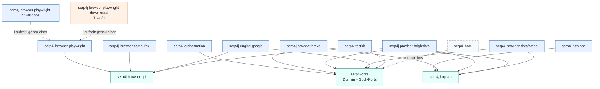

# WP4 – Gradle, Module & Distribution

Status: **Vorschlag** (Architekturphase, keine Implementierung)
Datum: 2026-10-31
Bezug: Architekturauftrag „Serp4J – Architecture Review & Design Phase", Arbeitspaket 4
Abhängige Arbeitspakete: WP1 (Domain), WP2 (Ports), WP3 (Browser), WP5 (Migration)

Dieses Dokument legt die Projektstruktur von Serp4J fest: Modulbaum, Abhängigkeiten zwischen den Modulen,
Java-Baselines, den Umgang mit optionalen Abhängigkeiten, Maven-Publishing, Versionierung und Teststruktur.
Inhaltliche Fragen des Domain-Modells und der Port-Verträge entscheiden WP1 und WP2. Dieses Dokument
legt nur fest, *in welchem Modul* sie liegen und *was* diese Module sehen dürfen.

---

## 1. Bestandsaufnahme

### 1.1 Serp4J-Repository

Das Repository `aresstack/Serp4J` ist zum Zeitpunkt dieser Analyse **leer** (kein Commit, kein Default-Branch,
kein Gradle-Wrapper). Es gibt also keine bestehende Struktur, auf die Rücksicht genommen werden muss.
Der Build kann von Grund auf so angelegt werden, wie hier beschrieben.

### 1.2 AskAI-Build (Referenz und Herkunft der Migration)

| Aspekt | Befund in `aresstack/askai` |
|---|---|
| Gradle | Wrapper **7.6.4**, Groovy-DSL, keine Version Catalogs, keine Convention-Plugins |
| Struktur | Ein flacher Multi-Project-Build mit ~30 Modulen, Konfiguration zentral in `subprojects {}` |
| Java | Alle Module `sourceCompatibility/targetCompatibility = 1.8`, ausgenommen zwei **bewusste Java-21-Sidecars** (`browser-mcp-server-java21`, `local-model-runtime-sidecar-java21`) mit Toolchain 21 |
| CI | Release-Workflow baut mit **Temurin 8** und Gradle 7.6.4; zusätzlich ein Workflow, der einen Offline-Gradle-Cache für Sandboxes ohne Internet erzeugt |
| Publishing | AskAI selbst publiziert nichts nach Maven; es **konsumiert** aber bereits eigene Artefakte unter `com.aresstack:*` von Maven Central (`win-directml-java`, `playwright4j`). Der Namespace `com.aresstack` ist dort also schon in Gebrauch. |
| Lizenz | MIT, „Copyright (c) 2026 AresStack" |

**`web-search-providers`** (Quelle der Migration):

```groovy
apply plugin: 'java-library'
dependencies {
    api 'com.google.code.gson:gson:2.13.1'                    // Gson ist Teil der öffentlichen API
    implementation 'org.asynchttpclient:async-http-client:2.16.0'  // Netty-basiert
    testImplementation 'junit:junit:4.13.2'
}
```

- Ein einziges Modul enthält API (`WebSearchProvider`, `SearchEngine`, `WebSearchRequest/Result`),
  alle drei Provider, HTTP-Transport, Konfigurations-DTOs, Gson-Persistenz, AES-GCM-Secret-Verschlüsselung,
  Registry und Composite.
- Der Port ist asynchron: `CompletableFuture<WebSearchResult> search(WebSearchRequest)`.
- Tests: JUnit 4, HTTP-Tests gegen lokale Fake-Server.

Für WP4 relevante Schlüsse:

1. **Gson als `api`** ist für eine Bibliothek ungünstig. Jeder Konsument erbt Gson als Compile-Abhängigkeit,
   und Gson-Typen können in die öffentliche API wandern. In Serp4J darf JSON-Verarbeitung nur ein
   Implementierungsdetail der Provider-Module sein.
2. **async-http-client 2.x** zieht Netty (mehrere MB) mit. Das widerspricht dem Ziel „leichtgewichtig, nur HTTP und JSON"
   nicht grundsätzlich, sollte aber austauschbar sein. AHC **3.x** benötigt Java 11 und darf daher nicht in Java-8-Module.
3. Persistenz und Verschlüsselung von Secrets sind AskAI-Anwendungsbelange. Sie gehören nicht in den Serp4J-Core
   (siehe Abschnitt 4.5).

### 1.3 Verifizierte Bytecode-Fakten (Grundlage der Java-Baselines)

Geprüft durch Auslesen der Class-File-Major-Version direkt aus den Maven-Central-JARs:

| Artefakt | Major-Version | Bedeutung |
|---|---|---|
| `com.microsoft.playwright:playwright:1.62.0` | 52 (alle 549 Klassen) | **Java 8**. Die Playwright-Java-API selbst ist Java-8-kompatibel. |
| `com.google.code.gson:gson:2.13.1` | 52 (+ `module-info` als 53, Multi-Release) | Java 8 |
| `com.aresstack:playwright4j:0.3.0` | Java 21 (laut AskAI-Build); POM hängt an `org.graalvm.polyglot:polyglot/js:25.0.0` | GraalVM 25 benötigt **Java 21** |

Außerdem hängt `playwright:1.62.0` transitiv an `com.microsoft.playwright:driver` und `driver-bundle`
(Node-Treiber plus plattformspezifische Binärdateien). AskAI schließt beide aus und ersetzt sie durch `playwright4j`.

**Konsequenz:** Ein Playwright-Adapter kann gegen Java 8 kompiliert werden. Die Java-Version wird erst durch die Wahl des
**Treibers zur Laufzeit** bestimmt (Node-Bundle → Java 8, GraalJS über playwright4j → Java 21).
Das ist die wichtigste Einzelerkenntnis dieses Arbeitspakets (siehe Abschnitt 5).

---

## 2. Leitprinzipien

1. **Optionalität entsteht durch Modulgrenzen, nicht durch Scopes.**
   Kein Modul hat „optionale" Abhängigkeiten im Sinne von Maven `<optional>` oder Gradle Feature Variants für Kernfunktionalität.
   Wer eine Fähigkeit braucht, zieht genau das Modul, das sie bereitstellt. Alles, was in einem Modul deklariert ist, ist dort Pflicht.
   Begründung: Maven-Konsumenten werten `<optional>` nicht transitiv aus. Gradle Feature Variants erscheinen im POM ebenfalls nur als
   optional und verlangen vom Maven-Nutzer manuelle Nacharbeit. Getrennte Artefakte funktionieren in beiden Welten identisch.
2. **Die Abhängigkeitsrichtung wird vom Build erzwungen, nicht nur dokumentiert.** Domain und Ports liegen in Modulen ohne
   jede Drittabhängigkeit. Ein Provider-Modul *kann* nichts von einem anderen Provider importieren, weil es nicht auf dem Classpath liegt.
3. **Java 8 ist die Regel, Java 21 die begründete Ausnahme.** Ausnahmen sind nur Laufzeit-Module, die keinen Port definieren
   und von keinem Java-8-Modul benötigt werden.
4. **Keine Drittanbieter-Typen in öffentlichen Signaturen** von Core-, Port- und Provider-Modulen (kein Gson, kein Netty, kein Playwright).
   Ausnahme: Ein Adapter-Modul darf Factory-Methoden anbieten, die einen fertigen Drittanbieter-Client entgegennehmen (z. B. eine Playwright-`Browser`-Instanz).
5. **Gleiche Version für alle Module** (Lockstep) plus BOM. Konsumenten kombinieren Module nie in unterschiedlichen Versionen.
6. **Offline-fähig bauen.** AskAI pflegt einen Offline-Gradle-Cache für Sandbox-Agenten. Serp4J sollte deshalb mit wenigen,
   etablierten Gradle-Plugins auskommen und keine Netzwerkzugriffe in der Konfigurationsphase benötigen.

---

## 3. Modulbaum

```
serp4j/                                   (Root, nicht publiziert)
├── build-logic/                          Included Build: Convention-Plugins (nicht publiziert)
├── gradle/libs.versions.toml             Version Catalog
│
├── serp4j-bom                            BOM (java-platform) für alle publizierten Module
│
├── serp4j-core                           Domain-Modell + Such-Ports              Java 8, 0 Deps
├── serp4j-orchestration                  Use Cases: Registry, Composite, Auswahl  Java 8
│
├── serp4j-http-api                       HTTP-Transport-Port (async)              Java 8, 0 Deps
├── serp4j-http-ahc                       Adapter: async-http-client 2.x           Java 8
│
├── serp4j-provider-brave                 Cloud-Adapter Brave Search API           Java 8
├── serp4j-provider-brightdata            Cloud-Adapter Bright Data SERP API       Java 8
├── serp4j-provider-dataforseo            Cloud-Adapter DataForSEO SERP API        Java 8
│
├── serp4j-browser-api                    BrowserSession-Port                      Java 8, 0 Deps
├── serp4j-browser-playwright             Adapter: Playwright-Java-API             Java 8
├── serp4j-browser-playwright-driver-node Laufzeit: offizieller Node-Treiber       Java 8 (nur Runtime-Deps)
├── serp4j-browser-playwright-driver-graal Laufzeit: playwright4j / GraalJS        Java 21
├── serp4j-browser-camoufox               Camoufox-Runtime (Download, Start, Profil) Java 8 (Ziel)
│
├── serp4j-engine-google                  Google Search + Google AI Mode           Java 8
│
├── serp4j-testkit                        Mock-Provider, Fakes, Contract-Tests     Java 8
│
└── serp4j-examples                       Beispiele und Live-Smoke-Tests (nicht publiziert)
```

### 3.1 Verantwortung der Module

| Modul | Enthält | Darf abhängen von |
|---|---|---|
| `serp4j-core` | Domain (`SearchRequest`, `SearchResponse`, `SearchData`, `SearchMetadata`, `SearchAnalysis`, `SearchResultItem`, `SerpFeature`, Identifikatoren für Provider und SearchEngine) und Ports (`SearchProvider`, `ConversationalSearchProvider`, `SearchSession`, `SearchConversationRequest`, `SearchCapabilities`, `SearchProviderRegistry` als Interface, Exception-Hierarchie, Credential-Port) | nichts (nur JDK 8) |
| `serp4j-orchestration` | Implementierungen der Use Cases: `DefaultSearchProviderRegistry`, `CompositeSearchProvider`, `ProviderSelection`, Fallback/Retry-Strategien, ggf. `ServiceLoader`-basierte Provider-Erkennung | `serp4j-core` |
| `serp4j-http-api` | Minimaler asynchroner HTTP-Port (`HttpTransport`, `HttpRequest`, `HttpResponse`, Authentifizierungsstrategien als Interfaces) | nichts |
| `serp4j-http-ahc` | Implementierung des HTTP-Ports mit async-http-client 2.x (Herkunft: `AsyncJsonHttpClient`, `AsyncHttpClientFactory`) | `serp4j-http-api`, AHC 2.x |
| `serp4j-provider-*` | Konfiguration (unveränderlich, Builder), Request-/Response-Mapper, Provider-Implementierung, `META-INF/services`-Eintrag | `serp4j-core`, `serp4j-http-api`; Gson als `implementation` |
| `serp4j-browser-api` | `BrowserSession`, `BrowserSessionFactory`, Seiten-/Netzwerk-Beobachtung, Isolation (Kontext pro Suchsitzung) als reine Interfaces und Werteklassen | nichts |
| `serp4j-browser-playwright` | Implementierung von `BrowserSessionFactory` auf Basis der Playwright-API, Chromium und Firefox/Camoufox als Launch-Varianten | `serp4j-browser-api`; Playwright-API **ohne** Treiber |
| `serp4j-browser-playwright-driver-node` | Nur Abhängigkeiten: `com.microsoft.playwright:driver` + `driver-bundle`. Kein eigener Code außer einem Marker für die Treiber-Erkennung. | Playwright-Treiber |
| `serp4j-browser-playwright-driver-graal` | Abhängigkeit auf `com.aresstack:playwright4j` plus Marker | playwright4j (GraalJS 25) |
| `serp4j-browser-camoufox` | Download, Prüfsummen/Pins, Manifest, Fingerprint-Profil und Start von Camoufox (Herkunft: AskAI-Sidecar, ursprünglich aus Argos) | `serp4j-browser-api`; Jackson oder Gson als `implementation` |
| `serp4j-engine-google` | Google-Search-Adapter (SERP-Extraktion) und Google AI Mode (implementiert `ConversationalSearchProvider`) | `serp4j-core`, `serp4j-browser-api`. **Nicht** Playwright. |
| `serp4j-testkit` | `MockSearchProvider`, `MockConversationalSearchProvider`, `FakeBrowserSession`, `FakeHttpTransport`, JSON-Fixtures, abstrakte Contract-Tests für Provider | `serp4j-core`, `serp4j-browser-api`, `serp4j-http-api`; JUnit Jupiter als `compileOnly` |

### 3.2 Bewusste Entscheidungen beim Schnitt

**Warum `serp4j-orchestration` getrennt vom Core?**
Clean Architecture verlangt, dass Use Cases nur Ports kennen. In einem gemeinsamen Modul wäre das nur eine Paketkonvention.
Als getrenntes Modul ist es überprüfbar: Ein Provider-Modul hängt nur am Core und kann Composite oder Registry gar nicht sehen.
Außerdem wollen Konsumenten wie AskAI eventuell ihre eigene Orchestrierung schreiben und nur Ports plus Provider ziehen.

**Warum ein eigener HTTP-Port statt direkter AHC-Nutzung in den Providern?**
Damit drei Dinge austauschbar werden, ohne Provider anzufassen:
(a) die HTTP-Bibliothek (AHC heute, später z. B. `java.net.http` in einem Java-11-Modul oder Apache HttpClient 5),
(b) Tests (`FakeHttpTransport` statt laufendem Server),
(c) Proxy, Retry und Rate Limiting zentral im Transport.
Der Port ist klein, weil alle drei Cloud-Provider nur JSON-über-HTTPS mit Header- oder Basic-Auth sprechen.

**Warum `serp4j-browser-api` nicht im Core?**
Das ist eine der Konfliktfragen aus dem Auftrag. Aus Build-Sicht spricht alles für ein eigenes Modul:
Cloud-only-Nutzer sehen keinerlei Browser-Typen; die Browser-API kann sich in eigenem Tempo entwickeln
(Netzwerkbeobachtung, Downloads, Isolation), ohne dass der Core eine neue Minor-Version braucht.
Die Kosten (ein weiteres, kleines JAR ohne Abhängigkeiten) sind gering. Die endgültige Entscheidung trifft die Integration zusammen mit WP2 und WP3.

**Warum `SearchAnalysis` im Core?**
`SearchResponse` muss den Bereich typisiert enthalten können. Die *Datentypen* von SearchAnalysis sind reine Werteklassen ohne
Abhängigkeiten und kosten im Core nichts. *Erzeugt* werden Analysen außerhalb (z. B. von AskAI oder späteren Modulen wie
`serp4j-analysis-*`). So bleibt die Trennung „Suchdaten vs. Analyse" auf Modulebene sichtbar, ohne das Modell aufzuspalten.

**Warum keine Module `serp4j-engine-google-search` und `serp4j-engine-google-ai` getrennt?**
Beide teilen Locale-, Consent- und Seitenlogik und beide brauchen nur `browser-api`. Eine Trennung lohnt sich erst, wenn
eine Variante eine zusätzliche Abhängigkeit braucht (z. B. ein reiner HTTP-Weg für Google Search). Dann kann ein
Modul `serp4j-engine-google-http` hinzukommen.

**Kein „serp4j-all"-Aggregat.** Ein Aggregat würde den Browser-Stack wieder unfreiwillig mitziehen. Stattdessen gibt es die BOM.

---

## 4. Dependency-Graph

### 4.1 Projektinterne Abhängigkeiten



Lesart:

- Ports (türkis) haben **keine** ausgehenden Kanten. Sie sind die stabilen Zentren.
- Kein Provider zeigt auf einen anderen Provider, auf `orchestration`, auf einen HTTP-Adapter oder auf ein Browser-Modul.
- `serp4j-engine-google` kennt den Browser nur über `serp4j-browser-api`. Welcher Browser-Adapter zur Laufzeit dahintersteht,
  entscheidet der Konsument.
- Die gestrichelten Kanten der Treiber-Module sind Laufzeitbeziehungen: Ein Treiber-Modul ergänzt den Playwright-Adapter, wird aber
  nicht von ihm referenziert (siehe Abschnitt 5).

### 4.2 Externe Abhängigkeiten und Konfigurationen

| Modul | `api` | `implementation` | `compileOnly` | `runtimeOnly` |
|---|---|---|---|---|
| `serp4j-core` | – | – | – | – |
| `serp4j-orchestration` | `serp4j-core` | – | – | – |
| `serp4j-http-api` | – | – | – | – |
| `serp4j-http-ahc` | `serp4j-http-api` | `async-http-client:2.x` | – | – |
| `serp4j-provider-*` | `serp4j-core`, `serp4j-http-api`¹ | `gson` | – | – |
| `serp4j-browser-api` | – | – | – | – |
| `serp4j-browser-playwright` | `serp4j-browser-api` | `playwright` (exkl. `driver`, `driver-bundle`) | – | – |
| `serp4j-browser-playwright-driver-node` | – | – | – | `playwright:driver`, `playwright:driver-bundle` |
| `serp4j-browser-playwright-driver-graal` | – | – | – | `com.aresstack:playwright4j` |
| `serp4j-browser-camoufox` | `serp4j-browser-api` | JSON-Bibliothek² | – | – |
| `serp4j-engine-google` | `serp4j-core`, `serp4j-browser-api` | – | – | – |
| `serp4j-testkit` | `serp4j-core`, `serp4j-browser-api`, `serp4j-http-api` | – | `junit-jupiter-api` | – |

¹ `api`, weil der Provider-Konstruktor einen `HttpTransport` entgegennimmt (Dependency Injection statt verstecktem Default).
Damit ist der Port Teil der öffentlichen Signatur und muss `api` sein.
Ein Provider-Modul bringt **keinen** konkreten HTTP-Adapter mit. Der Konsument wählt `serp4j-http-ahc` (oder später einen anderen).
Für Bequemlichkeit kann `serp4j-http-ahc` einen `ServiceLoader`-Eintrag haben, sodass ein Provider ohne explizite Übergabe den
einzigen gefundenen Transport nutzt.

² AskAI nutzt dafür heute Jackson (aus Argos übernommen). Serp4J sollte sich auf **eine** JSON-Bibliothek festlegen; Empfehlung: Gson,
weil die Provider sie bereits nutzen und Gson ohne transitive Abhängigkeiten kommt.

### 4.3 Typische Konsumenten-Setups

```groovy
// Nur Cloud, ein Provider
implementation platform('com.aresstack:serp4j-bom:0.1.0')
implementation 'com.aresstack:serp4j-provider-brave'
implementation 'com.aresstack:serp4j-http-ahc'

// Cloud mit Fallback über mehrere Provider
implementation 'com.aresstack:serp4j-orchestration'
implementation 'com.aresstack:serp4j-provider-brave'
implementation 'com.aresstack:serp4j-provider-dataforseo'
implementation 'com.aresstack:serp4j-http-ahc'

// Google AI Mode auf Java 8 mit offiziellem Node-Treiber
implementation 'com.aresstack:serp4j-engine-google'
implementation 'com.aresstack:serp4j-browser-playwright'
runtimeOnly    'com.aresstack:serp4j-browser-playwright-driver-node'

// Google AI Mode auf Java 21 ohne Node, mit Camoufox
implementation 'com.aresstack:serp4j-engine-google'
implementation 'com.aresstack:serp4j-browser-playwright'
implementation 'com.aresstack:serp4j-browser-camoufox'
runtimeOnly    'com.aresstack:serp4j-browser-playwright-driver-graal'
```

Maven-Nutzer schreiben dasselbe mit `<dependencyManagement>` (BOM, `scope=import`) und `<scope>runtime</scope>` für das Treiber-Modul.
Kein Setup erfordert Exclusions oder optionale Abhängigkeiten auf Konsumentenseite.

### 4.4 Wie AskAI Serp4J konsumiert

AskAI bleibt ein Java-8-Host. Während der Migration gibt es zwei Wege:

1. **Composite Build** (`includeBuild '../Serp4J'` in AskAIs `settings.gradle`) für gleichzeitige Entwicklung in beiden Repos.
   Voraussetzung: Beide Builds müssen mit derselben Gradle-JVM laufen können (siehe Abschnitt 6.1).
2. **Maven-Artefakte** (Snapshot oder Release) für den Normalbetrieb.

Der Playwright-Treiber über GraalJS bleibt für AskAI weiterhin in einem Java-21-Prozess. AskAIs Sidecar-Modul kann dann
`serp4j-browser-playwright` + `serp4j-browser-playwright-driver-graal` + `serp4j-engine-google` konsumieren, statt eigenen Code
zu pflegen. Der Java-8-Host bleibt frei von Java-21-Bytecode.

### 4.5 Was nicht in Serp4J gehört

- **Gson-basierte Konfigurationsspeicherung** (`GsonProviderConfigurationStore`, `ProviderConfigurationPaths`) und
  **AES-GCM-Verschlüsselung von Secrets**: Das ist Anwendungslogik von AskAI. Serp4J definiert im Core nur einen Credential-Port
  (z. B. `CredentialSupplier`, der beim Request einen Schlüssel liefert). AskAI implementiert ihn mit seiner verschlüsselten Ablage.
  Falls sich später zeigt, dass andere Konsumenten dasselbe wollen, kann ein optionales Modul `serp4j-config` entstehen.
  Die genaue Abgrenzung legt WP5 fest.
- **Playgrounds** (`DataForSeoPlayground`): gehören nach `serp4j-examples`.

---

## 5. Playwright, Treiber und Java-Versionen

Playwright Java besteht aus zwei Schichten:

1. **API-JAR** (`com.microsoft.playwright:playwright`): Java 8 (verifiziert, Abschnitt 1.3).
2. **Treiber**: Die API steuert einen separaten Treiber-Prozess. Offiziell ist das ein Node-Prozess aus `driver` + `driver-bundle`
   (mehrere Dutzend MB, plattformspezifisch). `playwright4j` ersetzt die Klasse `Driver` und betreibt den Playwright-Core
   auf GraalJS in einem zweiten Java-Prozess, ohne Node. Das erfordert Java 21.

Daraus folgt der Schnitt:

- `serp4j-browser-playwright` kompiliert gegen die API, **schließt die Treiber-Artefakte aus** und enthält selbst keinen Treiber.
  Es bleibt Java 8.
- Die beiden Treiber-Module liefern je genau eine Treiber-Implementierung. Der Konsument wählt eines.
- Beim Start prüft der Adapter, dass genau ein Treiber auf dem Classpath ist, und bricht sonst mit einer verständlichen Meldung ab
  (z. B. „Kein Playwright-Treiber gefunden. Füge serp4j-browser-playwright-driver-node oder -driver-graal hinzu."). Zwei konkurrierende
  `Driver`-Klassen würden sonst eine Reihenfolge-abhängige Auswahl erzeugen. AskAI dokumentiert genau dieses Problem im Build-Kommentar
  seines Sidecars.

Warum nicht Feature Variants (`registerFeature('nodeDriver')`)?
Sie würden im Gradle-Module-Metadata sauber funktionieren, im POM aber nur als optionale Abhängigkeiten erscheinen.
Ein Maven-Nutzer müsste die Treiber-Koordinaten dann selbst kennen. Separate Module sind für beide Welten gleich einfach.

**Risiken**

- Die Version der Playwright-API muss zu dem Playwright-Core passen, den der Treiber mitbringt. Bei `playwright4j` legt AskAI das heute
  per Kommentar fest (0.3.0 ↔ 1.62.x). In Serp4J wird das im Version Catalog als gemeinsame Gruppe gepflegt und über die BOM
  an Konsumenten weitergegeben. Ein Build-Check sollte die Kombination prüfen.
- Der Node-Treiber lädt plattformspezifische Binärdateien. Es ist zu prüfen, ob `driver-bundle` für alle Zielplattformen der Konsumenten
  passt (Windows ist bei AskAI die Hauptplattform).
- Camoufox ist Firefox-basiert. Ob die gewählte Playwright-Version mit der Camoufox-Version zusammenarbeitet, prüft WP3.
  Build-seitig wird die Camoufox-Version wie eine Dependency im Version Catalog gepinnt, obwohl sie zur Laufzeit heruntergeladen wird.

---

## 6. Build-Technik

### 6.1 Gradle-Version und JDKs

| Punkt | Empfehlung | Begründung |
|---|---|---|
| Gradle | **8.14.x** (Wrapper) | Läuft noch auf JDK 8 bis 24, also kompatibel zu AskAIs Java-8-CI und zu einem Composite Build mit AskAI. Gradle 9 benötigt eine JVM 17 für den Daemon. Wechsel auf 9.x, sobald AskAI ebenfalls umsteigt. |
| DSL | **Kotlin DSL** (`build.gradle.kts`) für Projekt- und Convention-Skripte | Typsicherheit und IDE-Unterstützung in Convention-Plugins. Groovy ginge ebenfalls; die Entscheidung ist nicht kritisch (offene Frage 1). |
| JDK für Gradle selbst | JDK 21 (lokal und CI) | Moderner Compiler, gleiche Basis wie das Java-21-Modul |
| Kompilieren Java-8-Module | Toolchain JDK 21 mit `options.release = 8` | `--release 8` prüft gegen die Java-8-API-Signaturen (`ct.sym`). Das verhindert versehentliche Nutzung von Java-9+-APIs zuverlässig, was `sourceCompatibility` allein nicht tut. JDK 21 unterstützt `--release 8` noch. |
| Tests Java-8-Module | Standardlauf auf JDK 21, zusätzlich CI-Matrix-Lauf auf **JDK 8** | Nur ein echter Lauf auf JDK 8 fängt Laufzeitunterschiede ab (z. B. TLS, `CompletableFuture`-Verhalten). In Gradle über einen zusätzlichen `Test`-Task mit `javaLauncher` für Toolchain 8. |
| Kompilieren Java-21-Modul | Toolchain JDK 21, `release = 21` | |
| Toolchain-Beschaffung | `org.gradle.toolchains.foojay-resolver-convention` | JDK 8 und 21 werden automatisch beschafft. Für Offline-Builds können lokale JDKs per `org.gradle.java.installations.paths` angegeben werden. |

### 6.2 Convention-Plugins (`build-logic`)

Keine Konfiguration über `allprojects {}`/`subprojects {}` wie in AskAI, sondern explizite Plugins pro Modultyp:

| Plugin-ID | Wirkung |
|---|---|
| `serp4j.java-library` | `java-library`, UTF-8, `-Xlint:all -Werror` (Ziel), Javadoc ohne Fehler, Reproduzierbare Archive, `Automatic-Module-Name` im Manifest |
| `serp4j.java8` | Toolchain 21 + `release = 8`, zusätzlicher Test-Task auf JDK 8 |
| `serp4j.java21` | Toolchain 21 + `release = 21` |
| `serp4j.published` | `maven-publish`, `signing`, Sources- und Javadoc-JAR, POM-Metadaten, Teilnahme an der BOM |
| `serp4j.provider` | Kombination für Provider-Module: Java 8 + published + Contract-Tests aus `serp4j-testkit` + Live-Test-Source-Set |

Jedes Modul-Build-Skript ist damit wenige Zeilen lang und deklariert nur seine Abhängigkeiten.

### 6.3 Version Catalog

`gradle/libs.versions.toml` ist die einzige Stelle für externe Versionen. Startpunkte (aus AskAI übernommen, beim Aufsetzen auf
aktuellen Stand prüfen):

```toml
[versions]
gson = "2.13.1"
asynchttpclient = "2.16.0"   # 2.x bleibt Java 8; 3.x verlangt Java 11
playwright = "1.62.0"        # muss zur Core-Version von playwright4j passen
playwright4j = "0.3.0"
junit-jupiter = "5.11.4"     # 5.x: JUnit 6 verlangt Java 17
assertj = "3.27.3"           # Java 8
```

### 6.4 JPMS

Java-8-Module erhalten **kein** `module-info.java`, aber einen stabilen `Automatic-Module-Name` im Manifest
(z. B. `com.aresstack.serp4j.core`). Jedes Modul hat ein eigenes Wurzelpaket (`com.aresstack.serp4j.core`,
`com.aresstack.serp4j.provider.brave`, …). Split Packages über Module hinweg sind verboten. Das hält die Tür für ein späteres
echtes `module-info` (per Multi-Release-JAR) offen.

### 6.5 Architekturprüfung im Build

Ergänzend zur Modulgrenze, die schon die meisten Verstöße unmöglich macht:

- **ArchUnit-Tests** (Java 8 kompatibel) im Core: Domain-Pakete dürfen nicht auf Port-Pakete zugreifen, falls WP2 diese Richtung festlegt.
  Kein Paket aus `serp4j-core` darf `java.net`, `java.io.File` oder Threads verwenden.
- **Dependency-Analyse** (z. B. `com.autonomousapps.dependency-analysis`) meldet falsche `api`/`implementation`-Zuordnungen.
  Optional, nur wenn es den Offline-Build nicht stört.

---

## 7. Teststruktur

| Ebene | Ort | Werkzeuge | Läuft in CI |
|---|---|---|---|
| Unit-Tests | `src/test` jedes Moduls | JUnit Jupiter 5.x, AssertJ 3.x | immer, JDK 21 und JDK 8 |
| Mapper-Tests mit echten JSON-Antworten | `src/test/resources/fixtures/<provider>/` | aufgezeichnete, anonymisierte Antworten von Brave, Bright Data, DataForSEO | immer |
| Provider-HTTP-Tests | `src/test` | `FakeHttpTransport` aus dem Testkit; für Transport-Adapter ein lokaler Server (`com.sun.net.httpserver`, im JDK enthalten) | immer |
| Contract-Tests | abstrakte Testklassen in `serp4j-testkit`, konkret in jedem Provider | z. B. `AbstractSearchProviderContractTest`, `AbstractConversationalSearchProviderContractTest` | immer |
| Browser-Integration | Source-Set `integrationTest` in `serp4j-browser-playwright` und `serp4j-engine-google` | echter Browser, lokale Testseiten | eigener CI-Job, nur Linux, mit installiertem Chromium |
| Live-Tests gegen echte APIs | Source-Set `liveTest` | API-Keys aus Umgebungsvariablen; ohne Key wird übersprungen (`Assumptions`) | nur manuell oder nächtlich, nie im PR-Build |

Hinweise:

- JUnit 4 aus AskAI wird bei der Migration auf Jupiter umgestellt. Mockito möglichst vermeiden; falls nötig, Mockito **4.x**
  (5.x verlangt Java 11 und würde den JDK-8-Testlauf brechen). Gleiches gilt für WireMock 3 (Java 11).
- Testabhängigkeiten der Java-8-Module müssen selbst auf JDK 8 laufen, sonst ist die JDK-8-Matrix wertlos.
- Fixtures sind Teil des Testkits, damit Konsumenten (z. B. AskAI) dieselben realistischen Antworten nutzen können.

---

## 8. Maven-Publishing

### 8.1 Koordinaten

| Element | Wert |
|---|---|
| groupId | `com.aresstack` |
| artifactId | `serp4j-<modul>`, identisch mit dem Gradle-Projektnamen |
| Version | gemeinsam für alle Module, z. B. `0.1.0` |
| Paketwurzel | `com.aresstack.serp4j.<modul>` (Bindestriche im Modulnamen werden zu Punkten bzw. entfallen) |

Publiziert werden alle Module außer `build-logic` und `serp4j-examples`.

### 8.2 Ziel und Werkzeug

- Ziel ist **Maven Central über das Central Publisher Portal** (das alte OSSRH-Verfahren wurde 2025 abgeschaltet).
  Der Namespace `com.aresstack` ist dort bereits verifiziert, weil `win-directml-java` und `playwright4j` darunter veröffentlicht sind.
- Empfohlenes Plugin: **`com.vanniktech.maven.publish`**. Es unterstützt das Central Portal direkt, erzeugt Sources- und Javadoc-JARs,
  signiert und kann den Upload automatisch freigeben. Alternative: `maven-publish` + JReleaser. Falls für `playwright4j` bereits ein
  Verfahren etabliert ist, sollte Serp4J dasselbe verwenden (offene Frage 4).
- Pflichtinhalte je Artefakt: Haupt-JAR, `-sources.jar`, `-javadoc.jar`, POM mit Name, Beschreibung, URL, Lizenz (MIT),
  Entwickler, SCM; Signaturen (`.asc`); zusätzlich Gradle Module Metadata (`.module`).
- Signatur in CI über In-Memory-GPG-Schlüssel aus GitHub-Secrets (`ORG_GRADLE_PROJECT_signingInMemoryKey` usw.).
  Keine Schlüssel im Repository.

### 8.3 BOM

`serp4j-bom` ist ein `java-platform`-Projekt mit `constraints` auf alle publizierten Module in der aktuellen Version.
Zusätzlich setzt die BOM die getestete Kombination aus `playwright` und `playwright4j` als Empfehlung. Externe Bibliotheken wie Gson
werden **nicht** in die BOM aufgenommen, um Konsumenten nicht unnötig Versionen aufzuzwingen.

### 8.4 Lizenz-Hinweis

AskAI steht unter MIT mit „AresStack" als Rechteinhaber. Für migrierten Code ist das unproblematisch, sofern Serp4J ebenfalls
MIT verwendet. Der Camoufox-Code stammt laut AskAI ursprünglich aus Argos. Dessen Lizenz muss vor der Übernahme geprüft werden.
Camoufox selbst (MPL 2.0) wird nur zur Laufzeit heruntergeladen und nicht mitverteilt.

---

## 9. Versionierung und Release

| Punkt | Festlegung |
|---|---|
| Schema | Semantic Versioning, `MAJOR.MINOR.PATCH` |
| Lockstep | Alle Module tragen immer dieselbe Version und werden gemeinsam released |
| Phase 0.x | Bis Implementierungsphase H abgeschlossen und AskAI migriert ist. Brechende Änderungen erhöhen die Minor-Version. |
| 1.0.0 | Wenn Core- und Port-API stabil sind und AskAI produktiv auf Serp4J läuft |
| Ab 1.0 | Binärkompatibilitätsprüfung der öffentlichen API im Build (z. B. `japicmp` gegen das letzte Release) für Core, Ports und Provider |
| Stabilitätsmarker | Experimentelle APIs (z. B. anfangs `ConversationalSearchProvider`, Browser-Module) werden mit einer Annotation `@Experimental` aus dem Core gekennzeichnet und sind von der Kompatibilitätsprüfung ausgenommen |
| Quelle der Version | `version` in `gradle.properties`; Release-Version kommt aus dem Git-Tag |
| Release-Ablauf | Tag `vX.Y.Z` auf `main` → GitHub-Actions-Workflow: Build, Tests (JDK 21 + JDK 8), Publish nach Central, GitHub Release mit Changelog |
| Snapshots | `X.Y.Z-SNAPSHOT` bei jedem Push auf `main` in das Snapshot-Repository des Central Portals, damit AskAI ohne lokales `mavenLocal` testen kann (AskAIs Build lehnt `mavenLocal` und SNAPSHOTs bewusst ab; für die Migrationszeit muss AskAI daher entweder Composite Build nutzen oder Snapshots temporär zulassen) |
| Changelog | `CHANGELOG.md` nach „Keep a Changelog" |

---

## 10. Empfohlene Reihenfolge beim Aufsetzen (für die Implementierungsphase)

1. Gradle-Wrapper, `settings.gradle.kts`, `build-logic` mit den Convention-Plugins, Version Catalog, leeres `serp4j-core`.
   CI-Workflow mit JDK-21-Build und JDK-8-Testlauf.
2. `serp4j-bom` und Publishing-Konfiguration, zunächst nur gegen `mavenLocal`/Build-Verzeichnis getestet.
3. Danach die Module in der Reihenfolge der Implementierungsphasen A bis H. Jedes neue Modul ist ein Eintrag in `settings.gradle.kts`
   und ein Build-Skript mit einem Convention-Plugin.

---

## 11. Offene Fragen für die Integration

1. **Kotlin- oder Groovy-DSL?** Empfehlung Kotlin. AskAI nutzt Groovy. Nicht architekturkritisch.
2. **`serp4j-browser-api` als eigenes Modul oder als Paket im Core?** Empfehlung eigenes Modul (Abschnitt 3.2). Abhängig von WP2/WP3.
3. **Wo liegen `SearchProviderRegistry` und `SearchCapabilities`?** Vorschlag: Interface der Registry und `SearchCapabilities` im Core,
   Implementierung in `serp4j-orchestration`. Abhängig von WP2.
4. **Publishing-Werkzeug:** Mit welchem Verfahren wurden `win-directml-java` und `playwright4j` veröffentlicht? Serp4J sollte es übernehmen.
5. **HTTP-Transport:** Reicht ein eigener kleiner Port, oder soll WP2 einen umfassenderen Transport-Vertrag definieren
   (Streaming, Rate Limits, Retry-Policy)? Und bleibt AHC 2.x der Standard-Adapter, oder kommt zusätzlich ein abhängigkeitsfreier
   Adapter auf Basis von `HttpURLConnection`?
6. **Camoufox-Modul auf Java 8:** Lässt sich der übernommene Code ohne Java-11+-APIs betreiben? Sonst Baseline 11 für dieses eine Modul.
   Und: Jackson beibehalten oder auf Gson vereinheitlichen?
7. **Gradle 8.14 oder 9.x?** Hängt davon ab, ob ein Composite Build mit AskAI (Gradle 7.6.4, CI auf JDK 8) gebraucht wird.
8. **Snapshots für AskAI:** Composite Build oder temporär Snapshot-Repository in AskAI zulassen?
9. **Treiber-Erkennung:** Marker per `ServiceLoader` oder Prüfung auf die konkrete `Driver`-Klasse? Abhängig von WP3.
10. **Lizenz:** Serp4J unter MIT wie AskAI? Lizenz des aus Argos stammenden Camoufox-Codes klären.
